# Deployment types

OpenVidu is self-hosted with the **[OpenVidu CLI](openvidu-cli.md)** (`ov`): one tool deploys and operates every deployment type on this page, on your laptop, on your own servers or on AWS, Azure, Google Cloud, Oracle Cloud and DigitalOcean.

There are different deployment options available, depending on your needs:

| Type of deployment        | [**OpenVidu**<br>**Local (development)**{ .nowrap }](#openvidu-local-development)         | <div class="w-10em">[**OpenVidu**<br>**Single Node**{ .nowrap }](#openvidu-single-node)</div> | [**OpenVidu**<br>**Elastic**{ .nowrap }](#openvidu-elastic) | [**OpenVidu**<br>**High Availability**{ .nowrap }](#openvidu-high-availability) |
| ------------------------- | ------------------------------------ | -------------------- | ---------------- | -------------------------- |
| **OpenVidu Edition**          | **COMMUNITY**{ .openvidu-tag .openvidu-community-tag } **PRO**{ .openvidu-tag .openvidu-pro-tag } | **COMMUNITY**{ .openvidu-tag .openvidu-community-tag } **PRO**{ .openvidu-tag .openvidu-pro-tag } | **PRO**{ .openvidu-tag .openvidu-pro-tag } | **PRO**{ .openvidu-tag .openvidu-pro-tag } |
| **Suitability**               | For local development in your laptop | For applications with medium user load | For applications with dynamic user load that require scalability | For applications where both scalability and fault tolerance are critical |
| **Features**                  | Friendly Docker Compose setup with Redis, Egress, Ingress, S3 storage and observability. With automatic certificate management to test across devices in your network | **COMMUNITY**{ .openvidu-tag .openvidu-community-tag } Custom LiveKit distribution with Redis, Egress, Ingress, S3 storage and observability.<br><br>**PRO**{ .openvidu-tag .openvidu-pro-tag } Same features but adding **2x performance** and **advanced observability**. | Same benefits as OpenVidu Single Node plus **2x performance**, **advanced observability** and **scalability** | Same benefits as OpenVidu Elastic plus **fault tolerance** |
| **Number of servers**         | Your laptop | 1 Node | 1 Master Node +<br><span class="nowrap">N Media Nodes</span> | 4 Master Nodes +<br><span class="nowrap">N Media Nodes</span> |
| **Installation instructions** | [Install](./local.md){ .md-button } | [Install](./single-node/index.md){ .md-button } | [Install](./elastic/index.md){ .md-button } | [Install](./ha/index.md){ .md-button } |

<br>

## OpenVidu Local (development)

To run OpenVidu in your local machine, this is the quickest option. It is a Docker Compose setup that includes all the necessary services to run OpenVidu in your LAN, including automated SSL certificates that will be valid across all devices in your network.

It comes in two flavors:

 - **OpenVidu Local** **COMMUNITY**{ .openvidu-tag .openvidu-community-tag }: mirrors the experience of **OpenVidu Single Node** **COMMUNITY**{ .openvidu-tag .openvidu-community-tag }, fine-tuned for local development.
 - **OpenVidu Local** **PRO**{ .openvidu-tag .openvidu-pro-tag }: mirrors the experience of **OpenVidu Single Node** **PRO**{ .openvidu-tag .openvidu-pro-tag }, fine-tuned for local development. In this case, OpenVidu runs in evaluation mode for free for development and testing purposes (some limits apply: maximum 8 Participants across all Rooms, maximum 5 minutes duration per Room).

{ .round-corners .dark-img loading=lazy }

## OpenVidu Single Node

This is the simplest production-ready OpenVidu deployment available. It provides all the features you need, but lacks scalability and fault tolerance. But make no mistake about it: it is perfectly suitable for medium-scale production deployments. For most projects, OpenVidu Single Node will be enough, at least until your user load gets serious. You can host hundreds of simultaneous participants in your rooms by running OpenVidu Community on a sufficiently powerful server!

It is composed of a single OpenVidu Node hosting all the necessary services in a monolithic setup. It comes in two flavors:

 - **OpenVidu Single Node** **COMMUNITY**{ .openvidu-tag .openvidu-community-tag }: all the features you need to build your real-time application.
 - **OpenVidu Single Node** **PRO**{ .openvidu-tag .openvidu-pro-tag }: for users who want the benefits of OpenVidu PRO in a single-node setup. It includes **2x performance** and **advanced observability** features.

  { .round-corners .dark-img loading=lazy }

## OpenVidu Elastic

This is the intermediate OpenVidu deployment. It provides **scalability** for your video rooms. Suitable for applications with dynamic load in the media plane that require scalability.

It is composed of two different types of nodes, one of them running on a cluster of multiple servers and the other running as a single monolithic server:

- **A cluster of Media Nodes** hosting all the media-related services. Your video rooms scale up and down thanks to this cluster.
- **A single Master Node** hosting all the support services in a monolithic setup.

  { .round-corners .dark-img loading=lazy }

## OpenVidu High Availability

This is the most complete OpenVidu deployment. It provides **scalability** for your video rooms and **fault tolerance** in all its services. Suitable for applications where both scalability and availability are critical.

It is composed of two different types of nodes running on two separate clusters:

- **A cluster of Media Nodes** hosting all the media-related services. Your video rooms scale up and down thanks to this cluster. The minimum number of nodes in this cluster is **1**, and it is designed to scale up and down dynamically according to workload.
- **A cluster of Master Nodes** hosting all the support services in their high availability format. Your deployment is fault-tolerant thanks to this cluster. The minimum number of nodes in this cluster is **4**, and it is designed to have a fixed number of nodes at all times.

  { .round-corners .dark-img loading=lazy }

## How OpenVidu is deployed { #how-openvidu-is-deployed }

Every deployment type is deployed and operated with the [OpenVidu CLI](openvidu-cli.md) (`ov`), with the same commands wherever it runs:

```bash
mkdir my-stack && cd my-stack
ov stack deploy --environment local      # OpenVidu on this machine, with Docker
ov stack status                          # operate it from this directory
ov stack destroy --delete-data           # and take it down again
```

On a cloud, one command creates the machines, and the machines then deploy OpenVidu themselves:

```bash
ov stack deploy my-stack --cloud aws --aws-region us-east-1 --mode auto
```

| Where OpenVidu runs | Single Node | Elastic | High Availability |
| --- | :---: | :---: | :---: |
| **Local**: this machine, with Docker, for development | [COMMUNITY and PRO](local.md) | — | — |
| **On premises**: your own Linux servers, over SSH | [COMMUNITY and PRO](single-node/on-premises/install.md) | [PRO](elastic/on-premises/install.md) | [PRO](ha/on-premises/install-nlb.md) |
| **AWS** | [COMMUNITY and PRO](single-node/aws/install.md) | [PRO](elastic/aws/install.md) | [PRO](ha/aws/install.md) |
| **Azure** | [COMMUNITY and PRO](single-node/azure/install.md) | [PRO](elastic/azure/install.md) | [PRO](ha/azure/install.md) |
| **Google Cloud** | [COMMUNITY and PRO](single-node/gcp/install.md) | [PRO](elastic/gcp/install.md) | [PRO](ha/gcp/install.md) |
| **Oracle Cloud** | [COMMUNITY and PRO](single-node/oracle/install.md) | [PRO](elastic/oracle/install.md) | [PRO](ha/oracle/install.md) |
| **DigitalOcean** | [COMMUNITY and PRO](single-node/digitalocean/install.md) | [PRO](elastic/digitalocean/install.md) | [PRO](ha/digitalocean/install.md) |

Elastic and High Availability span more than one machine, so they require OpenVidu PRO.

### COMMUNITY and PRO: the same commands { #community-and-pro }

Choosing `--edition community` (the default) or `--edition pro` is the only decision you make. How OpenVidu is installed and run on the machine follows from the edition; you do not configure it:

| | OpenVidu **COMMUNITY**{ .openvidu-tag .openvidu-community-tag } | OpenVidu **PRO**{ .openvidu-tag .openvidu-pro-tag } |
| --- | --- | --- |
| Deployed with | `ov stack deploy --edition community` | `ov stack deploy --edition pro --openvidu-pro-license <key>` (no license needed on a local stack) |
| Runs on the server as | Docker Compose and a systemd unit | Kubernetes |
| Topologies | Single Node | Single Node, Elastic, High Availability |
| Where the configuration lives | In the node's files (`/opt/openvidu/config/`) | In the cluster (`openvidu.yaml` and the service files), which any administrator can read |
| Administrators | Each administrator's directory keeps a copy of the desired state; if they differ, the node's files take precedence | Every administrator reads and writes the same configuration in the cluster |

A local stack runs on Docker Compose with either edition. This lets you develop against OpenVidu PRO on your laptop without Kubernetes, in evaluation mode and without a license. The [pricing page](../../pricing.md) explains what the PRO license includes; to get one, [create an OpenVidu account :fontawesome-solid-external-link:{.external-link-icon}](../../account.md){:target="_blank"} (there is a 15-day free trial).

### The stack directory { #the-stack-directory }

`ov` operates **one stack per directory**. The directory you deploy from becomes the stack: every later command finds the stack in the directory you run it from, with no name and no flags. From anywhere else, `--dir <path>` points to it. Two stacks are two directories.

The directory holds two things:

- **`openvidu-stack.yml`**: the desired state of the deployment. You never have to write it: the deploy flags write into it, and the deploy fills in the rest, **including every credential the stack needs**, so a redeploy reuses them.
- **`.openvidu/`**: the state the CLI keeps for the stack: how to reach it and its secrets. Keep both private.

Every deployed node also gets a copy of `ov` and a stack directory of its own, so `sudo ov stack status` works on the node too. A lost directory is recreated with `ov stack import` ([I lost the stack's directory](openvidu-cli.md#lost-the-stack-directory)).

### Auto and assisted modes { #auto-and-assisted-modes }

Every deploy can run in two modes:

- **`--mode auto`** runs the deployment. On a cloud it uses **your own cloud tools** (`aws`, `az`, `terraform`…), already authenticated, and shows the plan and asks before creating anything (`-y` answers yes).
- **`--mode assisted`** runs **nothing**. It writes the same files and prints the commands auto mode would run, for you to review and run yourself. On a cloud, once you have run them, `ov stack deploy <name> --cloud <cloud> --mode auto` waits for OpenVidu and registers the stack.

### Cloud deployments { #cloud-deployments }

`--cloud aws|azure|gcp|oracle|digitalocean` makes the deploy create the machines first, from the infrastructure template embedded in the CLI: CloudFormation on AWS, Bicep on Azure and Terraform on Google Cloud, Oracle Cloud and DigitalOcean. Then:

1. **The machines deploy OpenVidu themselves.** Each one downloads the same `ov` build and deploys the stack (the first node) or joins it (every other node).
2. **Your `ov` waits** until OpenVidu is up.
3. **Your `ov` registers the stack** in your directory.

From then on, `ov stack status`, `ov stack config`, `ov stack logs` and `ov stack destroy` work from that directory. Recordings and OpenVidu Meet data go to the cloud's object storage (S3, Azure Blob Storage, Cloud Storage, Object Storage or Spaces), so they outlive the machines. `--remote-state` also keeps the stack on its cloud, so another machine can take it over ([Remote state](openvidu-cli.md#remote-state)).

## Node services

OpenVidu is composed of several services that work together to provide a complete videoconferencing solution. Every service runs as a container: with Docker Compose on OpenVidu COMMUNITY and on a local deployment, and on Kubernetes on OpenVidu PRO.

### Master Node services

| SERVICE                | DESCRIPTION |
| :--------------------- | :---------- |
| **[OpenVidu Meet](../../meet/index.md)**      | A high-quality video calling service based on OpenVidu. |
| **OpenVidu Dashboard** | Web application interface for managing your cluster and visualizing your Rooms. |
| **Redis**              | Database used to share transient information between Media Nodes and coordinate them. In [OpenVidu High Availability](#openvidu-high-availability) this is an instance of a [Redis Cluster :fontawesome-solid-external-link:{.external-link-icon}](https://redis.io/docs/latest/operate/oss_and_stack/management/scaling/){:target="_blank"}. |
| **MongoDB**            | Database used to store analytics and monitoring persistent data. In [OpenVidu High Availability](#openvidu-high-availability) this is an instance of a [MongoDB Replica Set :fontawesome-solid-external-link:{.external-link-icon}](https://www.mongodb.com/docs/manual/replication/){:target="_blank"}. |
| **Minio**              | S3 bucket used to store recordings and OpenVidu Meet data. In [OpenVidu High Availability](#openvidu-high-availability) this is an instance of a [Minio Multi-Node :fontawesome-solid-external-link:{.external-link-icon}](https://docs.min.io/aistor/installation/linux/){:target="_blank"}. |
| **Caddy**              | Reverse proxy used as a loadbalancer to distribute client connections across your nodes and automatically manage your TLS certificate. |
| **Mimir (observability)**    | Module used to store metrics from Prometheus. |
| **Alloy (observability)**    | Module used to collect logs from all services and send them to Loki. |
| **Loki (observability)**     | Module used to store logs. |
| **Grafana (observability)**  | Module used to visualize logs and metrics in dashboards. |

### Media Node services

| SERVICE             | DESCRIPTION |
| :------------------ | :---------- |
| **OpenVidu Server** | Media server used to stream real-time video, audio and data. Based on SFUs LiveKit and mediasoup. |
| **Egress Server**   | Module used to export media from a Room (for example, recordings or RTMP broadcasting). See [Egress](../reference/egress.md). |
| **Ingress Server**  | Module used to import media into a Room (for example, an MP4 video or an RTSP stream). See [Ingress](../reference/ingress.md). |
| **Agents**          | Modules used to add AI capabilities to Rooms. See [AI Services](../ai/overview.md). |
| **Caddy**           | Reverse proxy used as a loadbalancer to distribute the load generated by the Media Nodes over the Minio, Mimir and Loki cluster. |
| **Prometheus (observability)** | Module used to collect metrics from OpenVidu Server and send them to Mimir. |
| **Alloy (observability)**   | Module used to collect logs from all services and send them to Loki. |
