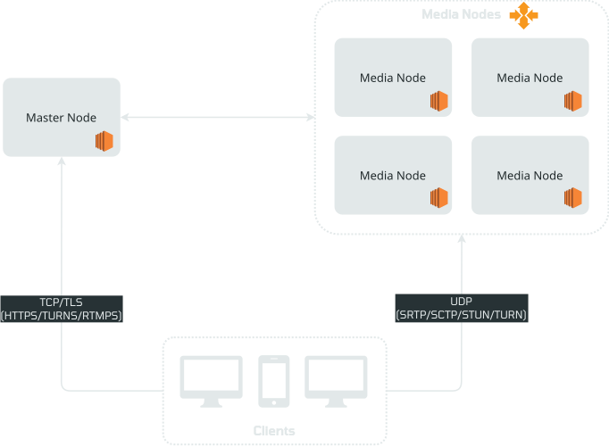

# OpenVidu Elastic installation: AWS

<div class="provider-chip" markdown>

:material-aws:{ .provider-chip-icon } AWS

</div>

--8<-- "self-hosting/common/elastic-license-intro.md"

One command creates the machines and OpenVidu comes up on them. `ov` renders the CloudFormation template embedded in its own binary for the Elastic topology and applies it with **your own `aws` CLI**. The machines then deploy OpenVidu themselves with the same `ov` build. When OpenVidu answers, `ov` registers the stack in your directory, and you operate it from there.

The deployed services are the same as in the [On Premises Elastic installation](../on-premises/install.md); on AWS the machines and their resources are created for you.

!!! info
    Port `9000` is MinIO's port. This deployment stores recordings and application data in Amazon S3 instead of MinIO, so MinIO is not deployed and port `9000` does not need to be open. The exception is the `v2compatibility` module: with it on, the chart runs MinIO even beside S3 (for its own recordings), and port `9000` is used again.

=== "Architecture overview"

    This is how the architecture of the deployment looks:

    { .round-corners .dark-img loading=lazy }

    - The Master Node acts as a Load Balancer, managing the traffic and distributing it among the Media Nodes and deployed services in the Master Node.
    - The Master Node has its own Caddy server acting as a Layer 4 (for TURN with TLS and RTMPS) and Layer 7 (for OpenVidu Dashboard, OpenVidu Meet, etc., APIs) reverse proxy.
    - WebRTC traffic (SRTP/SCTP/STUN/TURN) is routed directly to the Media Nodes.
    - An autoscaling group of Media Nodes is created to scale the number of Media Nodes based on the system load.

## Requirements

--8<-- "self-hosting/aws/ov-requirements.md"

Elastic also needs a **VPC** with public subnets, one for the master node and one or more for the media nodes. Without any of the network parameters, the deploy uses the region's default VPC and its default subnets.

## Deploy

The stack lives in its own empty directory. With no network parameters, Elastic uses the region's default VPC, the master in its first subnet and the media nodes spread over all of them:

```bash
mkdir openvidu && cd openvidu
ov stack deploy openvidu --cloud aws --aws-region us-east-1 \
  --edition pro --openvidu-pro-license <your-license> --deployment-type elastic \
  --certificate-type letsencrypt --mode auto
```

To run in a VPC of your own, pass **all three** network parameters (`ov` then uses them as they are and reads nothing). The reads below pick the default VPC's IDs; point them at your own, and keep `--region` the same as the deploy:

```bash
mkdir openvidu && cd openvidu
VPC=$(aws ec2 describe-vpcs --filters Name=is-default,Values=true \
  --query 'Vpcs[0].VpcId' --output text --region us-east-1)
SUBNETS=$(aws ec2 describe-subnets --filters Name=vpc-id,Values=$VPC Name=default-for-az,Values=true \
  --query 'Subnets[].SubnetId' --output text --region us-east-1 | tr '\t' ,)
ov stack deploy openvidu --cloud aws --aws-region us-east-1 \
  --edition pro --openvidu-pro-license <your-license> --deployment-type elastic \
  --param OpenViduVPC=$VPC \
  --param OpenViduMasterNodeSubnet=${SUBNETS%%,*} \
  --param OpenViduMediaNodeSubnets=$SUBNETS \
  --certificate-type letsencrypt --mode auto
```

Pass the three together or none: `ov` refuses part of a network (exit `2`), and the template checks that every subnet is in that VPC.

One master node and an auto scaling group of media nodes. The media nodes scale between `MinNumberOfMediaNodes` and `MaxNumberOfMediaNodes` (`--param`), or `--param FixedNumberOfMediaNodes=N` (equivalently `--set infrastructure.mediaNodes.fixedCount=N`) runs exactly N of them, on the first deploy and on a redeploy. To change the count later, see [Scale the media nodes](./admin.md#scale-the-media-nodes). `--aws-cluster-api-cidr <cidr>` limits who can reach the master's port 6443, the stack's remote admin control protocol. That port gives full control of the stack, so do not leave it open to `0.0.0.0/0`, the default, in production.

This is how the deploy of a stack named `el` (in `eu-south-2`) ends: `ov` waits until OpenVidu is up, then registers the stack:

```text
…
▶ Wait for the machines to deploy OpenVidu…
   · OpenVidu is up
   ✓ Wait for the machines to deploy OpenVidu
…
✔ OpenVidu Pro (elastic) is up on AWS
  URL:          https://openvidu-239b62-51-95-197-8.sslip.io/
  credentials:  aws secretsmanager get-secret-value --secret-id openvidu-elastic-eu-south-2-openvidu-el --query SecretString --output text --region eu-south-2
```

## Use your own domain

--8<-- "self-hosting/aws/ov-domain.md"

## What the deploy runs

--8<-- "self-hosting/aws/ov-deploy-plan.md"

## What the deploy creates

--8<-- "self-hosting/aws/ov-resources.md"

## Access OpenVidu

--8<-- "self-hosting/aws/ov-access.md"

## Review the commands first: assisted mode

--8<-- "self-hosting/aws/ov-assisted.md"

## Troubleshooting

--8<-- "self-hosting/aws/troubleshooting.md"

## Next steps

- [Administer the stack](./admin.md): scale the media nodes, change its configuration and destroy it.
- [Build your app](../../../build-your-app/index.md) against it, or follow a [tutorial](../../../tutorials/application-server/index.md): it connects with `LIVEKIT_URL`, `LIVEKIT_API_KEY` and `LIVEKIT_API_SECRET` (`ov stack config get livekit-api-key` and `livekit-api-secret` print them).
