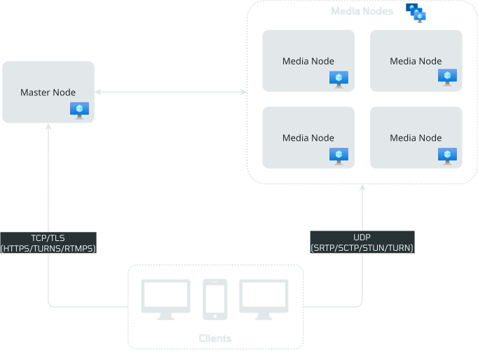

# OpenVidu Elastic installation: Azure

<div class="provider-chip" markdown>

:material-microsoft-azure:{ .provider-chip-icon } Azure

</div>

--8<-- "self-hosting/common/elastic-license-intro.md"

One command creates the machines and OpenVidu comes up on them. `ov` renders the Bicep template embedded in its own binary for the Elastic topology and applies it with **your own `az` CLI** (which compiles the Bicep). The machines then deploy OpenVidu themselves with the same `ov` build. When OpenVidu answers, `ov` registers the stack in your directory, and you operate it from there. See [how a deployment works](../../deployment-types.md#how-openvidu-is-deployed) for the shape shared by every cloud.

The deployed services are the same as in the [On Premises Elastic installation](../on-premises/install.md); on Azure, `ov` creates the infrastructure for you, with the media nodes in a Virtual Machine Scale Set that autoscales on load.

!!! info
    Port `9000` is MinIO's port. This deployment stores recordings and application data in Azure Blob Storage instead of MinIO, so MinIO is not deployed and port `9000` does not need to be open. The exception is the `v2compatibility` module: with it on, the chart runs MinIO even beside Azure Blob Storage.

=== "Architecture overview"

    This is what the deployment architecture looks like:

    { .round-corners .dark-img loading=lazy }

    - The Master Node acts as a Load Balancer, managing the traffic and distributing it among the Media Nodes and deployed services in the Master Node.
    - The Master Node has its own Caddy server acting as a Layer 4 (for TURN with TLS and RTMPS) and Layer 7 (for OpenVidu Dashboard, OpenVidu Meet, etc., APIs) reverse proxy.
    - WebRTC traffic (SRTP/SCTP/STUN/TURN) is routed directly to the Media Nodes.
    - A Virtual Machine Scale Set (VMSS) of Media Nodes is created to scale the number of Media Nodes based on the system load.

## Requirements

--8<-- "self-hosting/azure/ov-requirements.md"

## Deploy

The stack lives in its own empty directory. The command names the stack `openvidu`; the output comes from a real run of a stack with another name.

```bash
mkdir openvidu && cd openvidu
ov stack deploy openvidu --cloud azure --azure-location northeurope \
  --edition pro --openvidu-pro-license <your-license> --deployment-type elastic \
  --certificate-type letsencrypt --mode auto
```

One master node and a scale set of media nodes, with OpenVidu PRO on Kubernetes. The media nodes scale between `minNumberOfMediaNodes` and `maxNumberOfMediaNodes` (`--param`), or, at the first deploy, `--set infrastructure.mediaNodes.fixedCount=N` runs exactly N of them. For changing the count later, see [Scale the media nodes](./admin.md#scale-the-media-nodes).

This is how the deploy of a stack named `dpaz2` ends: `ov` waits until OpenVidu is up, then registers it:

```text
…
   · OpenVidu is up
   ✓ Wait for the machines to deploy OpenVidu
…
✔ OpenVidu Pro (elastic) is up on Azure
  URL:          https://openvidu-i4mxo8-52-138-152-30.sslip.io/
  credentials:  az keyvault secret show --vault-name openvidu-dpaz2-keyvault --name OPENVIDU-URL --query value -o tsv
```

## Use your own domain

--8<-- "self-hosting/azure/ov-domain.md"

## What the deploy runs

--8<-- "self-hosting/azure/ov-deploy-plan.md"

## What the deploy creates

--8<-- "self-hosting/azure/ov-resources.md"

## Access OpenVidu

--8<-- "self-hosting/azure/ov-access.md"

## Review the commands first: assisted mode

--8<-- "self-hosting/azure/ov-assisted.md"

## Troubleshooting

--8<-- "self-hosting/azure/troubleshooting.md"

## Next steps

- [Administer the deployment](./admin.md): change a parameter, scale the media nodes, operate it from another machine, destroy it.
- [Build your app](../../../build-your-app/index.md) against it, or follow a [tutorial](../../../tutorials/application-server/index.md): it connects with `LIVEKIT_URL`, `LIVEKIT_API_KEY` and `LIVEKIT_API_SECRET` (`ov stack config get livekit-api-key` and `livekit-api-secret` print them).
