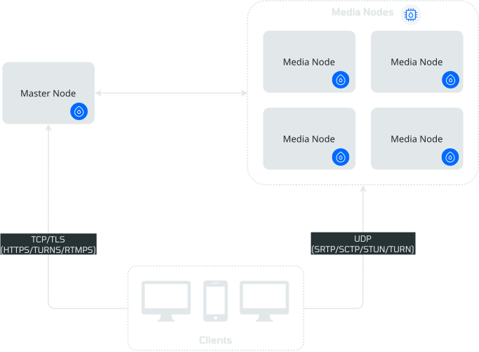

# OpenVidu Elastic installation: DigitalOcean

<div class="provider-chip" markdown>

:material-digital-ocean:{ .provider-chip-icon } DigitalOcean

</div>

--8<-- "self-hosting/common/elastic-license-intro.md"

One command creates the machines and OpenVidu comes up on them. `ov` renders the Terraform module embedded in its own binary for the Elastic topology, and applies it with **your own `terraform` and your API token**. The machines then deploy OpenVidu themselves with the same `ov` build. When OpenVidu answers, `ov` registers the stack in your directory, and you operate it from there.

=== "Architecture overview"

    This is what the deployment architecture looks like:

    { .round-corners .dark-img loading=lazy }

    - The Master Node acts as a Load Balancer, managing the traffic and distributing it among the Media Nodes and deployed services in the Master Node.
    - The Master Node has its own Caddy server acting as a Layer 4 (for TURN with TLS and RTMPS) and Layer 7 (for OpenVidu Dashboard, OpenVidu Meet, etc., APIs) reverse proxy.
    - WebRTC traffic (SRTP/SCTP/STUN/TURN) is routed directly to the Media Nodes.

## Requirements

--8<-- "self-hosting/digitalocean/ov-requirements.md"

## Deploy

The stack lives in its own empty directory. The command names the stack `openvidu`; the output comes from a real run of a stack with another name.

```bash
mkdir openvidu && cd openvidu
ov stack deploy openvidu --cloud digitalocean \
  --edition pro --openvidu-pro-license <your-license> --deployment-type elastic \
  --certificate-type letsencrypt --mode auto
```

One master node and an autoscaling pool of media nodes, in a VPC the template creates. The media nodes scale between `minNumberOfMediaNodes` and `maxNumberOfMediaNodes` (`--param`), or, at the first deploy, `--set infrastructure.mediaNodes.fixedCount=N` runs exactly N of them. To change the count later, see [Scale the media nodes](./admin.md#scale-the-media-nodes).

This is how the deploy of a stack named `dpdo2` ends: `ov` waits until the stack publishes its kubeconfig and the cluster answers, then registers it:

```text
…
   · OpenVidu is up: the stack published its kubeconfig and the cluster API answers at openvidu-7qr30p-142-93-224-169.sslip.io:6443
…
✔ OpenVidu Pro (elastic) is up on DigitalOcean
  URL:          https://openvidu-7qr30p-142-93-224-169.sslip.io/
  credentials:  env AWS_ACCESS_KEY_ID=$SPACES_ACCESS_KEY_ID AWS_SECRET_ACCESS_KEY=$SPACES_SECRET_ACCESS_KEY AWS_SESSION_TOKEN= aws s3 cp s3://openvidu-dpdo2-space-d15fca9b1c/secrets.env - --endpoint-url https://ams3.digitaloceanspaces.com
  kubeconfig:   .openvidu/digitalocean/kubeconfig.yaml
```

## What the deploy runs

--8<-- "self-hosting/digitalocean/ov-deploy-plan.md"

## What the deploy creates

--8<-- "self-hosting/digitalocean/ov-resources.md"

## Access OpenVidu

--8<-- "self-hosting/digitalocean/ov-access.md"

## Review the commands first: assisted mode

--8<-- "self-hosting/digitalocean/ov-assisted.md"

## Troubleshooting

--8<-- "self-hosting/digitalocean/troubleshooting.md"

## Next steps

- [Administer the stack](./admin.md): scale the media nodes, change a parameter, operate it from another machine, destroy it.
- [Build your app](../../../build-your-app/index.md) against it, or follow a [tutorial](../../../tutorials/application-server/index.md): it connects with `LIVEKIT_URL`, `LIVEKIT_API_KEY` and `LIVEKIT_API_SECRET`.
