# OpenVidu Elastic administration: Google Cloud Platform

:material-google-cloud:{ .provider-chip-icon } Google Cloud Platform

The deployment of OpenVidu Elastic on Google Cloud Platform is automated using Infrastructure Manager in Google Cloud Console, with Media Nodes managed within a [Managed Instance Group :fontawesome-solid-external-link:{.external-link-icon}](https://docs.cloud.google.com/compute/docs/instance-groups?hl=en){:target="_blank"}. This group dynamically adjusts the number of instances based on a target average CPU usage.

Internally, the Google Cloud Platform Elastic deployment mirrors the On Premises Elastic deployment, allowing you to follow the same administration and configuration guidelines of the [On Premises Elastic](../on-premises/admin.md) documentation. However, there are specific considerations unique to the Google Cloud Platform environment that are worth keeping in mind:

## Cluster shutdown and startup

The Master Node is a Virtual Machine Instance, while the Media Nodes are part of a Managed Instance Group. The process for starting and stopping these components differs:

!!! info "Deployments with a fixed number of Media Nodes"

    With **`fixedNumberOfMediaNodes`** greater than `0` (see [Fixed Number of Media Nodes](#fixed-number-of-media-nodes)) there is no autoscaler to edit, and the scale-in Cloud Run Function brings the group back to the fixed number within 5 minutes. To shut the cluster down, first pause the Cloud Scheduler job `<STACK_NAME>-scale-scheduler` in [Cloud Scheduler :fontawesome-solid-external-link:{.external-link-icon}](https://console.cloud.google.com/cloudscheduler){:target="_blank"}, then set the _"Number of instances"_ of the Managed Instance Group to `0` instead of its minimum and maximum. To start it up, set the number of instances back and resume the job.

=== "Shutting down the cluster"

    To shut down the cluster, you need to stop the Media Nodes and then stop the Master Node.

    1. Navigate to the [Google Cloud Platform Console :fontawesome-solid-external-link:{.external-link-icon}](https://console.cloud.google.com/compute/overview){:target="_blank"}.
    2. Then click into the Managed Instance Group resource called `<STACK_NAME>-media-node-group` and click on _"Edit"_.

        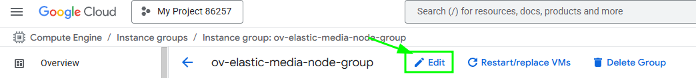{ .round-corners loading=lazy }

    3. On this tab, go to the **Group Size & autoscaling** tab and change the _"Minimum"_ and _"Maximum"_ number of instances to 0.

        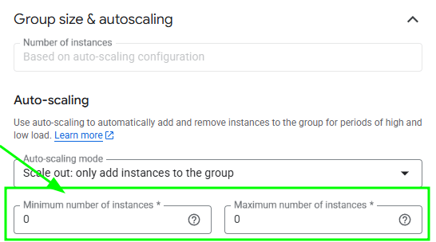{ .round-corners loading=lazy }

    4. Click _"Save"_ and wait for it to complete. You can check the progress in the _"VM instances"_ tab.

        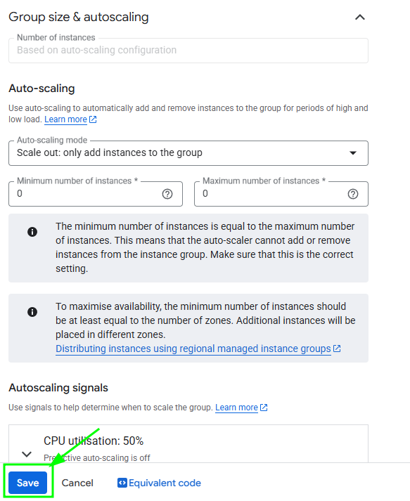{ .round-corners loading=lazy }

    5. After confirming that all Media Node instances are terminated, in _"VM instances"_ tab select the instance called `<STACK_NAME>-master-node`. Click on it to go to the Master Node instance. There, click on "Stop" to stop the instance.

        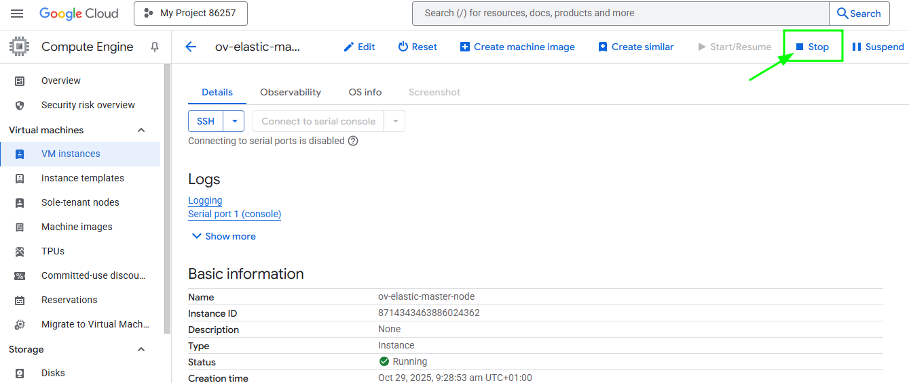{ .round-corners loading=lazy }

=== "Starting up the cluster"

    To start the cluster, first start the Master Node and then the Media Nodes.

    1. Navigate to the [Google Cloud Platform Console :fontawesome-solid-external-link:{.external-link-icon}](https://console.cloud.google.com/compute/overview){:target="_blank"}.
    2. In _"VM instances"_ tab select the instance called `<STACK_NAME>-master-node`, then click _"Start"_ to start the Master Node.

        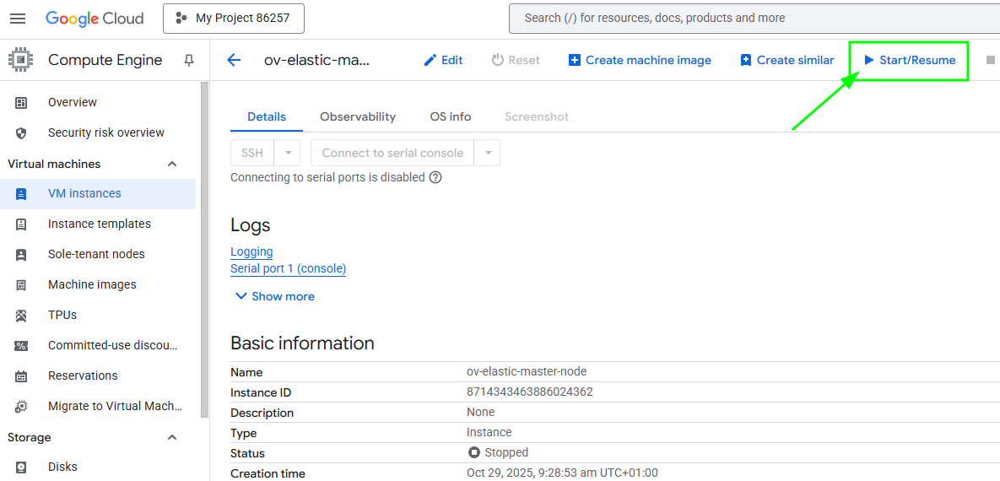{ .round-corners loading=lazy }

    3. Wait until the instance is running.
    4. Go to the _"Instance Groups"_ tab, and there click into the Managed Instance Group resource called `<STACK_NAME>-media-node-group` and click on _"Edit"_.

        { .round-corners loading=lazy }

    5. Go to the **Group Size & autoscaling** tab and change the _"Minimum"_ and _"Maximum"_ number of instances to your desired values.

        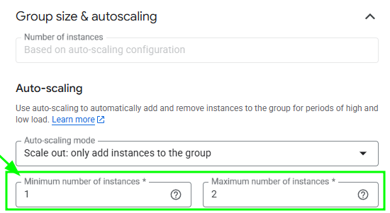{ .round-corners loading=lazy }

    6. Click _"Save"_ and wait for it to complete. You can check the progress in the _"Instances"_ tab.

        { .round-corners loading=lazy }

## Change the instance type

It is possible to change the instance type of both the Master Node and the Media Nodes. However, since the Media Nodes are part of a Managed Instance Group, the process differs. The following section details the procedures:

=== "Master Nodes"

    !!! warning

        This procedure requires downtime, as it involves stopping the Master Node.

    1. [Shutdown the cluster](#shutting-down-the-cluster).

        !!! info

            You can stop only the Master Node instance to change its instance type, but it is recommended to stop the whole cluster to avoid any issues.
    2. Go to the [Google Cloud Platform Console :fontawesome-solid-external-link:{.external-link-icon}](https://console.cloud.google.com/compute/overview){:target="_blank"} and locate the resource with the name `<STACK_NAME>-master-node` and click on it.
    3. Click on _"Edit"_ and inside change the _"Machine Type"_. Then select the size you desire and click on _"Save"_

        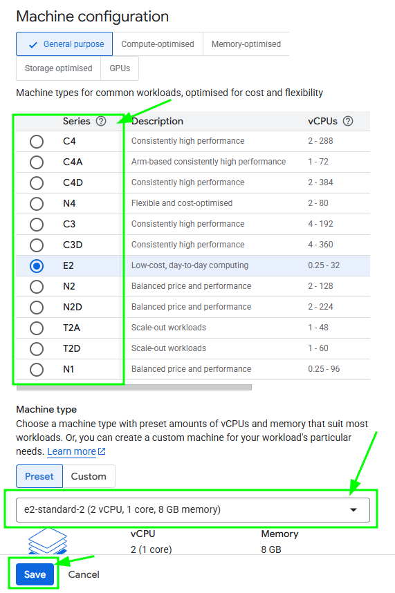{ .round-corners loading=lazy }

    4. [Start the cluster](#starting-up-the-cluster).

=== "Media Nodes"

    !!! info

        This will delete the media nodes without the graceful delete option. If you want to stop them gracefully, check the [Shutdown the Cluster](#shutting-down-the-cluster) tab.

    1. Go to the _"Instance Group"_ tab and select the resource called `<STACK_NAME>-media-node-group` and click on the _"Template"_.

        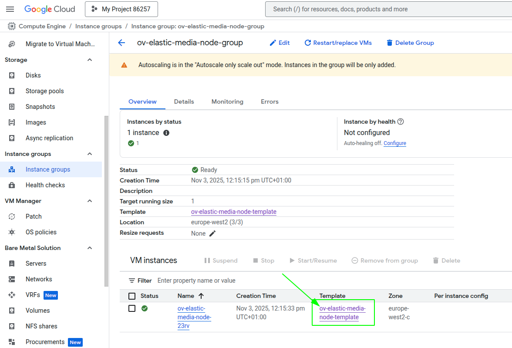{ .round-corners loading=lazy }

    2. To change the size click on _"Create similar"_ and create a new one with the desired size.

        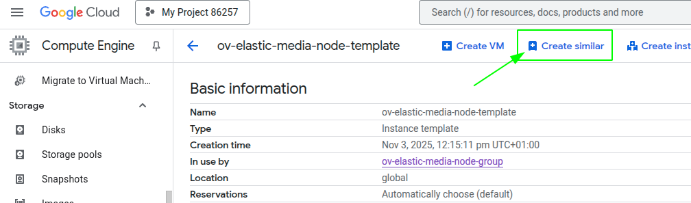{ .round-corners loading=lazy }

    3. Go back to the _"Instance Group"_ and click on _"Edit"_.

        { .round-corners loading=lazy }

    4. In _"Instance template & overrides"_, change the template to the one you created previously, and then click _"Save"_.

        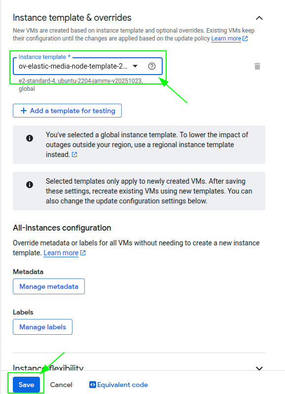{ .round-corners loading=lazy }

    5. Delete the old instances.

        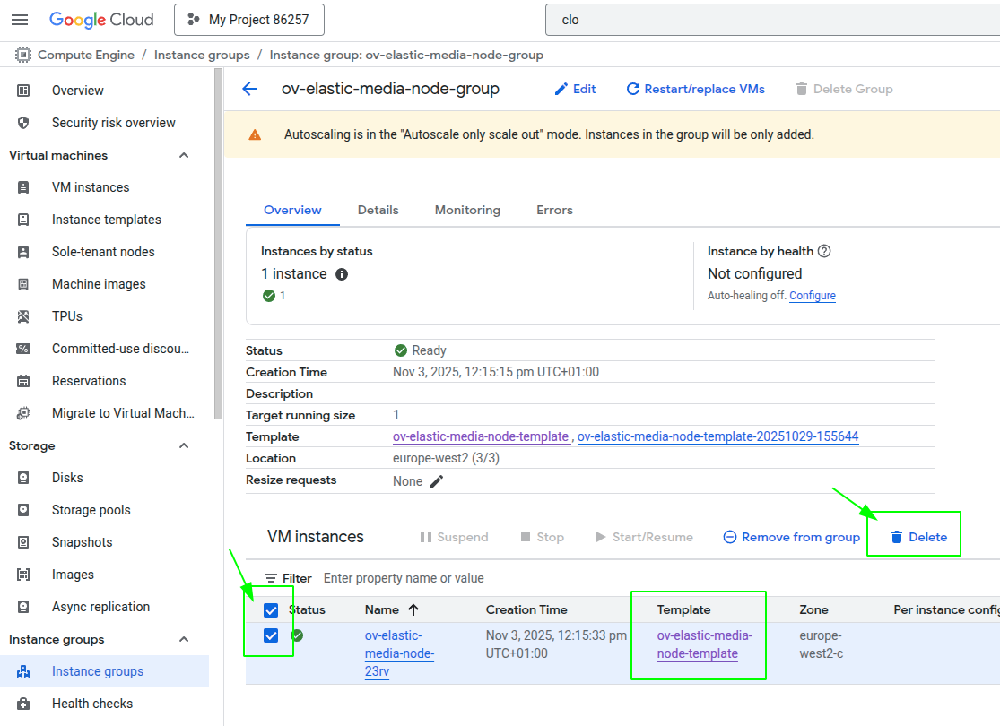{ .round-corners loading=lazy }

## Media Nodes Autoscaling Configuration

You can modify the autoscaling configuration of the Media Nodes by adjusting the scaling signals of the Managed Instance Group:

=== "Media Nodes Autoscaling Configuration"

    1. Go to the [Google Cloud Platform Console :fontawesome-solid-external-link:{.external-link-icon}](https://console.cloud.google.com/compute/overview){:target="_blank"}.
    2. Go to the _"Instance Groups"_ tab, and there click into the Managed Instance Group resource called `<STACK_NAME>-media-node-group` and click on _"Edit"_.

        { .round-corners loading=lazy }

    3. On this tab, go to _"Group size & autoscaling"_ and change the tab called _"Autoscaling signals"_
    4. In this tab you will find the signal currently in use. Here you can add new signals or modify existing ones.

        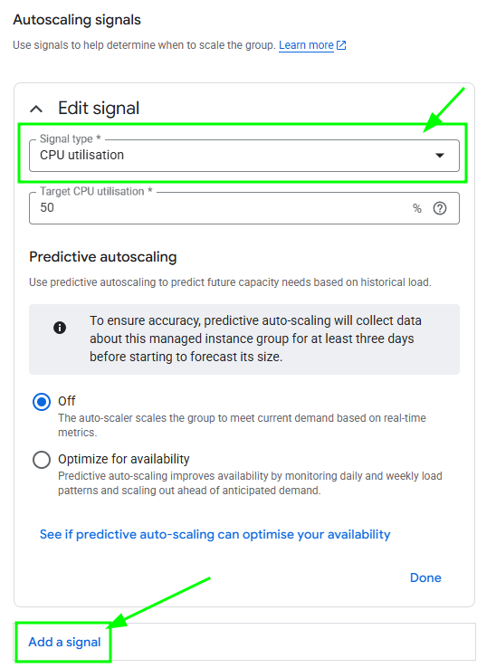{ .round-corners loading=lazy }

    !!! info

        OpenVidu Elastic is by default configured with a _"Target tracking scaling"_ policy that scales based on the target average CPU usage. However, you can configure different autoscaling policies according to your needs. For more information on the various types of autoscaling policies and how to implement them, refer to the [Google Cloud Platform
        MIG documentation :fontawesome-solid-external-link:{.external-link-icon}](https://docs.cloud.google.com/compute/docs/autoscaler?hl=en#autoscaling_policy){:target="_blank"}.

## Fixed Number of Media Nodes

The **`fixedNumberOfMediaNodes`** input value selects how the number of Media Nodes in the Managed Instance Group `<STACK_NAME>-media-node-group` is managed:

- **Autoscaling mode** (`0`, the default): an autoscaler adds Media Nodes based on CPU usage, between **minNumberOfMediaNodes** and **maxNumberOfMediaNodes**, and a scale-in Cloud Run Function, run every 5 minutes by a Cloud Scheduler job, drains the Media Nodes above the autoscaler's recommendation.
- **Fixed mode** (a value greater than `0`): no autoscaler is deployed. The same scale-in Cloud Run Function keeps the group at that number of Media Nodes: it drains the extra ones and adds the missing ones. **initialNumberOfMediaNodes**, **minNumberOfMediaNodes**, **maxNumberOfMediaNodes** and **scaleTargetCPU** are ignored.

=== "Change Fixed Number of Media Nodes"

    1. Go to [Infrastructure Manager :fontawesome-solid-external-link:{.external-link-icon}](https://console.cloud.google.com/infra-manager/deployments){:target="_blank"} in the GCP Console and select the deployment of OpenVidu Elastic.
    2. Edit the deployment, set the input value **`fixedNumberOfMediaNodes`** to the number of Media Nodes you want, keep the rest of the input values as they are, and update the deployment. If you deployed with the Terraform CLI instead, set the variable and run `terraform apply`.
    3. Wait for the update to complete. The scale-in Cloud Run Function brings the group to the new number on its next run, within 5 minutes. You can follow the Media Nodes in the Managed Instance Group called `<STACK_NAME>-media-node-group`.

    Raising the number adds Media Nodes. Lowering it drains the extra Media Nodes gracefully, with the same mechanism as an automatic scale-in: they leave the Managed Instance Group but keep running in _"VM instances"_ while they drain, stop accepting new Rooms, and delete themselves when their ongoing Rooms, recordings and ingests end. The drain starts within about 5 minutes of the update: the function runs every 5 minutes, and each Media Node notices within a minute that it has left the group.

### Activate or Deactivate Autoscaling

=== "Activate Autoscaling"

    1. Follow the steps of the _"Change Fixed Number of Media Nodes"_ tab above, setting **`fixedNumberOfMediaNodes`** to `0`. Change **minNumberOfMediaNodes**, **maxNumberOfMediaNodes** and **scaleTargetCPU** too if you do not want their current values.
    2. When the update completes, the autoscaler is deployed again and scales on CPU usage, starting from the Media Nodes that are running. If there are fewer than **minNumberOfMediaNodes**, the autoscaler adds Media Nodes up to it. If there are more than **maxNumberOfMediaNodes**, the scale-in Cloud Run Function drains the extra ones gracefully, down to the autoscaler's recommendation.

=== "Deactivate Autoscaling"

    1. Follow the steps of the _"Change Fixed Number of Media Nodes"_ tab above, setting **`fixedNumberOfMediaNodes`** to the number of Media Nodes you want.
    2. When the update completes, the autoscaler is removed, and the scale-in Cloud Run Function brings the group to that number on its next run: if more Media Nodes are running, the extra ones are drained gracefully; if fewer are running, Media Nodes are added.

!!! info "What an update changes"

    - An update never resizes the Managed Instance Group by itself: Terraform sets its size only when the deployment is created, to **initialNumberOfMediaNodes** (or to **fixedNumberOfMediaNodes** in fixed mode). After that, only the autoscaler and the scale-in Cloud Run Function change it, as described above.
    - In fixed mode, if the size of the group is changed by other means, for example by hand in the GCP Console, the scale-in Cloud Run Function brings it back to **fixedNumberOfMediaNodes** on its next run.

## Administration and configuration

Regarding the administration of your deployment, you can follow the instructions in section [On Premises Elastic Administration](../on-premises/admin.md).

Regarding the configuration of your deployment, you can follow the instructions in section [Changing Configuration](../../configuration/changing-config.md). Additionally, the [How to Guides](../../how-to-guides/index.md) offer multiple resources to assist with specific configuration changes.

In addition to these, a Google Cloud Platform deployment provides the capability to manage global configurations via the Google Cloud Platform Console using Secrets Manager created during the deployment:

=== "Changing configuration through Secrets Manager"

    1. Navigate to the [GCP Secrets Manager :fontawesome-solid-external-link:{.external-link-icon}](https://console.cloud.google.com/security/secret-manager){:target="_blank"} on Google Cloud Platform.
    2. Click on the desired secret you want to change and click on _"New Version"_.

        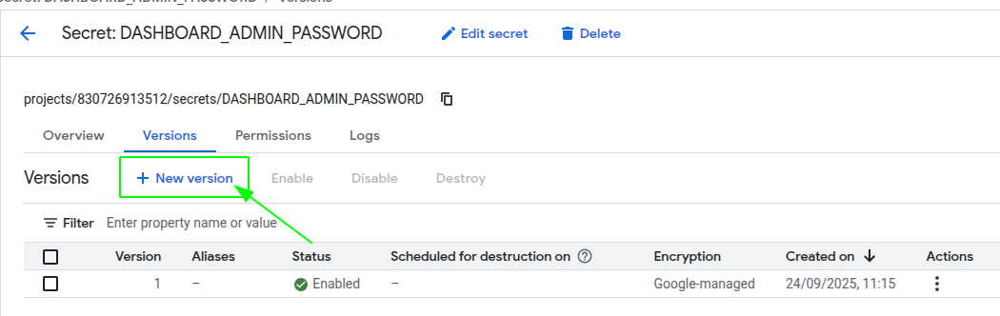{ .round-corners loading=lazy }

    3. Enter the new secret value on _"Secret Value"_ field and click on _"Add new version"_.

        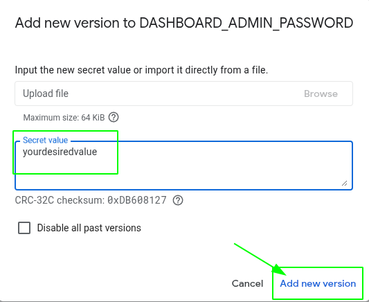{ .round-corners loading=lazy }

    4. Go to the Master Node resource and click on _"Stop"_ -> _"Start"_ to apply the changes to the OpenVidu Elastic deployment.

    Changes will be applied automatically.

## Backup and Restore

Review the [Backup and restore OpenVidu deployments](../../how-to-guides/backup-and-restore.md) guide for recommended backup workflows.
