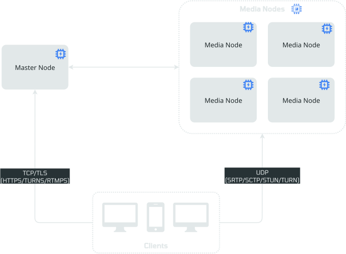

# OpenVidu Elastic installation: Google Cloud Platform

<div class="provider-chip" markdown>

:material-google-cloud:{ .provider-chip-icon } Google Cloud Platform

</div>

--8<-- "self-hosting/common/elastic-license-intro.md"

One command creates the machines and OpenVidu comes up on them. `ov` renders the Terraform module embedded in its own binary for the Elastic topology and applies it with **your own `terraform` and your `gcloud` credentials**. The machines then deploy OpenVidu themselves with the same `ov` build. When OpenVidu answers, `ov` registers the stack in your directory, and you operate it from there.

!!! info
    Port `9000` is MinIO's port. This deployment stores recordings and application data in Google Cloud Storage instead of MinIO, so MinIO is not deployed and port `9000` does not need to be open. The exception is the `v2compatibility` module: with it on, the chart runs MinIO even beside Cloud Storage.

=== "Architecture overview"

    This is what the deployment architecture looks like:

    { .round-corners .dark-img loading=lazy }

    - The Master Node acts as a Load Balancer, managing the traffic and distributing it among the Media Nodes and deployed services in the Master Node.
    - The Master Node has its own Caddy server acting as a Layer 4 (for TURN with TLS and RTMPS) and Layer 7 (for OpenVidu Dashboard, OpenVidu Meet, etc., APIs) reverse proxy.
    - WebRTC traffic (SRTP/SCTP/STUN/TURN) is routed directly to the Media Nodes.
    - A Managed Instance Group of Media Nodes is created to scale the number of Media Nodes based on system load.

## Requirements { #requirements }

--8<-- "self-hosting/gcp/ov-requirements.md"

## Deploy { #deploy }

The stack lives in its own empty directory. The command names the stack `openvidu`; the outputs come from real runs of stacks with other names.

```bash
mkdir openvidu && cd openvidu
ov stack deploy openvidu --cloud gcp --gcp-project my-project \
  --edition pro --openvidu-pro-license <your-license> --deployment-type elastic \
  --certificate-type letsencrypt --mode auto
```

One master node and a managed instance group of media nodes. The media nodes scale between `minNumberOfMediaNodes` and `maxNumberOfMediaNodes` (`--param`), or `--set infrastructure.mediaNodes.fixedCount=N` runs exactly N of them with no autoscaler. Either works on the first deploy and on a redeploy; to change the count later, see [Scale the media nodes](./admin.md#scale-the-media-nodes).

This is how the deploy of a stack named `dpgcp2` ends: `ov` waits until OpenVidu is up, then registers the stack:

```text
…
   · waiting for OpenVidu to come up (1m12s elapsed): OpenVidu is still installing
   · OpenVidu is up
…
✔ OpenVidu Pro (elastic) is up on Google Cloud
  URL:          https://openvidu-pwvcha-34-153-183-72.sslip.io/
  credentials:  gcloud secrets versions access latest --secret=openvidu-dpgcp2-OPENVIDU_URL --project=my-project  (every secret starts with openvidu-dpgcp2-)
```

## Use your own domain { #use-your-own-domain }

--8<-- "self-hosting/gcp/ov-domain.md"

## What the deploy runs { #what-the-deploy-runs }

--8<-- "self-hosting/gcp/ov-deploy-plan.md"

## What the deploy creates { #what-the-deploy-creates }

--8<-- "self-hosting/gcp/ov-resources.md"

## Access OpenVidu { #access-openvidu }

--8<-- "self-hosting/gcp/ov-access.md"

## Review the commands first: assisted mode { #assisted-mode }

--8<-- "self-hosting/gcp/ov-assisted.md"

## Troubleshooting { #troubleshooting }

--8<-- "self-hosting/gcp/troubleshooting.md"

## Next steps { #next-steps }

- [Administer the stack](./admin.md): change a parameter, scale the media nodes, operate it from another machine and destroy it.
- [Build your app](../../../build-your-app/index.md) against it, or follow a [tutorial](../../../tutorials/application-server/index.md): it connects with `LIVEKIT_URL`, `LIVEKIT_API_KEY` and `LIVEKIT_API_SECRET` (`ov stack config get livekit-api-key` and `livekit-api-secret` print them).
