# OpenVidu Elastic installation: On-premises

<div class="provider-chip" markdown>

:material-server:{ .provider-chip-icon } On-premises

</div>


--8<-- "self-hosting/common/elastic-license-intro.md"

Deploy OpenVidu Elastic on your own Linux servers with the [OpenVidu CLI](../../openvidu-cli.md) (`ov`). An Elastic stack is **deployed on one machine** (the master) exactly like a Single Node PRO, with `--deployment-type elastic`; every media node then **joins** it. Media nodes are elastic: add and remove them according to workload. Elastic requires OpenVidu **PRO**{ .openvidu-tag .openvidu-pro-tag }.

=== "Architecture overview"

    This is what the deployment architecture looks like:

    { .round-corners .dark-img loading=lazy }

    - The Master Node acts as a load balancer, managing the traffic and distributing it among the Media Nodes and the services on the Master Node.
    - The Master Node runs Caddy as a Layer 4 (TURN with TLS and RTMPS) and Layer 7 (Dashboard, Meet, APIs) reverse proxy.
    - WebRTC traffic (SRTP/SCTP/STUN/TURN) is routed directly to the Media Nodes.

The Master Node runs the data tier (MinIO, Redis, MongoDB), Caddy, the Dashboard and the optional Meet, observability and v2compatibility services. Each Media Node runs OpenVidu Server PRO, Ingress and Egress, and the observability agents.

## Requirements

Same as a [Single Node](../../single-node/on-premises/install.md#requirements), with **at least two machines**: one Master Node and one or more Media Nodes, each with a minimum of 4 CPU cores and 4 GB of RAM and Linux (Ubuntu recommended). The Master Node needs generous disk (100 GB recommended) for recordings; the nodes must reach each other on their private addresses. Each node runs the OpenVidu PRO license you pass to the master.

## Port rules

These are the inbound ports `ov` checks, with the names it prints for them. The master carries the public API; the media nodes carry the media. Open them before deploying; `ov` checks them for you ([Check the ports first](../../single-node/on-premises/install.md#check-the-ports)).

=== "Master Node"

    | Port | Scope | Level | Description |
    | --- | --- | --- | --- |
    | `443/tcp` | public | required | Caddy: LiveKit API, Dashboard, Meet, WHIP API, TURN with TLS, custom layouts. |
    | `80/tcp` | public | recommended | Caddy: HTTP-to-HTTPS redirect and Let's Encrypt validation. |
    | `6443/tcp` | admin | required | Stack remote admin control protocol: the port your machine administers the stack through. |
    | `22/tcp` | admin | required | SSH: the port `ov` reaches the node through. |

    The master's firewall must let the pod networks `10.42.0.0/16` and `10.43.0.0/16` reach it. The media nodes reach the master's `6443/tcp` and `8472/udp` (Kubernetes cluster traffic).

=== "Media Node"

    | Port | Scope | Level | Description |
    | --- | --- | --- | --- |
    | `443/udp` | public | recommended | OpenVidu LiveKit Server: STUN/TURN over UDP. |
    | `50000-60000/udp` | public | recommended | OpenVidu LiveKit Server: WebRTC media over UDP. |
    | `7881/tcp` | public | recommended | OpenVidu LiveKit Server: WebRTC media over TCP. |
    | `22/tcp` | admin | required | SSH: the port `ov` reaches the node through. |
    | `10250/tcp` | internal | required | Kubernetes cluster traffic, from the master only. |
    | `8472/udp` | internal | required | Kubernetes cluster traffic, from the master only. |

With the `ingress` module, also open `1935/tcp` (RTMP) on the master and `7885/udp` (WHIP) on the media nodes. `join` checks these internal ports in both directions and prints the exact `ufw` rule to add, scoped to the source, if one is closed.

## Deploy the master

Deploy the first machine as the master, exactly like a [Single Node PRO](../../single-node/on-premises/install.md#deploy) but with `--deployment-type elastic`:

```console
$ mkdir ov-elastic && cd ov-elastic
$ ov stack deploy el --edition pro --environment on-premises --deployment-type elastic \
    --ssh ubuntu@172.30.0.101 --ssh-key ~/.ssh/id_ed25519 \
    --openvidu-pro-license <your-license> \
    --domain-name 172-30-0-101.openvidu-local.dev \
    --certificate-type owncert --owncert-public-key ~/certs/fullchain.pem --owncert-private-key ~/certs/privkey.pem \
    --mode auto

▶ Check the inbound ports…
       Ports of 172.30.0.101 (master node of an elastic stack)
       PORT      SCOPE   LEVEL        STATE  TO OPEN
       443/tcp   public  required     open
       80/tcp    public  recommended  open
       6443/tcp  admin   required     open
       22/tcp    admin   required     open
       ✓ host firewall: the ufw firewall lets 10.42.0.0/16 and 10.43.0.0/16 reach the node
   ✓ Check the inbound ports
…
✔ deploy completed.
wrote spec to openvidu-stack.yml
✔ stack "el" recorded in this directory
```

The stack is up with its data tier on the master, but its media services have nowhere to run yet.

## Join a media node

From the stack's directory, `ov stack join --ssh` reads the join address and token from the master over SSH (the token never appears on screen), checks the ports, installs the node agent and joins the machine:

```console
$ ov stack join --ssh ubuntu@172.30.0.102 --as media
→ reading the join address and token from 172.30.0.101
→ checking the ports of 172.30.0.102 from here and from the stack's masters
  Ports of 172.30.0.102 (media node of an elastic stack)
  PORT                      SCOPE     LEVEL        STATE  TO OPEN
  443/udp                   public    recommended  open
  50000-60000/udp           public    recommended  open
  7881/tcp                  public    recommended  open
  22/tcp                    admin     required     open
  10250/tcp ← 172.30.0.101  internal  required     open   (only from 172.30.0.101)
  8472/udp ← 172.30.0.101   internal  required     open   (only from 172.30.0.101)

▶ Join the cluster…
   · join 172.30.0.102 to the stack as a media node
   ✓ Join the cluster

▶ Leave the OpenVidu CLI on the node…
   · copy this CLI (ov-admin, 63 MB) to /usr/local/bin/ov
   ✓ Leave the OpenVidu CLI on the node

▶ Wait for the stack to see the node…
   ✓ Wait for the stack to see the node

✔ 172.30.0.102 joined the stack as a media node.
```

Before installing anything it checks the ports the new node needs, from your machine and from the master: if a required internal port is not reachable, the join stops with exit `6` and prints the `ufw` rule to add on each side. The login, key and port default to the ones the stack recorded. The join returns once the stack sees the node as ready, so the node takes work as soon as the command ends. Each media node is one more `ov stack join --ssh`. See [Add a media node](admin.md#add-a-media-node) for the other ways to join (on the node itself, or in assisted mode).

## Install on the servers themselves, or review the commands first

As on a Single Node, you can put `ov` on the master and deploy with [`--this-node`](../../single-node/on-premises/install.md#install-on-the-server-itself), and [review every command before it runs with `--mode assisted`](../../single-node/on-premises/install.md#assisted-mode) (the assisted runbook of a join ends with `ov stack status --wait --joined --wait-timeout 15m`). A media node can also [join itself](admin.md#add-a-media-node) from the machine with `ov stack join --this-node`.

A master deployed with `--this-node` records no SSH to itself, so `ov stack join --ssh <media-node>` from its directory cannot read the join address and token from the master over SSH. Pass them with `--address` and `--token` from `ov stack join-info` (run on the master), or join each media node on the machine itself with `ov stack join --this-node`.

## Configure your application to use the deployment

Your application connects with `LIVEKIT_URL`, `LIVEKIT_API_KEY` and `LIVEKIT_API_SECRET`. Read them from the stack's directory:

```bash
ov stack config get livekit-api-key
ov stack config get livekit-api-secret
```

`LIVEKIT_URL` is your domain as `wss://yourdomain.example.io/` or `https://yourdomain.example.io/`.

## Configuration and administration

Once deployed, see [Administration](admin.md) to operate the stack, add and remove media nodes, change the configuration and back up its data.
