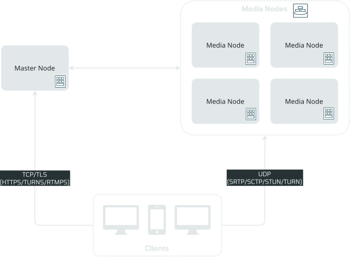

# OpenVidu Elastic installation: Oracle Cloud Infrastructure

--8<-- "self-hosting/oracle/provider-chip.md"

--8<-- "self-hosting/common/elastic-license-intro.md"

One command creates the machines and OpenVidu comes up on them. `ov` renders the Terraform module embedded in its own binary for the Elastic topology and applies it with **your own `terraform` and your OCI API key**. The master installs OpenVidu on itself and the media nodes join it, all with the same `ov` build. When OpenVidu answers, `ov` registers the stack in your directory, and you operate it from there. OpenVidu Elastic runs on Kubernetes.

=== "Architecture overview"

    { .round-corners .dark-img loading=lazy }

    - The master node runs a Caddy reverse proxy (Layer 4 for TURN with TLS and RTMPS, Layer 7 for the APIs, OpenVidu Dashboard and OpenVidu Meet) and distributes traffic to the media nodes.
    - WebRTC traffic (SRTP/SCTP/STUN/TURN) is routed directly to the media nodes.
    - Media nodes belong to an OCI Instance Pool. Scale-out is handled by its autoscaling configuration; scale-in is delegated to an OCI Function that gracefully drains a media node before terminating it.

## Requirements { #requirements }

--8<-- "self-hosting/oracle/ov-requirements.md"

Elastic adds one requirement when the media nodes autoscale:

- **The scale-in function's image (autoscaling only).** An autoscaling media pool uses an OCI Function that gracefully drains a media node before the pool removes it. Its image is the template's `scale_in_function_image` parameter. The template ships a default, `mad.ocir.io/axp2ice0s7el/openvidu-oci-scalein:main`, which is published in `eu-madrid-1` and works there with no extra flag. In any other region an OCI Function can only pull from an [OCI Registry (OCIR) :fontawesome-solid-external-link:{.external-link-icon}](https://docs.oracle.com/en-us/iaas/Content/Registry/Concepts/registryoverview.htm){:target="_blank"} of that region, so copy the image into your region's OCIR and pass it with `--param scale_in_function_image=<image>`. With a fixed media-node count (`--param fixedNumberOfMediaNodes=N`) there is no function and no image is needed.

## Deploy { #deploy }

The stack lives in its own empty directory:

```bash
export OCI_COMPARTMENT_OCID=ocid1.compartment.oc1..<compartment>
mkdir openvidu && cd openvidu
ov stack deploy openvidu --cloud oracle --oci-region eu-madrid-1 \
  --edition pro --openvidu-pro-license <your-license> --deployment-type elastic \
  --certificate-type letsencrypt --mode auto
```

One master node and an autoscaling pool of media nodes: one to start with, between `minNumberOfMediaNodes` and `maxNumberOfMediaNodes`, adding one when their average CPU goes over `scaleTargetCPU` (all `--param`). `--set infrastructure.mediaNodes.fixedCount=N` (or `--param fixedNumberOfMediaNodes=N`) runs exactly N media nodes with no autoscaling and no scale-in Function, on this deploy or on a later redeploy. To change the count, see [Scale the media nodes](./admin.md#scale-the-media-nodes). `--param clusterApiAllowedCidr=<cidr>` limits who can reach the master's port 6443, the stack's remote admin control protocol. That port gives full control of the stack, so do not leave it open to `0.0.0.0/0`, the default, in production.

## Use your own domain { #use-your-own-domain }

--8<-- "self-hosting/oracle/ov-domain.md"

## What the deploy runs { #what-the-deploy-runs }

--8<-- "self-hosting/oracle/ov-deploy-plan.md"

## What the deploy creates { #what-the-deploy-creates }

--8<-- "self-hosting/oracle/ov-resources.md"

## Access OpenVidu { #access-openvidu }

--8<-- "self-hosting/oracle/ov-access.md"

## Review the commands first: assisted mode { #assisted-mode }

--8<-- "self-hosting/oracle/ov-assisted.md"

## Troubleshooting { #troubleshooting }

--8<-- "self-hosting/oracle/troubleshooting.md"

## Next steps { #next-steps }

- [Administer the stack](./admin.md): change a parameter, scale the media nodes, operate it from another machine, destroy it.
- [Build your app](../../../build-your-app/index.md) against it: it connects with `LIVEKIT_URL`, `LIVEKIT_API_KEY` and `LIVEKIT_API_SECRET` (`ov stack config get livekit-api-key` and `livekit-api-secret` print them).
