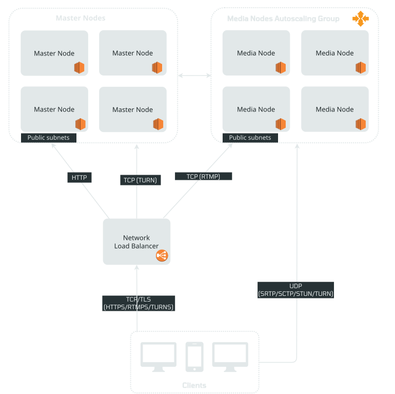

# OpenVidu High Availability installation: AWS

<div class="provider-chip" markdown>

:material-aws:{ .provider-chip-icon } AWS

</div>

--8<-- "self-hosting/common/ha-license-intro.md"

One command creates the machines and OpenVidu comes up on them. `ov` renders the CloudFormation template embedded in its own binary for the High Availability topology and applies it with **your own `aws` CLI**. The machines then deploy OpenVidu themselves with the same `ov` build. When OpenVidu answers at the load balancer, `ov` registers the stack in your directory, and you operate it from there.

The deployed services are the same as in the [On Premises High Availability installation](../on-premises/install-nlb.md); on AWS the machines and their resources are created for you.

=== "Architecture overview"

    { .round-corners .dark-img loading=lazy }

    - Four master nodes run behind a Network Load Balancer that terminates TLS with your ACM certificate and distributes HTTPS traffic to them.
    - An autoscaling group of Media Nodes is created to scale the number of Media Nodes based on the system load.
    - WebRTC traffic (SRTP/SCTP/STUN/TURN) is routed directly to the Media Nodes over UDP, the lowest latency and the best quality.
    - Clients that cannot use UDP relay their media with TURN over TLS on your domain, through the load balancer and the master nodes.

## Requirements

--8<-- "self-hosting/aws/ov-requirements.md"

High Availability also needs three things of your own:

- A **domain**. The load balancer serves it, and the deploy creates the DNS record for you when the domain is in a Route 53 hosted zone of your account; otherwise you create it yourself (see [Deploy](#deploy)).
- An **ACM certificate** for the domain, in the same region. `ov` requests it for you when the domain is in Route 53; otherwise pass it with `--param OpenViduCertificateARN=<arn>`. See [Create and configure an AWS certificate](../../how-to-guides/create-configure-AWS-certificate.md).
- A **VPC with three or more subnets in different availability zones** (the four masters spread across them so the cluster survives losing a zone). A region's default VPC has one subnet per zone. With fewer than three master subnets, the deploy stops before creating anything.

## Deploy

The stack lives in its own empty directory. With the domain in a Route 53 hosted zone of your account, one command does everything, the DNS record and the ACM certificate included:

```bash
mkdir openvidu && cd openvidu
ov stack deploy openvidu --cloud aws --aws-region us-east-1 \
  --edition pro --openvidu-pro-license <your-license> --deployment-type ha \
  --domain-name openvidu.example.com --mode auto
```

This uses the region's default VPC, the masters spread across its availability zones and the media nodes across all of them. To use a VPC and subnets of your own, pass them with `--param` (a region's default VPC has one subnet per availability zone, so this picks them):

```bash
mkdir openvidu && cd openvidu
VPC=$(aws ec2 describe-vpcs --filters Name=is-default,Values=true \
  --query 'Vpcs[0].VpcId' --output text --region us-east-1)
SUBNETS=$(aws ec2 describe-subnets --filters Name=vpc-id,Values=$VPC Name=default-for-az,Values=true \
  --query 'Subnets[].SubnetId' --output text --region us-east-1 | tr '\t' ,)
ov stack deploy openvidu --cloud aws --aws-region us-east-1 \
  --edition pro --openvidu-pro-license <your-license> --deployment-type ha \
  --domain-name openvidu.example.com \
  --param OpenViduVPC=$VPC \
  --param OpenViduMasterNodeSubnets=$SUBNETS \
  --param OpenViduMediaNodeSubnets=$SUBNETS \
  --mode auto
```

Four master nodes behind a Network Load Balancer, plus an auto scaling group of media nodes. TLS terminates at the load balancer with the ACM certificate, so `--certificate-type` does not apply (if you pass one, the deploy warns and goes on). The media nodes scale between `MinNumberOfMediaNodes` and `MaxNumberOfMediaNodes` (`--param`); see [Scale the media nodes](./admin.md#scale-the-media-nodes). To serve TURN over TLS on a domain of its own, with its own load balancer, add `--turn-domain-name turn.example.com` (and `--param TurnCertificateARN=<arn>` when you bring its certificate). `--aws-cluster-api-cidr <cidr>` limits who can reach the masters' port 6443, the stack's remote admin control protocol. That port gives full control of the stack, so do not leave it open to `0.0.0.0/0`, the default, in production.

**If your domain is not in Route 53** (another provider or another account), pass the certificate with `--param OpenViduCertificateARN=<arn>`, and once the stack exists, **point the domain at the load balancer**: a CNAME (or a Route 53 alias record) to the stack's `NLBDNS` output. Nothing serves the domain until you do. The deploy prints the record as soon as the machines exist, so you can create it while they deploy. This prints the `NLBDNS` output (the CloudFormation stack is `openvidu-<name>`):

```bash
aws cloudformation describe-stacks --stack-name openvidu-openvidu --region us-east-1 \
  --query "Stacks[0].Outputs[?OutputKey=='NLBDNS'].OutputValue" --output text
```

Because the load balancer terminates TLS, `ov stack status --wait` only counts nodes and services; the URL is checked at the load balancer. This is the wait of a stack named `demo-ha`:

```console
$ ov stack status --wait
note: the stack runs behind a proxy that terminates TLS, so its URL is checked at that proxy: the wait counts nodes and services only
waiting for https://openvidu.example.com to be ready (Ctrl-C to stop)…
  ⏳ master nodes 4/4, media nodes 1/1, services 41/49 (0s)
…
  ⏳ master nodes 4/4, media nodes 1/1, services 48/49 (44s)
✔ demo-ha is ready (every node and service; its URL answers at the proxy in front of it)
```

## What the deploy runs

--8<-- "self-hosting/aws/ov-deploy-plan.md"

## What the deploy creates

--8<-- "self-hosting/aws/ov-resources.md"

## Access OpenVidu

--8<-- "self-hosting/aws/ov-access.md"

## Review the commands first: assisted mode

--8<-- "self-hosting/aws/ov-assisted.md"

## Troubleshooting

--8<-- "self-hosting/aws/troubleshooting.md"

## Next steps

- [Administer the stack](./admin.md): scale the media nodes, change its configuration and destroy it.
- [Build your app](../../../build-your-app/index.md) against it, or follow a [tutorial](../../../tutorials/application-server/index.md): it connects with `LIVEKIT_URL`, `LIVEKIT_API_KEY` and `LIVEKIT_API_SECRET` (`ov stack config get livekit-api-key` and `livekit-api-secret` print them).
