# OpenVidu High Availability administration: Azure

<div class="provider-chip" markdown>

:material-microsoft-azure:{ .provider-chip-icon } Azure

</div>


The deployment of OpenVidu High Availability on Azure is automated using Azure Resource Manager Templates, with 4 Virtual Machine Instances as Master Nodes and any number of Media Nodes managed within a [Virtual Machine Scale Set :fontawesome-solid-external-link:{.external-link-icon}](https://learn.microsoft.com/en-us/azure/virtual-machine-scale-sets/overview){:target="_blank"}. The Virtual Machine Scale Set of Media Nodes is configured to scale based on the target average CPU usage.

Internally, the Azure High Availability deployment mirrors the On Premises High Availability deployment, allowing you to follow the same administration and configuration guidelines provided in the [On Premises High Availability](../on-premises/admin.md) documentation. However, there are specific considerations unique to the Azure environment that are worth keeping in mind:

## Cluster Shutdown and Startup

You can start and stop the OpenVidu High Availability cluster at any time. The following sections detail the procedures:

=== "Shutdown the Cluster"

    To shut down the cluster, you need to stop the Media Nodes and then stop the Master Nodes.

    !!! warning "Gracefully stopping Media Nodes"

        There is currently a limitation with Media Nodes that prevents them from stopping gracefully on a manual shutdown — they will terminate immediately without waiting for active Rooms to complete.

        Wait for your active Rooms to finish before stopping the cluster, or SSH into each Media Node and run **`/usr/local/bin/stop_media_node.sh`** to drain it manually before stopping.

    1. Navigate to the [Azure Portal Dashboard :fontawesome-solid-external-link:{.external-link-icon}](https://portal.azure.com/#home){:target="_blank"} and go to the Resource Group where you deployed OpenVidu HA.
    2. Click into the Virtual Machine Scale Set resource called _"stackName-mediaNodeScaleSet"_ and click _"Availability + scale"_ on the left panel, then click on _"Scaling"_ option.

        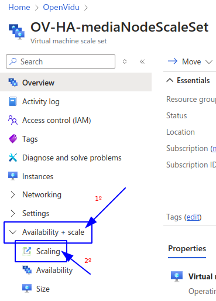{ .round-corners loading=lazy }

    3. On this tab, modify the _"Instance Limits"_ to 0.

        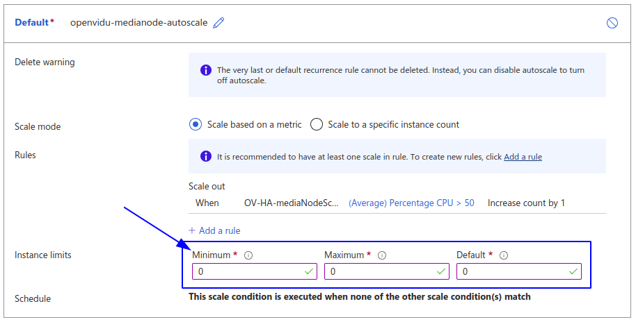{ .round-corners loading=lazy }

    4. Click _"Save"_ and wait for it to complete. You can check the progress in the _"Instances"_ tab.

        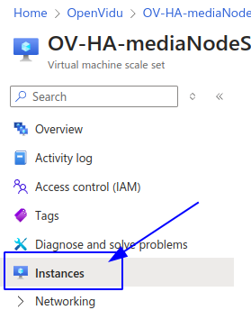{ .round-corners loading=lazy }

    5. After confirming that all Media Node instances are terminated, go back to the Resource Group and locate the resource called _"stackName-VM-MasterNode1"_. Click on it to go to the Master Node 1 instance. There, click on _"Stop"_ to stop the instance.

        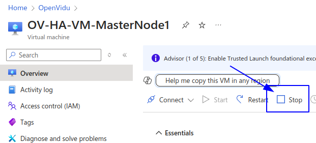{ .round-corners loading=lazy }

    6. Repeat step 5 for all the Master Nodes.

=== "Startup the Cluster"

    To start the cluster, start the Master Nodes first and then the Media Nodes.

    1. Navigate to the [Azure Portal Dashboard :fontawesome-solid-external-link:{.external-link-icon}](https://portal.azure.com/#home){:target="_blank"} and go to the Resource Group where you deployed OpenVidu HA.
    2. In the resource group click on the resource called _"stackName-VM-MasterNode1"_ and click on start to start the Master Node 1.

        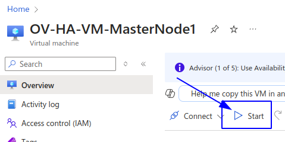{ .round-corners loading=lazy }

    3. Wait until the instance is running.
    4. Repeat step 2 and 3 for all the Master Nodes until they are all up and running.
    5. Go back to the Resource Group, and there click into the Virtual Machine Scale Set resource called _"stackName-mediaNodeScaleSet"_ and click _"Availability + scale"_ on the left panel, then click the _"Scaling"_ option.

        { .round-corners loading=lazy }

    6. On this tab, modify the _"Instance Limits"_ to your desired values.

        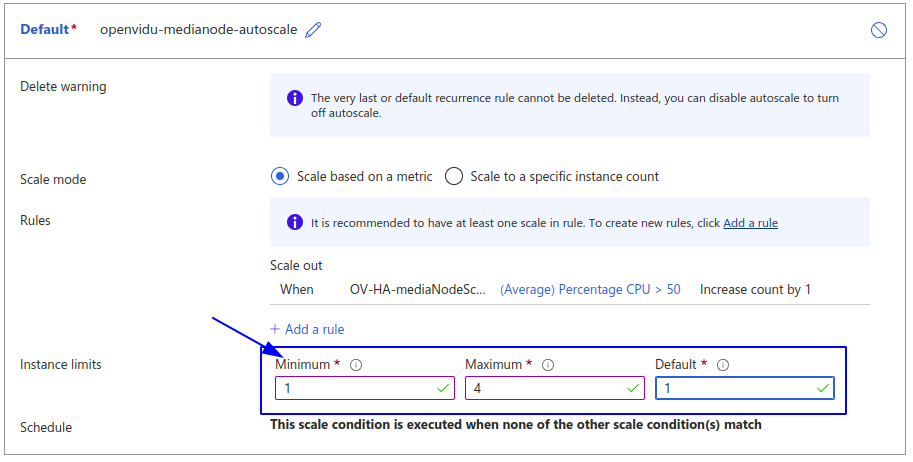{ .round-corners loading=lazy }

    7. Click _"Save"_ and wait for it to complete. You can check the progress in the _"Instances"_ tab.

        { .round-corners loading=lazy }


## Change the instance type

It is possible to change the instance type of both the Master Node and the Media Nodes. The following section details the procedures.

=== "Master Nodes"

    !!! warning
        
        This procedure requires downtime, as it involves stopping the Master Node.

    1. [Shutdown the cluster](#shutdown-the-cluster).
    2. Go to the Azure Resource Group where you deployed and locate the resource with the name _"stackName-VM-MasterNode1"_ and click on it.
    3. On the left panel click on _"Availability + scale"_ tab and inside click on _"Size"_ tab. Then select the size you desire and click on _"Resize"_

        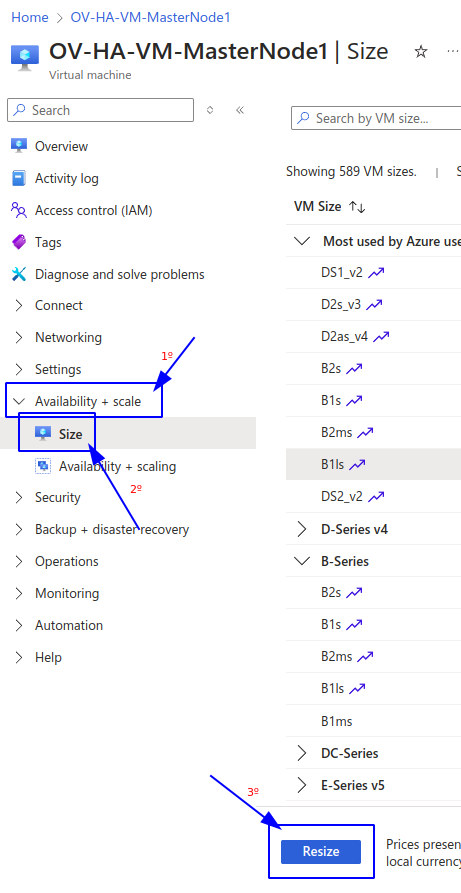{ .round-corners loading=lazy }

    4. Repeat steps 2 and 3 for all the Master Nodes just in case you want to resize all of them, if not just do it for the ones you want.
    4. [Start the cluster](#startup-the-cluster).

=== "Media Nodes"

    !!! info

        This will restart the media nodes without the graceful delete option, if you want to stop them gracefully check the [Shutdown the Cluster](#shutdown-the-cluster) tab

    1. Go to the [Azure Portal Dashboard :fontawesome-solid-external-link:{.external-link-icon}](https://portal.azure.com/#home){:target="_blank"} on Azure.
    2. Select the Resource Group where you deployed OpenVidu High Availability.
    3. Locate the resource with the name _"stackName-mediaNodeScaleSet"_. Click on it to go to the Virtual Machine Scale Set.
    4. On the left panel click on _"Availability + scale"_ tab and inside click on _"Size"_.

        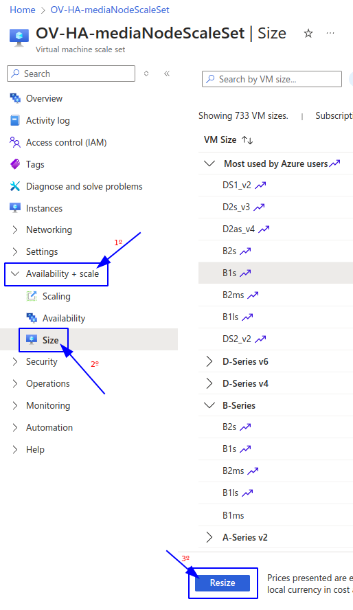{ .round-corners loading=lazy }

    5. Select the new instance type and click on _"Resize"_.

## Media Nodes Autoscaling Configuration

You can modify the autoscaling configuration of the Media Nodes by adjusting the scaling rules of the Virtual Machine Scale Set:

=== "Media Nodes Autoscaling Configuration"

    1. Go to the [Azure Portal Dashboard :fontawesome-solid-external-link:{.external-link-icon}](https://portal.azure.com/#home){:target="_blank"} on Azure.
    2. Select the Resource Group where you deployed OpenVidu High Availability.
    3. Locate the resource with the name _"stackName-mediaNodeScaleSet"_ and click on it.
    4. On the left panel click on _"Availability + scale"_ tab and inside click on _"Scaling"_ option.

        { .round-corners loading=lazy }

    5. In the _"Default"_ box you will find a section called _"Rules"_. Here you can add new rules or modify existing ones.
        
        !!! warning

            Currently there is only one rule to scale out. We are actively working on providing a graceful scale-in process for Media Nodes to avoid active Rooms disruption.

        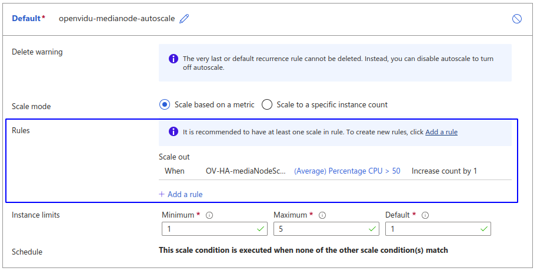{ .round-corners loading=lazy }

    === "Modify existing rules"
        
        Click on the rule you want to modify and change the **Criteria** as desired. To accept the changes click on _"Update_".

        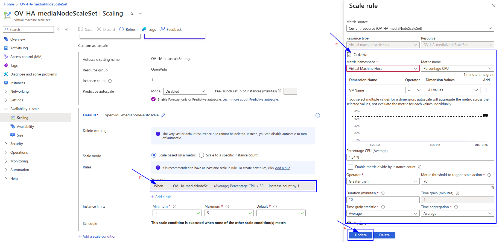{ .round-corners loading=lazy }

    === "Add a new rule"

        Click on _"Add a rule"_ option and fill the **Criteria** as desired. To add the rule click on _"Add"_.

        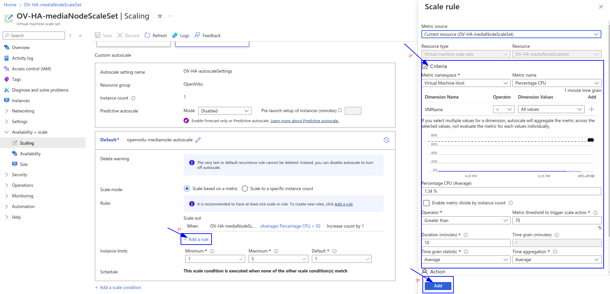{ .round-corners loading=lazy }

    !!! info
        
        OpenVidu High Availability is by default configured with a _"Target tracking scaling"_ policy that scales based on the target average CPU usage. However, you can configure different autoscaling policies according to your needs. For more information on the various types of autoscaling policies and how to implement them, refer to the [Azure Scaling Set documentation :fontawesome-solid-external-link:{.external-link-icon}](https://learn.microsoft.com/en-us/azure/virtual-machine-scale-sets/virtual-machine-scale-sets-autoscale-portal){:target="_blank"}.

## Fixed Number of Media Nodes

The **Fixed Number Of Media Nodes** parameter of the template selects how the number of Media Nodes is managed:

- **Autoscaling mode** (`0`, the default): the autoscale setting of the Virtual Machine Scale Set adds and removes Media Nodes based on CPU usage, between **Min Number Of Media Nodes** and **Max Number Of Media Nodes**, as described in [Media Nodes Autoscaling Configuration](#media-nodes-autoscaling-configuration).
- **Fixed mode** (a value greater than `0`): the autoscale profile of the Scale Set is pinned to that number, with its minimum, maximum and default instance counts all set to it, so CPU usage never changes the number of Media Nodes. **Initial Number Of Media Nodes**, **Min Number Of Media Nodes**, **Max Number Of Media Nodes** and **Scale Target CPU** are ignored.

=== "Change Fixed Number of Media Nodes"

    1. Go to the [Azure Portal Dashboard :fontawesome-solid-external-link:{.external-link-icon}](https://portal.azure.com/#home){:target="_blank"} on Azure.
    2. Select the Resource Group where you deployed OpenVidu High Availability, and on the left panel click on _"Settings"_ > _"Deployments"_.
    3. Select the deployment of OpenVidu and click on _"Redeploy"_.
    4. Set **Fixed Number Of Media Nodes** to the number of Media Nodes you want, keep the rest of the parameters as they are, and click on _"Review + create"_ and then on _"Create"_.
    5. Wait for the deployment to complete. The autoscale setting then brings the Scale Set to the new number. You can follow the Media Nodes in the _"Instances"_ tab of the resource _"stackName-mediaNodeScaleSet"_.

    Raising the number adds Media Nodes. To lower it, first remove the extra Media Nodes gracefully as described in [Lower the number of Media Nodes](#lower-the-number-of-media-nodes), and then redeploy with the new number.

### Lower the number of Media Nodes

Media Nodes protect themselves from scale-in, so that only a graceful drain removes them, and Azure does not accept an autoscale setting whose minimum or maximum is below the number of Media Nodes that are running. A redeploy that sets **Fixed Number Of Media Nodes**, **Min Number Of Media Nodes** or **Max Number Of Media Nodes** below that number fails with `UnsupportedCapacity`. Remove the extra Media Nodes first:

1. Go to the Resource Group where you deployed OpenVidu High Availability, click into the Virtual Machine Scale Set resource called _"stackName-mediaNodeScaleSet"_ and click _"Availability + scale"_ on the left panel, then click the _"Scaling"_ option.
2. Select _"Manual scale"_, keep the instance count as it is and click _"Save"_. The autoscale setting no longer adds or removes Media Nodes.
3. For each Media Node to remove, select it in the _"Instances"_ tab, click on _"Run command"_ > _"RunShellScript"_, and run:

    ```bash
    sudo systemd-run --unit=openvidu-stop-media-node --setenv=HOME=/root /usr/local/bin/stop_media_node.sh
    ```

    The Media Node stops accepting new Rooms and removes itself from the Scale Set when its ongoing Rooms, recordings and ingests end. `systemd-run` keeps the drain running after the Run command returns, however long the Rooms last.

4. When the Scale Set has the number of Media Nodes you want, redeploy with it as described in the _"Change Fixed Number of Media Nodes"_ tab above, or with the new **Min Number Of Media Nodes** in autoscaling mode. The redeploy turns autoscaling back on.

### Switch between autoscaling and a fixed number

=== "Back to autoscaling"

    1. Follow the steps of the _"Change Fixed Number of Media Nodes"_ tab above, setting **Fixed Number Of Media Nodes** to `0`. Change **Min Number Of Media Nodes**, **Max Number Of Media Nodes** and **Scale Target CPU** too if you do not want their current values.
    2. When the deployment completes, the autoscale setting scales on CPU usage again, starting from the Media Nodes that are running, and adds Media Nodes if there are fewer than **Min Number Of Media Nodes**. **Min Number Of Media Nodes** and **Max Number Of Media Nodes** cannot be below the Media Nodes that are running: to go lower, remove the extra ones first as described in [Lower the number of Media Nodes](#lower-the-number-of-media-nodes).

=== "From autoscaling to a fixed number"

    1. Follow the steps of the _"Change Fixed Number of Media Nodes"_ tab above, setting **Fixed Number Of Media Nodes** to the number of Media Nodes you want.
    2. When the deployment completes, the autoscale setting is pinned to that number, and Media Nodes are added if fewer are running. If more Media Nodes are running than the number you set, remove the extra ones first as described in [Lower the number of Media Nodes](#lower-the-number-of-media-nodes): Azure does not accept the deployment otherwise.

!!! info "What a redeploy changes"

    - A redeploy never changes the number of Media Nodes by itself: the template does not set the instance count of the Scale Set, only the limits of its autoscale setting, which then adds Media Nodes up to its minimum. **Initial Number Of Media Nodes** applies only when the deployment is created.
    - The autoscale setting is rewritten from the template parameters, so changes made by hand to its rules or instance limits in the portal (see [Media Nodes Autoscaling Configuration](#media-nodes-autoscaling-configuration)) are replaced.

## Administration and configuration

Regarding the administration of your deployment, you can follow the instructions in the [On Premises High Availability Administration](../on-premises/admin.md) section.

Regarding the configuration of your deployment, you can follow the instructions in section [Changing Configuration](../../configuration/changing-config.md). Additionally, the [How to Guides](../../how-to-guides/index.md) offer multiple resources to assist with specific configuration changes.

In addition to these, an Azure deployment provides the capability to manage global configurations via the Azure portal using Key Vault Secrets created during the deployment:

=== "Changing configuration through Key Vault secrets"

    1. Navigate to the [Azure Portal Dashboard :fontawesome-solid-external-link:{.external-link-icon}](https://portal.azure.com/#home){:target="_blank"} on Azure.
    2. Select the Resource Group where you deployed your OpenVidu HA Stack.
    3. In the _"stackname-keyvault"_ resource, click on _"Objects"_ -> _"Secrets"_ on the left panel. This will show you all the secrets that are stored in the Key Vault of the OpenVidu HA deployment.

        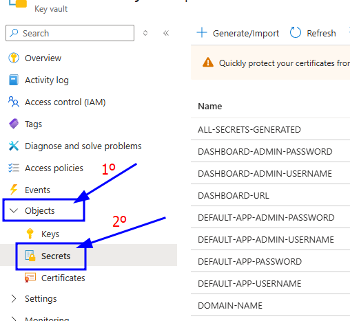{ .round-corners loading=lazy }

    4. Click on the desired secret you want to change and click on _"New Version"_.

        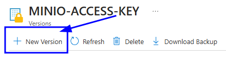{ .round-corners loading=lazy }

    5. Enter the new secret value on _"Secret Value"_ field and click on _"Create"_.

        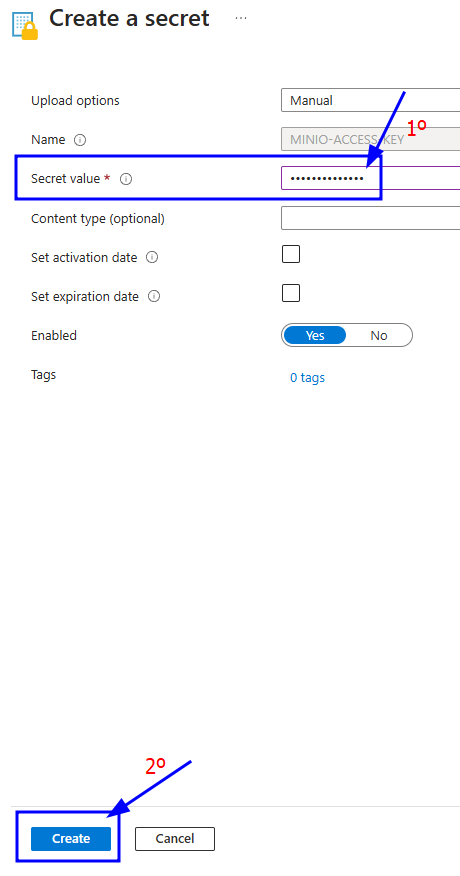{ .round-corners loading=lazy }

    6. Go to the Master Node resource whose secrets you want to change and click on _"Restart"_ to apply the changes to the OpenVidu HA deployment.

        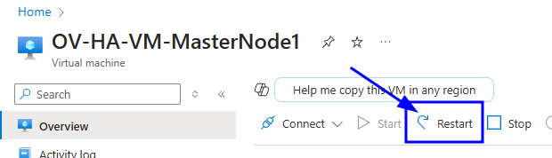{ .round-corners loading=lazy }

    Changes will be applied automatically in all the nodes of your OpenVidu High Availability deployment.

## Backup and Restore

Review the [Backup and restore OpenVidu deployments](../../how-to-guides/backup-and-restore.md) guide for recommended backup workflows.
