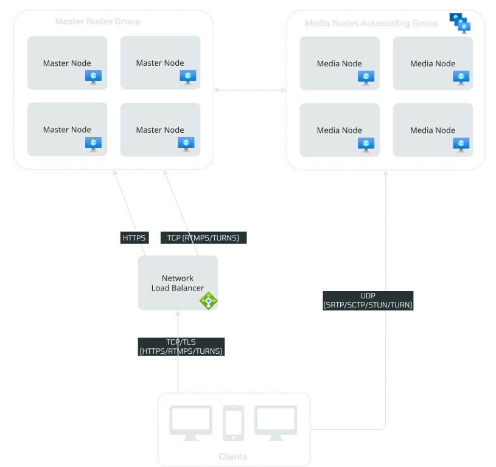

# OpenVidu High Availability installation: Azure

<div class="provider-chip" markdown>

:material-microsoft-azure:{ .provider-chip-icon } Azure

</div>

--8<-- "self-hosting/common/ha-license-intro.md"

One command creates the machines and OpenVidu comes up on them. `ov` renders the Bicep template embedded in its own binary for the High Availability topology and applies it with **your own `az` CLI** (which compiles the Bicep). The machines then deploy OpenVidu themselves with the same `ov` build. When OpenVidu answers, `ov` registers the stack in your directory, and you operate it from there. See [how a deployment works](../../deployment-types.md#how-openvidu-is-deployed) for the shape shared by every cloud.

The deployed services are the same as in the [On Premises High Availability installation](../on-premises/install-nlb.md); on Azure, `ov` creates the infrastructure for you, with four master nodes behind a load balancer and the media nodes in a Virtual Machine Scale Set that autoscales on load.

!!! info
    Port `9000` is MinIO's port. This deployment stores recordings and application data in Azure Blob Storage instead of MinIO, so MinIO is not deployed and port `9000` does not need to be open. The exception is the `v2compatibility` module: with it on, the chart runs MinIO even beside Azure Blob Storage.

=== "Architecture overview"

    This is what the deployment architecture looks like:

    { .round-corners .dark-img loading=lazy }

    - The Load Balancer distributes HTTPS traffic to the Master Nodes.
    - If RTMP media is ingested, the Load Balancer also routes this traffic to the Master Nodes, which act as a bridge due to a limitation on Azure.
    - WebRTC traffic (SRTP/SCTP/STUN/TURN) is routed directly to the Media Nodes.
    - 4 fixed Virtual Machine Instances are created for the Master Nodes. It must always be 4 Master Nodes to ensure high availability.
    - A Virtual Machine Scale Set (VMSS) of Media Nodes is created to scale the number of Media Nodes based on the system load.

## Requirements

--8<-- "self-hosting/azure/ov-requirements.md"

High Availability needs more vCPU quota than a single node, because it creates five machines at once (four masters and the initial media nodes). If the location's quota does not fit the default sizes, set smaller ones with `--param masterNodeInstanceType=<size> --param mediaNodeInstanceType=<size>`.

## Deploy

The stack lives in its own empty directory. The command names the stack `openvidu`; the output comes from a real run of a stack with another name.

```bash
mkdir openvidu && cd openvidu
ov stack deploy openvidu --cloud azure --azure-location northeurope \
  --edition pro --openvidu-pro-license <your-license> --deployment-type ha \
  --mode auto
```

Four master nodes behind a passthrough load balancer, plus a scale set of media nodes, with OpenVidu PRO on Kubernetes.

The load balancer passes TLS through untouched, and Caddy on the masters terminates it with the certificate type you choose:

- **`selfsigned`**, the default on High Availability: a certificate the four masters share. Browsers warn about it, so use it only to try out the topology.
- **`owncert`**, for production: your own certificate for your domain, base64-encoded. Add these flags to the command above:

    ```bash
    --domain-name openvidu.example.com --certificate-type owncert \
      --owncert-public-key "$(base64 -w0 fullchain.pem)" \
      --owncert-private-key "$(base64 -w0 privkey.pem)"
    ```

    On a cloud the certificate travels as a template parameter, so pass its content, base64-encoded as above, not the path to the file.

Let's Encrypt and ZeroSSL do **not** work on this topology: their HTTP challenge reaches a port 80 that only redirects to HTTPS, so the certificate is never issued and `ov stack status --wait` times out. Without `--domain-name` the stack answers at an `sslip.io` name derived from the load balancer's address; with your own domain, point it at that address (the deployment's `publicIp` output: `az deployment group show --resource-group <group> --name <deployment> --query properties.outputs.publicIp.value -o tsv`, with the group and deployment names the plan printed). Do it as soon as the deploy ends: `ov stack status --wait` waits until the stack answers at its domain, and reports `URL not answering yet` until then.

Five machines need more vCPU quota than a single node: the run below passed `--param masterNodeInstanceType=Standard_D2s_v3 --param mediaNodeInstanceType=Standard_F4s_v2` to fit within the location's quota.

This is how the deploy of a stack named `demo-ha` ends, followed by `ov stack status --wait` confirming that every node and service is ready:

```text
…
✔ OpenVidu Pro (high availability) is up on Azure
  URL:          https://openvidu-zksfiv-20-107-185-207.sslip.io/
  credentials:  az keyvault secret show --vault-name ov-demo-ha-keyvault --name OPENVIDU-URL --query value -o tsv

$ ov stack status --wait
waiting for https://openvidu-zksfiv-20-107-185-207.sslip.io to be ready (Ctrl-C to stop)…
✔ demo-ha is ready (https://openvidu-zksfiv-20-107-185-207.sslip.io)
```

## What the deploy runs

--8<-- "self-hosting/azure/ov-deploy-plan.md"

## What the deploy creates

--8<-- "self-hosting/azure/ov-resources.md"

## Access OpenVidu

--8<-- "self-hosting/azure/ov-access.md"

## Review the commands first: assisted mode

--8<-- "self-hosting/azure/ov-assisted.md"

## Troubleshooting

--8<-- "self-hosting/azure/troubleshooting.md"

## Next steps

- [Administer the deployment](./admin.md): change a parameter, scale the media nodes, operate it from another machine, destroy it.
- [Build your app](../../../build-your-app/index.md) against it, or follow a [tutorial](../../../tutorials/application-server/index.md): it connects with `LIVEKIT_URL`, `LIVEKIT_API_KEY` and `LIVEKIT_API_SECRET` (`ov stack config get livekit-api-key` and `livekit-api-secret` print them).
