# OpenVidu High Availability installation: DigitalOcean

<div class="provider-chip" markdown>

:material-digital-ocean:{ .provider-chip-icon } DigitalOcean

</div>

--8<-- "self-hosting/common/ha-license-intro.md"

One command creates the machines and OpenVidu comes up on them. `ov` renders the Terraform module embedded in its own binary for the High Availability topology, and applies it with **your own `terraform` and your API token**. The machines then deploy OpenVidu themselves with the same `ov` build. When OpenVidu answers, `ov` registers the stack in your directory, and you operate it from there.

=== "Architecture overview"

    This is what the deployment architecture looks like:

    { .round-corners .dark-img loading=lazy }

    - The Load Balancer distributes HTTPS traffic to the Master Nodes.
    - If RTMP media is ingested, the Load Balancer also routes this traffic to the Master Nodes, which act as a bridge.
    - WebRTC traffic (SRTP/SCTP/STUN/TURN) is routed directly to the Media Nodes.
    - 4 fixed Droplets are created for the Master Nodes. It must always be 4 Master Nodes to ensure high availability.

## Requirements

--8<-- "self-hosting/digitalocean/ov-requirements.md"

On High Availability there are two topology-specific points:

- **A certificate.** The load balancer passes TLS through to the masters, so Let's Encrypt and ZeroSSL do **not** work here (their HTTP challenge reaches a port 80 that only redirects to HTTPS). Use `selfsigned` (the default) to try the topology out, or `owncert` for production.
- **A domain, for production.** No DigitalOcean template points a domain. Point an `A` record at the load balancer's address, which the deploy prints as soon as the load balancer exists, while it waits for the machines, as described below.

## Deploy

The stack lives in its own empty directory. The command names the stack `openvidu`; the output comes from a real run of a stack with another name.

```bash
mkdir openvidu && cd openvidu
ov stack deploy openvidu --cloud digitalocean \
  --edition pro --openvidu-pro-license <your-license> --deployment-type ha \
  --mode auto
```

Four master nodes behind a passthrough load balancer, plus an autoscaling pool of media nodes.

The load balancer passes TLS through untouched, and Caddy on the masters terminates it with the certificate type you choose:

- **`selfsigned`**, the default on High Availability: a certificate the four masters share. Browsers warn about it, so use it only to try out the topology.
- **`owncert`**, for production: your own certificate for your domain, base64-encoded. Add these flags to the command above:

    ```bash
    --domain-name openvidu.example.com --certificate-type owncert \
      --owncert-public-key "$(base64 -w0 fullchain.pem)" \
      --owncert-private-key "$(base64 -w0 privkey.pem)"
    ```

    On a cloud the certificate travels as a template parameter, so pass its content, base64-encoded as above, not the path to the file.

Let's Encrypt and ZeroSSL do **not** work on this topology: their HTTP challenge reaches a port 80 that only redirects to HTTPS, so the certificate is never issued and `ov stack status --wait` times out. Without `--domain-name` the stack answers at an `sslip.io` name derived from the load balancer's address. With your own domain, point an `A` record at that address: the deploy prints the record to create (`openvidu.example.com. A <loadBalancerIp>`) as soon as the load balancer exists, while it waits for the machines, so create it then. If the domain does not resolve yet when OpenVidu is up, the deploy ends with `! OpenVidu Pro (high availability) is deployed on DigitalOcean, with one step left: openvidu.example.com does not point at it yet.` and the record again, and `ov stack status --wait` reports `URL not answering yet` until the record resolves. The address is also the `loadBalancerIp` output of `terraform -chdir=.openvidu/digitalocean output`.

This is how the deploy of a stack named `demo-ha` ends, followed by `ov stack status --wait` confirming that every node and service is ready:

```text
…
✔ OpenVidu Pro (high availability) is up on DigitalOcean
  URL:          https://openvidu-j78sfb-129-212-214-216.sslip.io/
  credentials:  env AWS_ACCESS_KEY_ID=$SPACES_ACCESS_KEY_ID AWS_SECRET_ACCESS_KEY=$SPACES_SECRET_ACCESS_KEY AWS_SESSION_TOKEN= aws s3 cp s3://openvidu-demo-ha-space-appdata-b62adba1a3/secrets.env - --endpoint-url https://ams3.digitaloceanspaces.com

$ ov stack status --wait
waiting for https://openvidu-j78sfb-129-212-214-216.sslip.io to be ready (Ctrl-C to stop)…
✔ demo-ha is ready (https://openvidu-j78sfb-129-212-214-216.sslip.io)
```

## What the deploy runs

--8<-- "self-hosting/digitalocean/ov-deploy-plan.md"

## What the deploy creates

--8<-- "self-hosting/digitalocean/ov-resources.md"

## Access OpenVidu

--8<-- "self-hosting/digitalocean/ov-access.md"

## Review the commands first: assisted mode

--8<-- "self-hosting/digitalocean/ov-assisted.md"

## Troubleshooting

--8<-- "self-hosting/digitalocean/troubleshooting.md"

## Next steps

- [Administer the stack](./admin.md): scale the media nodes, change a parameter, operate it from another machine, destroy it.
- [Build your app](../../../build-your-app/index.md) against it, or follow a [tutorial](../../../tutorials/application-server/index.md): it connects with `LIVEKIT_URL`, `LIVEKIT_API_KEY` and `LIVEKIT_API_SECRET`.
