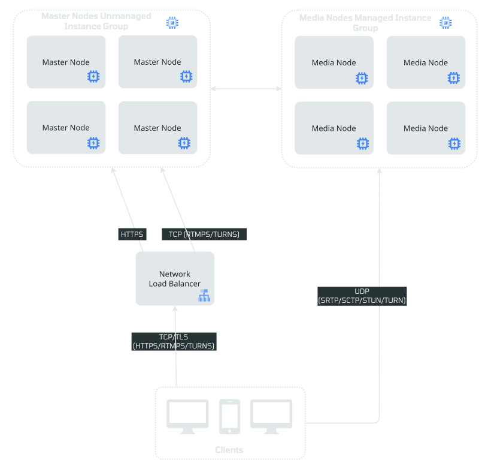

# OpenVidu High Availability installation: Google Cloud Platform

<div class="provider-chip" markdown>

:material-google-cloud:{ .provider-chip-icon } Google Cloud Platform

</div>

--8<-- "self-hosting/common/ha-license-intro.md"

One command creates the machines and OpenVidu comes up on them. `ov` renders the Terraform module embedded in its own binary for the High Availability topology and applies it with **your own `terraform` and your `gcloud` credentials**. The machines then deploy OpenVidu themselves with the same `ov` build. When OpenVidu answers, `ov` registers the stack in your directory, and you operate it from there.

!!! info
    Port `9000` is MinIO's port. This deployment stores recordings and application data in Google Cloud Storage instead of MinIO, so MinIO is not deployed and port `9000` does not need to be open. The exception is the `v2compatibility` module: with it on, the chart runs MinIO even beside Cloud Storage.

=== "Architecture overview"

    This is what the deployment architecture looks like:

    { .round-corners .dark-img loading=lazy }

    - The Load Balancer distributes HTTPS traffic to the Master Nodes.
    - If RTMP media is ingested, the Load Balancer also routes this traffic to the Master Nodes, which act as a bridge.
    - WebRTC traffic (SRTP/SCTP/STUN/TURN) is routed directly to the Media Nodes.
    - 4 fixed Virtual Machine Instances are created for the Master Nodes. It must always be 4 Master Nodes to ensure high availability.
    - A Managed Instance Group of Media Nodes is created to scale the number of Media Nodes based on system load.

## Requirements { #requirements }

--8<-- "self-hosting/gcp/ov-requirements.md"

High Availability adds two requirements for a production deployment:

- **Your own domain and certificate.** The four masters sit behind a passthrough TCP load balancer, so Let's Encrypt and ZeroSSL cannot be issued on this topology (see [Deploy](#deploy)). Use the default `selfsigned` certificate only to try the topology out, and `owncert` with your own domain for production.
- **A DNS record you point at the load balancer**, which `ov` prints as soon as the load balancer exists (see below). No Google Cloud template points a domain for you.

## Deploy { #deploy }

The stack lives in its own empty directory. The command names the stack `openvidu`; the outputs come from real runs of stacks with other names.

```bash
mkdir openvidu && cd openvidu
ov stack deploy openvidu --cloud gcp --gcp-project my-project \
  --edition pro --openvidu-pro-license <your-license> --deployment-type ha \
  --mode auto
```

Four master nodes behind a passthrough TCP load balancer, plus a managed instance group of media nodes. `--param clusterApiAllowedCidr=<cidr>` limits who can reach the masters' port 6443, the stack's remote admin control protocol. That port gives full control of the stack, so do not leave it open to `0.0.0.0/0`, the default, in production.

The load balancer passes TLS through untouched, and Caddy on the masters terminates it with the certificate type you choose:

- **`selfsigned`**, the default on High Availability: a certificate the four masters share. Browsers warn about it, so use it only to try out the topology.
- **`owncert`**, for production: your own certificate for your domain, base64-encoded. Add these flags to the command above:

    ```bash
    --domain-name openvidu.example.com --certificate-type owncert \
      --owncert-public-key "$(base64 -w0 fullchain.pem)" \
      --owncert-private-key "$(base64 -w0 privkey.pem)"
    ```

    On a cloud the certificate travels as a template parameter, so pass its content, base64-encoded as above, not the path to the file.

Let's Encrypt and ZeroSSL do **not** work on this topology: their HTTP challenge reaches a port 80 that only redirects to HTTPS, so the certificate is never issued and `ov stack status --wait` times out. Without `--domain-name` the stack answers at an `sslip.io` name derived from the load balancer's address.

With your own domain, **point it at the load balancer**. The deploy does it for you up to the DNS record: as soon as the load balancer exists the deploy prints the `A` record to create (`<domain> A <load_balancer_ip>`), so you can create it while OpenVidu installs. If the name does not point at the stack when OpenVidu is up, the deploy ends with one step left instead of `is up`, and prints the record again:

```text
! OpenVidu Pro (high availability) is deployed on Google Cloud, with one step left: openvidu.example.com does not point at it yet.
  Create this DNS record where its zone is hosted, and it is up:
    openvidu.example.com.                    A      34.39.52.221
  URL:          https://openvidu.example.com/ (once the record resolves)
  Meanwhile `ov stack status` works (it reaches the stack by its address), and
  `ov stack status --wait` waits for the record too.
```

Create the record as soon as `ov` prints it: `ov stack status --wait` reports `URL not answering yet` until the name resolves to the load balancer.

This is how the deploy of a stack named `demo-ha` ends with an `sslip.io` name (nothing to point), followed by `ov stack status --wait` confirming that every node and service is ready:

```text
…
✔ OpenVidu Pro (high availability) is up on Google Cloud
  URL:          https://openvidu-3jjbjv-34-39-52-221.sslip.io/
  credentials:  gcloud secrets versions access latest --secret=openvidu-demo-ha-OPENVIDU_URL --project=my-project  (every secret starts with openvidu-demo-ha-)

$ ov stack status --wait
waiting for https://openvidu-3jjbjv-34-39-52-221.sslip.io to be ready (Ctrl-C to stop)…
✔ demo-ha is ready (https://openvidu-3jjbjv-34-39-52-221.sslip.io)
```

## What the deploy runs { #what-the-deploy-runs }

--8<-- "self-hosting/gcp/ov-deploy-plan.md"

## What the deploy creates { #what-the-deploy-creates }

--8<-- "self-hosting/gcp/ov-resources.md"

## Access OpenVidu { #access-openvidu }

--8<-- "self-hosting/gcp/ov-access.md"

## Review the commands first: assisted mode { #assisted-mode }

--8<-- "self-hosting/gcp/ov-assisted.md"

## Troubleshooting { #troubleshooting }

--8<-- "self-hosting/gcp/troubleshooting.md"

## Next steps { #next-steps }

- [Administer the stack](./admin.md): change a parameter, scale the media nodes, operate it from another machine and destroy it.
- [Build your app](../../../build-your-app/index.md) against it, or follow a [tutorial](../../../tutorials/application-server/index.md): it connects with `LIVEKIT_URL`, `LIVEKIT_API_KEY` and `LIVEKIT_API_SECRET` (`ov stack config get livekit-api-key` and `livekit-api-secret` print them).
