# OpenVidu High Availability installation: On-premises

<div class="provider-chip" markdown>

:material-server:{ .provider-chip-icon } On-premises

</div>


--8<-- "self-hosting/common/ha-license-intro.md"

Deploy OpenVidu High Availability on your own Linux servers with the [OpenVidu CLI](../../openvidu-cli.md) (`ov`). High Availability is **four master nodes plus one or more media nodes**: the first master is deployed, then three more masters and the media nodes **join** it. The stack survives the loss of any single master. High Availability requires OpenVidu **PRO**{ .openvidu-tag .openvidu-pro-tag }.

There are two ways to expose the four masters:

- **A DNS record per master**: the stack's domain has one `A` record for each master, so clients reach any of them. This is how the [deploy below](#deploy-with-a-dns-record-per-master) runs, and it needs nothing in front of the masters.
- **A TCP load balancer** in front of the four masters, which the domain points at. This is the setup for production: the load balancer's health checks keep clients away from a master that is down ([In production: behind a load balancer](#behind-a-load-balancer)).

=== "Architecture overview"

    This is how the architecture of a production deployment looks:

    { .round-corners .dark-img loading=lazy }

    - A Network Load Balancer (TCP/UDP) distributes traffic across all Master Nodes.
    - WebRTC traffic (SRTP/SCTP/STUN/TURN) is routed directly to the Media Nodes.

Each Master Node runs the clustered data tier (MinIO, the MongoDB replica set, Redis behind Sentinel), Caddy, the Dashboard and the optional Meet, observability and v2compatibility services, with one replica of each clustered service per master. Each Media Node runs OpenVidu Server PRO, Ingress and Egress, and the observability agents.

## Requirements

Same as a [Single Node](../../single-node/on-premises/install.md#requirements), with **at least five machines**: four Master Nodes and one or more Media Nodes, each with a minimum of 4 CPU cores and 4 GB of RAM and Linux (Ubuntu recommended). The Master Nodes need generous disk (100 GB recommended) for recordings; all nodes must reach each other on their private addresses, and the Media Nodes need a public IP because media is sent directly to them. The whole cluster runs the OpenVidu PRO license you pass to the first master.

## Port rules

These are the inbound ports `ov` checks, with the names it prints for them. `join` checks the internal ports in both directions and prints the exact `ufw` rule to add, scoped to the source, if one is closed.

=== "Master Node"

    | Port | Scope | Level | Description |
    | --- | --- | --- | --- |
    | `443/tcp` | public | required | Caddy: LiveKit API, Dashboard, Meet, WHIP API, TURN with TLS, custom layouts. |
    | `80/tcp` | public | recommended | Caddy: HTTP-to-HTTPS redirect and Let's Encrypt validation. |
    | `6443/tcp` | admin | required | Stack remote admin control protocol: the port your machine administers the stack through; also between masters. |
    | `22/tcp` | admin | required | SSH: the port `ov` reaches the node through. |
    | `2379-2380/tcp` | internal | required | Kubernetes cluster traffic (cluster state and its replication), between masters. |
    | `10250/tcp` | internal | required | Kubernetes cluster traffic (node control), between masters and from the media nodes. |
    | `8472/udp` | internal | required | Kubernetes cluster traffic (overlay network), between all nodes. |

    Each master's firewall must let the pod networks `10.42.0.0/16` and `10.43.0.0/16` reach it.

=== "Media Node"

    | Port | Scope | Level | Description |
    | --- | --- | --- | --- |
    | `443/udp` | public | recommended | OpenVidu LiveKit Server: STUN/TURN over UDP. |
    | `50000-60000/udp` | public | recommended | OpenVidu LiveKit Server: WebRTC media over UDP. |
    | `7881/tcp` | public | recommended | OpenVidu LiveKit Server: WebRTC media over TCP. |
    | `22/tcp` | admin | required | SSH: the port `ov` reaches the node through. |
    | `10250/tcp` | internal | required | Kubernetes cluster traffic, from the masters only. |
    | `8472/udp` | internal | required | Kubernetes cluster traffic, from the masters only. |

With the `ingress` module, also open `1935/tcp` (RTMP) on the masters and `7885/udp` (WHIP) on the media nodes.

## Deploy with a DNS record per master { #deploy-with-a-dns-record-per-master }

Create one `A` record per master for the stack's domain (here `ha.example.com`, with records for `172.30.0.110` to `172.30.0.113`), and bring a certificate for it (`owncert`) or use `selfsigned`. Deploy the first master with `--deployment-type ha` and that domain, exactly like a [Single Node PRO](../../single-node/on-premises/install.md#deploy). Then join three more masters and the media nodes from the same directory:

```bash
ov stack deploy ha --edition pro --environment on-premises --deployment-type ha \
  --ssh ubuntu@172.30.0.110 --ssh-key ~/.ssh/id_ed25519 \
  --openvidu-pro-license <your-license> \
  --domain-name ha.example.com \
  --certificate-type owncert --owncert-public-key ~/certs/fullchain.pem --owncert-private-key ~/certs/privkey.pem \
  --mode auto
ov stack join --ssh ubuntu@172.30.0.111 --as master
ov stack join --ssh ubuntu@172.30.0.112 --as master
ov stack join --ssh ubuntu@172.30.0.113 --as master
ov stack join --ssh ubuntu@172.30.0.114 --as media
```

Each master join checks the cluster's internal ports (the API on `6443/tcp`, etcd on `2379-2380/tcp`, the kubelet on `10250/tcp`, the overlay on `8472/udp`) in both directions with the masters already in the stack, then joins the machine and confirms it carries the labels the stack schedules by:

```console
$ ov stack join --ssh ubuntu@172.30.0.111 --as master
→ reading the join address and token from 172.30.0.110
→ checking the ports of 172.30.0.111 from here and from the stack's masters
  Ports of 172.30.0.111 (master node of an ha stack)
  PORT                      SCOPE     LEVEL        STATE  TO OPEN
  443/tcp                   public    required     open
  80/tcp                    public    recommended  open
  22/tcp                    admin     required     open
  6443/tcp ← 172.30.0.110   internal  required     open   (only from 172.30.0.110)
  8472/udp ← 172.30.0.110   internal  required     open   (only from 172.30.0.110)
  2379/tcp ← 172.30.0.110   internal  required     open   (only from 172.30.0.110)
  2380/tcp ← 172.30.0.110   internal  required     open   (only from 172.30.0.110)
  10250/tcp ← 172.30.0.110  internal  required     open   (only from 172.30.0.110)

▶ Join the cluster…
   · join 172.30.0.111 to the stack as a master node
   ✓ Join the cluster

▶ Confirm the node's labels…
   ✓ Confirm the node's labels

✔ 172.30.0.111 joined the stack as a master node.
```

As the masters join, Redis Sentinel, the MongoDB replica set, MinIO and the clustered Loki and Mimir place one replica on each master. The first wait after the joins takes several minutes while the replicas settle:

```console
$ ov stack status --wait
waiting for https://ha.example.com to be ready (Ctrl-C to stop)…
  ⏳ master nodes 4/4, media nodes 1/1, services 28/53, restarting: caddy-proxy@node-172-30-0-111, caddy-proxy@node-172-30-0-112 (0s)
…
✔ ha is ready (https://ha.example.com)
```

On shared or simulated machines the wait can exceed the default 5 minutes; `ov stack status --wait --wait-timeout 15m` is the honest setting there. While the cluster is still being assembled, `ov stack status --wait --joined` waits only for the masters that have joined and says how many are missing; the assisted runbook of each join ends with `ov stack status --wait --joined --wait-timeout 15m`. Before touching any server, `join` rejects a join the stack has no place for: `--as master` on an Elastic stack, any join to a single node, and any join to a Community stack. See [Add a media node](admin.md#add-a-media-node).

## In production: behind a load balancer { #behind-a-load-balancer }

Put a load balancer in front of the four masters, so the stack survives losing one:

- **TCP passthrough, not TLS termination.** Pass `443/tcp`, `80/tcp` and `6443/tcp` (the stack's remote admin control protocol) through to the four masters, with a TCP health check on `443`; add `1935/tcp` with RTMP ingest. Caddy on the masters terminates TLS, so the certificate is `selfsigned` or `owncert`: **Let's Encrypt does not work behind a passthrough load balancer**. TCP passthrough is the default and needs no proxy flag. For a load balancer that terminates TLS instead, deploy with `--external-load-balancer` (Caddy then gets plain HTTP on `7880` and plain RTMP on `1935`); adding `--internal-tls-termination` keeps a declared load balancer in TCP passthrough while Caddy terminates TLS.
- **The domain points at the load balancer.**
- **Deploy the first master with the load balancer's domain and `--skip-port-check`.** The port check probes the domain, and nothing behind the load balancer is healthy yet. Before skipping the check, open the ports yourself:

    ```bash
    ov stack deploy ha --edition pro --environment on-premises --deployment-type ha \
      --ssh ubuntu@<master-1> --ssh-key ~/.ssh/id_ed25519 \
      --openvidu-pro-license <your-license> \
      --domain-name <domain of the load balancer> --certificate-type selfsigned \
      --skip-port-check --mode auto
    ```

- **Join the masters with `--lb-host`** (the load balancer in front of the masters) **and `--public-ip`** (the node's public address). The certificate of port `6443` covers both, so `ov` reaches the stack at either address:

    ```bash
    ov stack join --ssh ubuntu@<master> --as master --lb-host <load-balancer> --public-ip <master's public IP>
    ```

- When the nodes reach each other on a private network and you reach them on public addresses, the join's port check reports the internal ports (`6443`, `8472`, `2379-2380`, `10250`) as closed although they are open between the nodes. Open them between the nodes, then join the masters and the media nodes with `--skip-port-check`.

Expect the stack to be ready about 10 minutes after the last join: wait for it with `ov stack status --wait --wait-timeout 20m`.

If you want to force all traffic including WebRTC through the load balancer, see the [Force media traffic through port 443](../../how-to-guides/force-single-port.md) guide.

## Configure your application to use the deployment

Your application connects with `LIVEKIT_URL`, `LIVEKIT_API_KEY` and `LIVEKIT_API_SECRET`. Read them from the stack's directory:

```bash
ov stack config get livekit-api-key
ov stack config get livekit-api-secret
```

`LIVEKIT_URL` is your domain as `wss://yourdomain.example.io/` or `https://yourdomain.example.io/`.

## Configuration and administration

Once deployed, see [Administration](admin.md) to operate the stack, add and remove media nodes, change the configuration and back up its data.
