# OpenVidu High Availability installation: Oracle Cloud Infrastructure

--8<-- "self-hosting/oracle/provider-chip.md"

--8<-- "self-hosting/common/ha-license-intro.md"

One command creates the machines and OpenVidu comes up on them. `ov` renders the Terraform module embedded in its own binary for the High Availability topology and applies it with **your own `terraform` and your OCI API key**. The first master installs OpenVidu on itself and the other three masters and the media nodes join it, all with the same `ov` build. When OpenVidu answers, `ov` registers the stack in your directory, and you operate it from there. OpenVidu High Availability runs on Kubernetes.

=== "Architecture overview"

    { .round-corners .dark-img loading=lazy }

    - An OCI Network Load Balancer is the public entry point. It passes HTTPS (443), HTTP (80) and RTMPS (1935) through to the four master nodes.
    - Four master nodes run behind the load balancer; they spread across availability domains and fault domains, so the stack keeps serving with a master, a fault domain, or (in a region of three) an availability domain down.
    - WebRTC traffic (SRTP/SCTP/STUN/TURN) is routed directly to the media nodes, which belong to an autoscaling OCI Instance Pool with a scale-in OCI Function.

## Requirements { #requirements }

--8<-- "self-hosting/oracle/ov-requirements.md"

High Availability adds a few requirements of its own:

- **A domain and a certificate.** The cluster sits behind a network load balancer that passes TLS through to the masters, so **Let's Encrypt and ZeroSSL do not work** (their HTTP challenge reaches a port 80 that only redirects to HTTPS). Use `selfsigned` (the default, for trying the topology out) or `owncert` with your own certificate (production). Point your domain at the load balancer, as described under [Deploy](#deploy).
- **The scale-in function's image (autoscaling only).** An autoscaling media pool uses an OCI Function that gracefully drains a media node before the pool removes it. Its image is the template's `scale_in_function_image` parameter. The template ships a default, `mad.ocir.io/axp2ice0s7el/openvidu-oci-scalein:main`, which is published in `eu-madrid-1` and works there with no extra flag. In any other region an OCI Function can only pull from an [OCI Registry (OCIR) :fontawesome-solid-external-link:{.external-link-icon}](https://docs.oracle.com/en-us/iaas/Content/Registry/Concepts/registryoverview.htm){:target="_blank"} of that region, so copy the image into your region's OCIR and pass it with `--param scale_in_function_image=<image>`. With a fixed media-node count (`--param fixedNumberOfMediaNodes=N`) there is no function and no image is needed.
- **A regional subnet, if you bring your own.** `--param subnet_ocid=<ocid>` (and `vcn_ocid=<ocid>`) must name a public, regional subnet: High Availability spreads its masters across availability domains, so a single-availability-domain subnet is refused.

## Deploy { #deploy }

The stack lives in its own empty directory. To try it, with no domain and a self-signed certificate:

```bash
export OCI_COMPARTMENT_OCID=ocid1.compartment.oc1..<compartment>
mkdir openvidu && cd openvidu
ov stack deploy openvidu --cloud oracle --oci-region eu-madrid-1 \
  --edition pro --openvidu-pro-license <your-license> --deployment-type ha \
  --certificate-type selfsigned --mode auto
```

Four master nodes behind a passthrough network load balancer, plus an autoscaling pool of media nodes (`--param minNumberOfMediaNodes`, `maxNumberOfMediaNodes`, `scaleTargetCPU`, or `fixedNumberOfMediaNodes=N` for exactly N with no autoscaling). To change the count later, see [Scale the media nodes](./admin.md#scale-the-media-nodes).

For production, bring your own certificate for your domain, base64-encoded (on a cloud the certificate travels as a template parameter, so pass its content, not the path to the file):

```bash
ov stack deploy openvidu --cloud oracle --oci-region eu-madrid-1 \
  --edition pro --openvidu-pro-license <your-license> --deployment-type ha \
  --domain-name openvidu.example.com --certificate-type owncert \
  --owncert-public-key "$(base64 -w0 fullchain.pem)" \
  --owncert-private-key "$(base64 -w0 privkey.pem)" --mode auto
```

Without `--domain-name` the stack answers at an `sslip.io` name derived from the load balancer's address. With your own domain, **point it at the load balancer**: as soon as the masters exist the deploy prints the `A` record to create (`<domain> A <nlb_public_ip>`, the `nlb_public_ip` output of `terraform -chdir=.openvidu/oracle output`), and, if the name does not point at the stack when it is up, ends with that step left instead of `is up`:

```text
! OpenVidu Pro (high availability) is deployed on Oracle Cloud, with one step left: openvidu.example.com does not point at it yet.
  Create this DNS record where its zone is hosted, and it is up:
    openvidu.example.com.                    A      <nlb_public_ip>
  URL:          https://openvidu.example.com/ (once the record resolves)
  Meanwhile `ov stack status` works (it reaches the stack by its address), and
  `ov stack status --wait` waits for the record too.
```

Create the record as soon as the deploy prints it: `ov stack status --wait` reports `URL not answering yet` until the name resolves to the load balancer. With a `sslip.io` name nothing is needed.

## What the deploy runs { #what-the-deploy-runs }

--8<-- "self-hosting/oracle/ov-deploy-plan.md"

## What the deploy creates { #what-the-deploy-creates }

--8<-- "self-hosting/oracle/ov-resources.md"

## Access OpenVidu { #access-openvidu }

--8<-- "self-hosting/oracle/ov-access.md"

## Review the commands first: assisted mode { #assisted-mode }

--8<-- "self-hosting/oracle/ov-assisted.md"

## Troubleshooting { #troubleshooting }

--8<-- "self-hosting/oracle/troubleshooting.md"

## Next steps { #next-steps }

- [Administer the stack](./admin.md): change a parameter, scale the media nodes, operate it from another machine, destroy it.
- [Build your app](../../../build-your-app/index.md) against it: it connects with `LIVEKIT_URL`, `LIVEKIT_API_KEY` and `LIVEKIT_API_SECRET` (`ov stack config get livekit-api-key` and `livekit-api-secret` print them).
