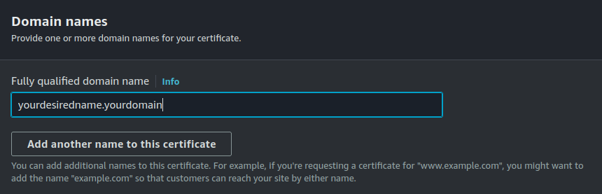
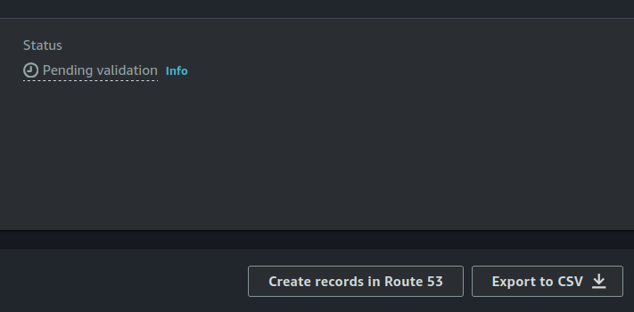
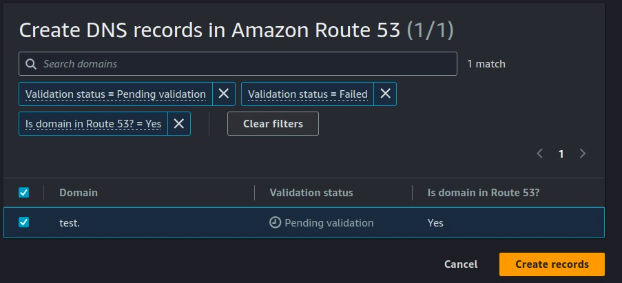
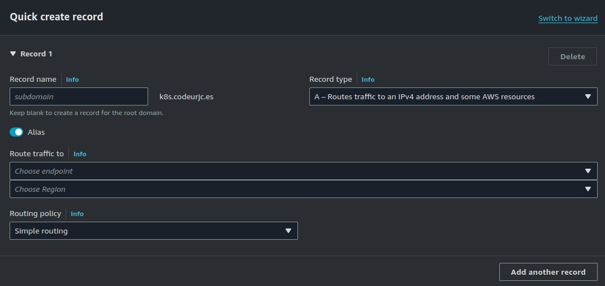

# Create AWS certificate for OpenVidu HA deployment

You will need this certificate to deploy the High Availability deployment. This guide shows you how to create it.

## Prerequisites

It is important to note that you will need access to the Certificate Manager in your AWS account, as well as access to a domain provider.
You will need a domain to be able to create and associate the certificate.


## Creation

=== "AWS Certificate creation"

    These are the steps you need to follow to create the AWS certificate; keep in mind that you need a domain.

    First, go to AWS Certificate Manager and request a new public certificate. The following parameter is the most important.

    { .round-corners loading=lazy }

    /// caption
    Domain configuration
    ///

    You need to replace **`yourdesiredname`** for whatever name you want and **`yourdomain`** for the name of the domain that you own.

    Next, leave the rest of the parameters as they are and click request.


The next page will display the certificate status. Here you will need to create a record in your domain provider to validate the status; initially it will show as pending.

=== "Create record in your domain provider"

    Here you will need to create a new CNAME record in the domain you own by using the CNAME name (up to the domain name portion) as the subdomain and the CNAME value as the record value.

    In AWS Certificate Manager, you can check the CNAME name and value by clicking on the certificate you want.

=== "Create record in Route 53"

    { .round-corners loading=lazy }

    You need to click the button called **`Create records in Route 53`**. This will lead you to the next page, where you just click Create records and that's it.

    { .round-corners loading=lazy }
    /// caption
    Create record for certificate
    ///

    Please verify that you have a new entry in the records table of the specified Hosted Zone in Route 53 with the CNAME of the certificate you just created.

    Try refreshing until the status changes to Issued (shown in green).


## Deploy the HA stack with the certificate

The High Availability template terminates TLS at a Network Load Balancer with the certificate you just created, so you pass its ARN to the deploy. Copy the **ARN** of the certificate (shown at the top of the certificate's page in AWS Certificate Manager) and give it to `ov stack deploy` as `--param OpenViduCertificateARN=…`, along with your domain:

```bash
ov stack deploy ha --cloud aws --aws-region <region> \
  --edition pro --openvidu-pro-license <your-license> \
  --deployment-type ha \
  --domain-name yourdesiredname.yourdomain \
  --param OpenViduCertificateARN=arn:aws:acm:<region>:<account>:certificate/<id> \
  --mode auto
```

Because the load balancer terminates TLS with this ACM certificate, `--certificate-type` does not apply to an HA stack on AWS. For the full AWS deploy options (VPC, subnets and the rest), see [Deploy OpenVidu on AWS](../deployment-types.md#cloud-deployments).

## Point the domain at the load balancer

When the deploy finishes, **point your domain at the load balancer**: nothing serves the domain until you do. In Route 53 (the Hosted Zone of your domain), create a record for `yourdesiredname.yourdomain`:

{ .round-corners loading=lazy }

- Enable **Alias**.
- In **subdomain**, enter the same value you used for `yourdesiredname` when creating the AWS certificate.
- In **Choose endpoint**, select *Alias to Network Load Balancer*, and in **Choose Region** select the region where the stack is deployed.
- In the field that appears, select the load balancer that belongs to the stack you deployed (its DNS name is the stack's `NLBDNS` output).

For the other fields, leave them as they are.