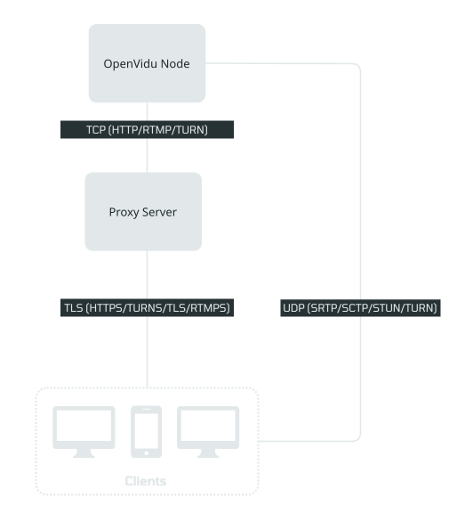

# How to deploy and configure OpenVidu with an existing external proxy

By default, OpenVidu is deployed with an internal [Caddy server :fontawesome-solid-external-link:{.external-link-icon}](https://caddyserver.com/){:target="_blank"} to configure and manage SSL certificates. However, there are certain scenarios where using an external proxy might be preferable:

- You wish to manage SSL certificates manually.
- A specific proxy server is required for enhanced security.
- You need to integrate a proxy server already in your infrastructure.

If none of these scenarios apply to you and you prefer to use the default internal Caddy server, please refer to the [official installation guides](../deployment-types.md).

For those needing to deploy OpenVidu using an external proxy, this guide offers detailed steps to deploy it and configure the external proxy.

- [External Proxy for OpenVidu Single Node](#single-node)
- [External Proxy for OpenVidu Elastic](#elastic)
- [External Proxy for OpenVidu High Availability](#high-availability)

=== "Single Node"

    !!! note
        The Single Node deployment with an external proxy is based on the same instructions as the [Single Node Deployment](../single-node/on-premises/install.md) (both the COMMUNITY and PRO editions), but with some modifications to the installation command and port rules. We recommend reading the installation guide before proceeding with this guide for a better understanding of the deployment.

    This is what the architecture of the deployment looks like:

    { .round-corners .dark-img loading=lazy }

    **1. Prerequisites**

    To deploy OpenVidu with an external proxy, ensure you have the following prerequisites:

    - **A machine with at least 4GB RAM and 4 CPU cores** and **Linux installed (Ubuntu recommended)**. This machine will serve as the OpenVidu server.
    - An additional machine for the proxy server is recommended. Alternatively, you can use the same machine as OpenVidu, but be aware that the proxy server will consume resources. Note that [some ports will be used by OpenVidu](../single-node/on-premises/install.md#port-rules), except for the ports utilized by the proxy server (TCP 80, 443, and 1935).
    - **Generous disk space (100GB recommended)** if you are going to record your sessions.
    - The machine where OpenVidu is installed **must have a Public IP or a reachable IP from the users**.
    - The proxy server also **must have a Public IP or a reachable IP from the users**.
    - A domain name for your OpenVidu deployment pointing to the machine where the proxy server is running. In this guide, we will use `openvidu.example.io`.
    - A domain name for the TURN server pointing to the machine where the proxy server is running. In this guide, we will use `turn.example.io`.

    **2. Port Rules**

    You can follow the same rule ports of the [Single Node Deployment](../single-node/on-premises/install.md#port-rules) but some ports are used by the proxy server and others are not needed. The inbound rules for the OpenVidu proxy would be as follows:

    === "OpenVidu Machine"

        **Inbound Rules**

        | Protocol    | Ports          | <div class="w-8em">Source</div>          | Description                                                |
        | ----------- | -------------- | --------------- | ---------------------------------------------------------- |
        | TCP         | 7880           | External proxy | Allows access to the following: <ul><li>LiveKit API.</li><li>OpenVidu Dashboard.</li><li>OpenVidu Meet.</li><li>WHIP API.</li><li>Custom layouts</li></ul> |
        | TCP         | 5349           | External proxy | TURN with TLS. |
        | TCP         | 1945           | External proxy | Needed if you want to ingest RTMP streams using Ingress service. |
        | UDP         | 443            | 0.0.0.0/0, ::/0 | STUN/TURN server over UDP. |
        | TCP         | 9000           | 0.0.0.0/0, ::/0 | Needed if you want to expose MinIO publicly. |
        | TCP         | 7881           | 0.0.0.0/0, ::/0 | (Optional) Needed for WebRTC media traffic over TCP with Pion. |
        | UDP         | 7885           | 0.0.0.0/0, ::/0 | Needed if you want to ingest WebRTC using WHIP. |
        | UDP         | 50000-60000    | 0.0.0.0/0, ::/0 | Needed for WebRTC media traffic over UDP. |
        | TCP         | 50000-60000    | 0.0.0.0/0, ::/0 | (Optional) Needed for WebRTC media traffic over TCP with Mediasoup. Without it, clients that cannot use UDP relay their media through TURN. |

        Also keep the admin ports open to the machine you run `ov` from, as in the [install port rules](../single-node/on-premises/install.md#port-rules): `22/tcp` (SSH) and, on a **PRO**{ .openvidu-tag .openvidu-pro-tag } single node, `6443/tcp` (stack remote admin control protocol).

        **Outbound Rules**

        Typically, all outbound traffic is allowed.

    === "Proxy Server"

        **Inbound Rules**

        | Protocol    | Ports          | <div class="w-8em">Source</div>          | Description                                                |
        | ----------- | -------------- | --------------- | ---------------------------------------------------------- |
        | TCP         | 80             | 0.0.0.0/0, ::/0 | HTTP redirection to HTTPS. |
        | TCP         | 443            | 0.0.0.0/0, ::/0 | HTTPS access to the OpenVidu API and TURN with TLS. |
        | TCP         | 1935           | 0.0.0.0/0, ::/0 | RTMP with TLS. |


    **3. Deploy OpenVidu Single Node with the `--external-proxy` flag**

    Deploy OpenVidu with the [OpenVidu CLI](../openvidu-cli.md) from an empty directory on your machine, passing the `--external-proxy` flag so OpenVidu serves plain HTTP for your proxy to terminate TLS in front of it. `ov` generates every credential; you do not pass them.

    === "Single Node **COMMUNITY**{ .openvidu-tag .openvidu-community-tag }"

        ```bash
        mkdir openvidu && cd openvidu
        ov stack deploy openvidu \
            --environment on-premises \
            --ssh ubuntu@<OPENVIDU_SERVER_IP> --ssh-key ~/.ssh/id_ed25519 \
            --domain-name openvidu.example.io \
            --turn-domain-name turn.example.io \
            --enabled-modules egress,ingress,dashboard,meet,observability \
            --external-proxy \
            --mode auto
        ```

    === "Single Node **PRO**{ .openvidu-tag .openvidu-pro-tag }"

        ```bash
        mkdir openvidu && cd openvidu
        ov stack deploy openvidu \
            --edition pro --environment on-premises \
            --ssh ubuntu@<OPENVIDU_SERVER_IP> --ssh-key ~/.ssh/id_ed25519 \
            --openvidu-pro-license <your-license> \
            --domain-name openvidu.example.io \
            --turn-domain-name turn.example.io \
            --enabled-modules egress,ingress,dashboard,meet,observability,v2compatibility \
            --rtc-engine mediasoup \
            --external-proxy \
            --mode auto
        ```

    Notes:

    - Replace `openvidu.example.io` with your FQDN and `turn.example.io` with your TURN server FQDN. Both must point at the proxy server.
    - Replace `<OPENVIDU_SERVER_IP>` with the address of the OpenVidu machine. To deploy on the machine itself, log in and use `--this-node` instead of `--ssh`.
    - With `--external-proxy`, TLS terminates at your proxy, so `--certificate-type` does not apply.
    - In **PRO**{ .openvidu-tag .openvidu-pro-tag } edition, the `--openvidu-pro-license` parameter is mandatory. You can get your license key [here :fontawesome-solid-external-link:{.external-link-icon}](../../../account.md){:target="_blank"}. Depending on the RTC engine, `--rtc-engine` can be `mediasoup` or `pion`.

    **4. Configure the external proxy**

    --8<-- "self-hosting/common/proxy-nginx-advanced.md"

    Notes:

    - Replace `openvidu.example.io` and `turn.example.io` with your domain names. These domain names must be configured in your DNS to point to the proxy server.
    - Replace `<SINGLE_NODE_PRIVATE_IP>` with the private IP of the OpenVidu server.
    - You can also have a proxy in the same machine as OpenVidu, simply replace `<SINGLE_NODE_PRIVATE_IP>` with `127.0.0.1`.

    If you want to force all traffic including WebRTC to go through the external proxy, check the [Force media traffic through port 443](force-single-port.md) guide.

=== "Elastic"

    !!! note
        The Elastic deployment with an external proxy is based on the same instructions as the [Elastic Deployment](../elastic/on-premises/install.md), but with some modifications to the installation command and port rules. We recommend reading the [Elastic Deployment](../elastic/on-premises/install.md) guide before proceeding with this guide for a better understanding of the deployment.

    This is what the architecture of the deployment looks like:

    { .round-corners .dark-img loading=lazy }

    **1. Prerequisites**

    To deploy OpenVidu Elastic with an external proxy, ensure you have the following prerequisites:

    - **At least 2 machines** for OpenVidu, each with a minimum of **4GB RAM**, **4 CPU cores**, and **Linux** installed (Ubuntu is recommended). One machine will serve as the Master Node, while the others will function as Media Nodes.
    - An additional machine for the proxy server is recommended. Alternatively, you can use the same machine as the Master Node, but be aware that the proxy server will consume resources. Note that [some ports will be used by OpenVidu](../elastic/on-premises/install.md#port-rules), except for the ports utilized by the proxy server (TCP 80, 443, and 1935).
    - Significant disk space on the **Master Node, with 100GB recommended**, especially if you plan to record your sessions (Egress). Media Nodes require less space; however, account for the space needed for ongoing recordings on these nodes.
    - **Each machine must have a Public IP or a reachable IP from the users**.
    - **The proxy server must have a Public IP or a reachable IP from the users**.
    - **A domain name for your OpenVidu deployment pointing to the proxy server**. In this guide, we will use `openvidu.example.io`.
    - **A domain name for the TURN server pointing to the proxy server**. In this guide, we will use `turn.example.io`.

    **2. Port Rules**

    Follow the [Elastic port rules](../elastic/on-premises/install.md#port-rules) for the Master Node and the Media Nodes, with one change on the master: because the external proxy terminates TLS, the master does not serve `443/tcp` publicly. Open these ports to the proxy server instead, and keep the admin ports (`6443/tcp`, `22/tcp`), the Kubernetes cluster traffic between nodes, and all the Media Node ports exactly as the install guide describes. An Elastic stack is PRO on Kubernetes, so the data services (Redis, MongoDB, MinIO) run as pods and communicate over the pod network, not over host ports between nodes.

    === "Master Node (to the proxy)"

        **Inbound Rules**

        | Protocol    | Ports          | <div class="w-8em">Source</div> | Description                                                |
        | ----------- | -------------- | --------------- | ---------------------------------------------------------- |
        | TCP         | 7880           | External Proxy | HTTP API: LiveKit API, OpenVidu v2 Compatibility API, Dashboard, Meet, WHIP API, custom layouts. |
        | TCP         | 5349           | External Proxy | TURN with TLS. |
        | TCP         | 1945           | External Proxy | RTMP ingest, with the `ingress` module. |

        The admin ports (`6443/tcp`, `22/tcp`) and the Kubernetes cluster traffic between the master and the media nodes are unchanged from the [install guide](../elastic/on-premises/install.md#port-rules).

    === "Media Nodes"

        Unchanged from the [install guide](../elastic/on-premises/install.md#port-rules): the media nodes carry the public media ports and the Kubernetes cluster traffic from the master. The external proxy does not connect to them.

    === "Proxy Server"

        And the inbound rules for the proxy server would be as follows:

        | Protocol    | Ports          | <div class="w-8em">Source</div>          | Description                                                |
        | ----------- | -------------- | --------------- | ---------------------------------------------------------- |
        | TCP         | 80             | 0.0.0.0/0, ::/0 | HTTP redirection to HTTPS. |
        | TCP         | 443            | 0.0.0.0/0, ::/0 | HTTPS access to the OpenVidu API and TURN with TLS. |
        | TCP         | 1935           | 0.0.0.0/0, ::/0 | RTMP with TLS. |

    **3. Deploy OpenVidu Elastic with the `--external-proxy` flag**

    An Elastic stack is **deployed on one machine** (the master) with `--deployment-type elastic`; every media node then **joins** it. Deploy the master with `--external-proxy`, then join the media nodes from the same directory. `ov` generates every credential, and reads the join address and token from the master itself; you do not pass them.

    === "Deploy the Master Node"

        ```bash
        mkdir openvidu && cd openvidu
        ov stack deploy openvidu \
            --edition pro --environment on-premises --deployment-type elastic \
            --ssh ubuntu@<MASTER_NODE_IP> --ssh-key ~/.ssh/id_ed25519 \
            --openvidu-pro-license <your-license> \
            --domain-name openvidu.example.io \
            --turn-domain-name turn.example.io \
            --enabled-modules egress,ingress,dashboard,meet,observability,v2compatibility \
            --rtc-engine mediasoup \
            --external-proxy \
            --mode auto
        ```

        Notes:

        - `--openvidu-pro-license` is mandatory. You can get a 15-day free trial license key by [creating an OpenVidu account :fontawesome-solid-external-link:{.external-link-icon}](../../../account.md){:target="_blank"}.
        - Replace `openvidu.example.io` with your FQDN and `turn.example.io` with your TURN server FQDN. Both must point at the proxy server.
        - With `--external-proxy`, TLS terminates at your proxy, so `--certificate-type` does not apply.
        - Depending on the RTC engine, `--rtc-engine` can be `mediasoup` or `pion`.

    === "Join the Media Nodes"

        From the same stack directory, join each media node over SSH:

        ```bash
        ov stack join --ssh ubuntu@<MEDIA_NODE_IP> --as media
        ```

        `ov` reads the join address and token from the master, checks the node's ports and joins it as a media node. Each media node is one more `ov stack join --ssh`. See [Add a media node](../elastic/on-premises/admin.md#add-a-media-node).

    **4. Configure the external proxy**

    --8<-- "self-hosting/common/proxy-nginx-advanced-elastic.md"

    Notes:

    - Replace `openvidu.example.io` and `turn.example.io` with your domain names. These domain names must be configured in your DNS to point to the proxy server.
    - Replace `<MASTER_NODE_PRIVATE_IP>` with the private IP of the Master Node.
    - You can also have a proxy in the same machine as the Master Node, simply replace `<MASTER_NODE_PRIVATE_IP>` with `127.0.0.1`.

    If you want to force all traffic including WebRTC to go through the external proxy, check the [Force media traffic through port 443](force-single-port.md) guide.

=== "High Availability"

    The High Availability deployment already has a way to configure an external proxy (described as a Network Load Balancer), which is explained [in this section](../ha/on-premises/install-nlb.md).
