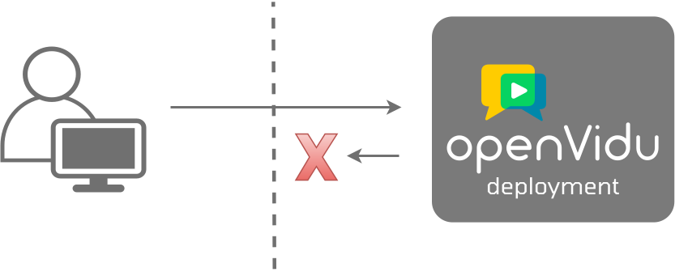
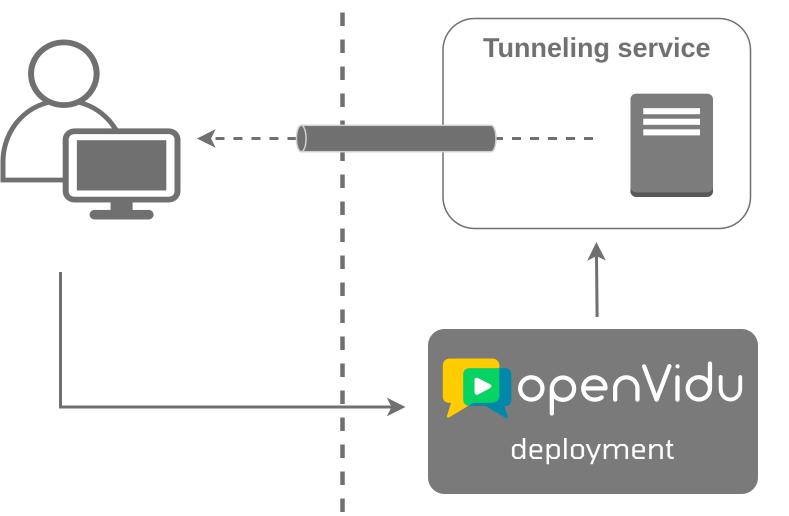

# Enable Webhooks

If you need to integrate OpenVidu with other services, you can use webhooks to send notifications about events that occur in your OpenVidu deployment. This guide explains how to enable webhooks.

## OpenVidu Server Configuration

The webhook configuration lives in the media server's service file, `livekit.yaml`. Edit it with the CLI, which applies the change and restarts the media server when you save:

```bash
ov stack config file edit livekit.yaml
```

Add your URL to the `urls` list of its `webhook` section (the section's exact contents differ between editions):

```yaml
webhook:
    api_key: ${openvidu.LIVEKIT_API_KEY:?mandatory}
    urls:
    ...
        - https://<YOUR_WEBHOOK_URL>
```

In this example, `<YOUR_WEBHOOK_URL>` is the URL where you want to receive the notifications. When you save, `ov stack config file apply` validates the document, renders the stack with it and restarts the media server across your entire OpenVidu deployment.

## **PRO**{ .openvidu-tag .openvidu-pro-tag } V2 Compatibility Configuration

If you are using the V2 Compatibility module, you can also enable webhooks for the V2 Compatibility layer, with these parameters of the V2 Compatibility service:

!!! note

    The PRO chart ships no `v2compatibility.env` document. How these V2 Compatibility settings are changed on a PRO stack deployed with `ov` is not documented yet.

```
V2COMPAT_OPENVIDU_WEBHOOK=true
V2COMPAT_OPENVIDU_WEBHOOK_ENDPOINT=https://<YOUR_WEBHOOK_URL>
```

Where `<YOUR_WEBHOOK_URL>` is the URL where you want to receive the notifications.

Check in the [Configuration Reference](../configuration/reference.md#pro-v2compatibilityenv) all the webhook events you can receive by setting the parameter `V2COMPAT_OPENVIDU_WEBHOOK_EVENTS`.

## Send Webhooks to a Local Application Server

When developing locally against a production deployment and webhook events are required by your application, you will face issues because OpenVidu cannot access your local application server.

To receive webhooks from OpenVidu on your local machine, you need to expose your local application server to the internet. This exposure allows OpenVidu to send webhooks directly to your application server.

The following images illustrate the difference between an unreachable and a reachable local application server:

<div class="grid-container" markdown>

<div class="grid-50" markdown>
{ loading=lazy }
/// caption
Unreachable local application server
///
</div>

<div class="grid-50" markdown>
{ loading=lazy }
/// caption
Reachable local application server
///
</div>

</div>

Exposing your local application server to the internet is a common practice when developing applications locally. Tools like [VS Code port forwarding :fontawesome-solid-external-link:{.external-link-icon}](https://code.visualstudio.com/docs/debugtest/port-forwarding){:target="_blank"}, [Ngrok :fontawesome-solid-external-link:{.external-link-icon}](https://ngrok.com/){:target="_blank"}, [LocalTunnel :fontawesome-solid-external-link:{.external-link-icon}](https://localtunnel.github.io/www/){:target="_blank"}, [LocalXpose :fontawesome-solid-external-link:{.external-link-icon}](https://localxpose.io/){:target="_blank"} and [Zrok :fontawesome-solid-external-link:{.external-link-icon}](https://zrok.io/){:target="_blank"} can help you achieve this.

These tools provide you with a public URL that forwards requests to your local application server. You can use this URL to receive webhooks from OpenVidu, configuring it in the OpenVidu Server as explained in the [previous section](#openvidu-server-configuration).
