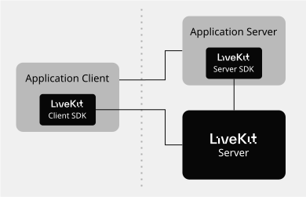

# OpenVidu Local installation (Development)

A local deployment is OpenVidu running on your own machine with **Docker Compose**, for development. It runs either edition, so you can develop against OpenVidu PRO on your laptop, and it comes with certificates that let you test from other devices on your network.

On **Linux**, the [OpenVidu CLI](openvidu-cli.md) (`ov`) deploys it: it materializes a real `docker compose` project you can inspect and edit, starts it and waits for it to be ready, and then operates it with the same commands as a production deployment. On **Windows and macOS**, where the CLI is not available yet, the deployment comes from the [openvidu-local-deployment :fontawesome-solid-external-link:{.external-link-icon}](https://github.com/OpenVidu/openvidu-local-deployment){:target="_blank"} repository and you run it with Docker Compose yourself.

## Requirements

=== ":simple-linux:{.icon .lg-icon .tab-icon} Linux"

    - [Docker :fontawesome-solid-external-link:{.external-link-icon}](https://docs.docker.com/engine/install/){:target="_blank"} installed and running, with the Compose plugin.
    - About 1 GB of free memory and 2 CPU cores for the containers (a stack with every default module uses under 1 GB at rest; rooms, recordings and ingest add to it), and a few GB of disk for the images.
    - The [OpenVidu CLI](openvidu-cli.md#install-the-openvidu-cli).

=== ":fontawesome-brands-windows:{.icon .lg-icon .tab-icon} Windows"

    - Install [Docker Desktop :fontawesome-solid-external-link:{.external-link-icon}](https://docs.docker.com/desktop/setup/install/windows-install/){:target="_blank"}

=== ":simple-apple:{.icon .lg-icon .tab-icon} macOS"

    - Install [Docker Desktop :fontawesome-solid-external-link:{.external-link-icon}](https://docs.docker.com/desktop/setup/install/mac-install/){:target="_blank"}

## Deploy

=== ":simple-linux:{.icon .lg-icon .tab-icon} Linux"

    An empty directory is the stack. Make one and deploy from it; everything is on by default (OpenVidu Meet, the Dashboard, recording, ingest):

    ```console
    $ mkdir openvidu-local && cd openvidu-local
    $ ov stack deploy --environment local
    discovered private IP 192.168.0.27 for LAN access
    materializing the deployment into ./openvidu-local-stack1 and starting it (the first run downloads images)…
    wrote spec to openvidu-stack.yml
    ✓ docker compose up -d --remove-orphans
    ✔ OpenVidu compose deployment started in ./openvidu-local-stack1
    ✔ stack "stack1" recorded in this directory
      OpenVidu Meet API: https://192-168-0-27.openvidu-local.dev:9443
    waiting for OpenVidu to be ready (Ctrl-C to stop waiting; the deployment keeps running)…
      ⏳ still starting: OpenVidu, Meet, Dashboard, MinIO (0s)
      ⏳ still starting: Meet, Dashboard (2s)
      ⏳ still starting: Meet, Dashboard (5s)
      ⏳ still starting: Meet, Dashboard (7s)
      ⏳ still starting: Meet, Dashboard (9s)

    ====================================================
    🎉 OpenVidu is ready! 🎉
    ====================================================

    This deployment is for local development only. Do not use it in production.

    ------------------ OpenVidu Meet -------------------
      - Access from this machine:
          - http://localhost:9080
      - Access from other devices in your LAN:
          - https://192-168-0-27.openvidu-local.dev:9443
      - Credentials:
          - Username: admin
          - Password: admin
          - API Key:  meet-api-key

    ----------------- LiveKit Server API ---------------
      - Access from this machine:
          - http://localhost:7880
          - ws://localhost:7880
      - Access from other devices in your LAN:
          - https://192-168-0-27.openvidu-local.dev:7443
          - wss://192-168-0-27.openvidu-local.dev:7443
      - Credentials:
          - API Key:    devkey
          - API Secret: secret

    ------------------- Other Services -----------------
      - OpenVidu Dashboard:
          - URL:      http://localhost:7880/dashboard
          - Username: admin
          - Password: admin
      - MinIO Console:
          - URL:      http://localhost:7880/minio-console
          - Username: minioadmin
          - Password: minioadmin
    ====================================================
    Operate this deployment with `ov stack ...`.
    ```

    `ov` waits for the endpoints itself and then prints a banner with the URLs and credentials (`--no-wait` skips the wait). The banner lists only what the enabled modules serve. LAN access is on by default: `ov` detects this machine's private IP and adds the `openvidu-local.dev` URLs ([Access it over your LAN](#accessing-your-local-deployment-from-other-devices-on-your-network)). Without a name, `ov` names the stack `stack1` and materializes it in `./openvidu-local-stack1`; `ov stack deploy <name>` sets the name and `--local-dir` the directory.

    The deployment is a normal `docker compose` project inside the stack directory (`./openvidu-local-<name>` by default). Its files are real and yours to edit: the configuration is `config/openvidu.yaml` and the service files beside it, and `ov stack config` changes them for you ([Configuration](configuration/changing-config.md)). After editing a file by hand, `ov stack deploy` applies it.

    #### OpenVidu PRO locally

    `--edition pro` runs OpenVidu PRO on the same Docker Compose engine (not Kubernetes): the PRO media server, Egress, Ingress and the OpenVidu 2 compatibility API, locally. It needs **no license**:

    ```console
    $ mkdir labp-stack && cd labp-stack
    $ ov stack deploy labp --environment local --edition pro --local-dir ./labp --no-lan
    materializing the deployment into ./labp and starting it (the first run downloads images)…
    wrote spec to openvidu-stack.yml
    ✓ docker compose up -d --remove-orphans
    ✔ OpenVidu compose deployment started in ./labp
    ✔ stack "labp" recorded in this directory
      OpenVidu Meet API: http://localhost:9080
    waiting for OpenVidu to be ready (Ctrl-C to stop waiting; the deployment keeps running)…
      ⏳ still starting: Meet, Dashboard (0s)
      ⏳ still starting: Meet, Dashboard (2s)
      ⏳ still starting: Meet, Dashboard (4s)

    ====================================================
    🎉 OpenVidu is ready! 🎉
    ====================================================

    This deployment is for local development only. Do not use it in production.

    ------------------ OpenVidu Meet -------------------
      - Access from this machine:
          - http://localhost:9080
      - Credentials:
          - Username: admin
          - Password: admin
          - API Key:  meet-api-key

    ----------------- LiveKit Server API ---------------
      - Access from this machine:
          - http://localhost:7880
          - ws://localhost:7880
      - Credentials:
          - API Key:    devkey
          - API Secret: secret

    ------------------- Other Services -----------------
      - OpenVidu Dashboard:
          - URL:      http://localhost:7880/dashboard
          - Username: admin
          - Password: admin
      - MinIO Console:
          - URL:      http://localhost:7880/minio-console
          - Username: minioadmin
          - Password: minioadmin
    ====================================================
    Operate this deployment with `ov stack ...`.
    ```

    A local OpenVidu PRO deployment runs in **evaluation mode**, for development and testing: at most 8 participants across all rooms and 5 minutes per room. It does not accept a license: `--openvidu-pro-license` is rejected (exit `4`, `license (--openvidu-pro-license) cannot be set on a local stack`) before any container starts. Every module is on by default, `v2compatibility` included. A licensed deployment belongs on a server or a cloud: see the [pricing page](../../pricing.md) for what the license includes. The OpenVidu Dashboard of a local stack is the Community one, because the PRO dashboard checks the license when it starts.

    !!! warning "One local OpenVidu runs at a time"

        Each stack is **namespaced** by its compose project (its containers, volumes and network are per-stack), so you can keep several side by side, each in its own directory, and `ov stack destroy --delete-data` on one never touches another's data. But all stacks bind the **same host ports** (7880, 9080, 9000, and, since local is dev-only, Redis 6379 and MongoDB 27017), so only one can run at a time. Deploying a new one while another runs fails, naming the reason (`a local OpenVidu stack is already running — only one runs at a time`); `--free-ports` stops the running one first and keeps its data; it asks for confirmation unless you pass `-y`.

=== ":fontawesome-brands-windows:{.icon .lg-icon .tab-icon} Windows and :simple-apple:{.icon .lg-icon .tab-icon} macOS"

    The installation consists of cloning a repository and running a script to configure your local IP address in the deployment. Then, you can start, stop, and manage your deployment with Docker Compose.

    === "OpenVidu **COMMUNITY**{ .openvidu-tag .openvidu-community-tag }"

        1.  Clone the following repository:

            ```bash
            git clone https://github.com/OpenVidu/openvidu-local-deployment -b 3.9.0
            ```

            !!! info

                To use a specific OpenVidu version, switch to the desired tag with `git checkout <version>`, e.g., `git checkout 3.0.0`. By default, the latest version is used.

        2.  Configure the local deployment

            === ":fontawesome-brands-windows:{.icon .lg-icon .tab-icon} Windows"

                ```powershell
                cd openvidu-local-deployment/community
                .\configure_lan_private_ip_windows.bat
                ```

            === ":simple-apple:{.icon .lg-icon .tab-icon} macOS"

                ```bash
                cd openvidu-local-deployment/community
                ./configure_lan_private_ip_macos.sh
                ```


        3.  Run OpenVidu

            ```bash
            docker compose up
            ```

    === "OpenVidu **PRO**{ .openvidu-tag .openvidu-pro-tag }"

        1.  Clone the following repository:

            ```bash
            git clone https://github.com/OpenVidu/openvidu-local-deployment -b 3.9.0
            ```

            !!! info

                To use a specific OpenVidu version, switch to the desired tag with `git checkout <version>`, e.g., `git checkout 3.0.0`. By default, the latest version is used.


        2.  Configure the local deployment

            === ":fontawesome-brands-windows:{.icon .lg-icon .tab-icon} Windows"

                ```powershell
                cd openvidu-local-deployment/pro
                .\configure_lan_private_ip_windows.bat
                ```

            === ":simple-apple:{.icon .lg-icon .tab-icon} macOS"

                ```bash
                cd openvidu-local-deployment/pro
                ./configure_lan_private_ip_macos.sh
                ```


        3.  Run OpenVidu

            ```bash
            docker compose up
            ```

        !!! info

            <th colspan="2" class="title"><strong class="nowrap">OpenVidu <span class="openvidu-tag openvidu-pro-tag">PRO</span></strong></th> runs locally in evaluation mode for free for development and testing purposes. Some limits apply:

            - Maximum 8 Participants across all Rooms
            - Maximum 5 minutes duration per Room

            For a production environment, you need to [create an OpenVidu account :fontawesome-solid-external-link:{.external-link-icon}](../../account.md){:target="_blank"} to get a license key.
            There's a 15 day free trial waiting for you!

    The deployment is ready when you see the following message:

    ```
     =========================================
     🎉 OpenVidu is ready! 🎉
     =========================================

     OpenVidu Server && LiveKit Server URLs:

         - From this machine:

             - http://localhost:7880
             - ws://localhost:7880

         - From other devices in your LAN:

             - https://xxx-yyy-zzz-www.openvidu-local.dev:7443
             - wss://xxx-yyy-zzz-www.openvidu-local.dev:7443

     =========================================

     OpenVidu Developer UI (services and passwords):

         - http://localhost:7880
         - https://xxx-yyy-zzz-www.openvidu-local.dev:7443

     =========================================
    ```

    By visiting [http://localhost:7880](http://localhost:7880){:target="_blank"} you have the OpenVidu Developer UI available, with a summary of the deployed services and passwords. You can access the following services:

    - **OpenVidu API (LiveKit compatible)** ([http://localhost:7880](http://localhost:7880){:target="_blank"}): the main API endpoint for your OpenVidu and LiveKit applications. OpenVidu v2 compatibility API is only available in OpenVidu **PRO**{ .openvidu-tag .openvidu-pro-tag }.
    - **OpenVidu Dashboard** ([http://localhost:7880/dashboard](http://localhost:7880/dashboard){:target="_blank"}): a web application interface to visualize your Rooms, Ingress and Egress services.
    - **MinIO** ([http://localhost:7880/minio-console](http://localhost:7880/minio-console){:target="_blank"}): an S3 storage service for recordings.
    - **OpenVidu Meet** ([http://localhost:9080](http://localhost:9080){:target="_blank"}): a high-quality video calling service based on OpenVidu.

    You just need to point your OpenVidu and LiveKit applications to `http://localhost:7880` or `ws://localhost:7880` and start developing. Check our [tutorials](../tutorials/application-client/index.md) for a step-by-step guide to developing your first application using OpenVidu.

## Configure your application

=== ":simple-linux:{.icon .lg-icon .tab-icon} Linux"

    The banner of the deploy lists the URLs and credentials: your application connects to `ws://localhost:7880` (or `http://localhost:7880`, depending on the SDK) with the API key `devkey` and the secret `secret`. `ov stack config get livekit-api-key` and `ov stack config get livekit-api-secret` print them at any time.

    The deployment's files are real and yours to edit: the configuration is `config/openvidu.yaml` and the service files beside it, in the deployment directory (`./openvidu-local-<name>`), and [`ov stack config`](configuration/changing-config.md) changes them for you. After editing a file by hand, `ov stack deploy` applies it. For example, to send [webhooks](how-to-guides/enable-webhooks.md) to your application, add its URL to the `webhook` section of `config/livekit.yaml` and run `ov stack deploy`.

=== ":fontawesome-brands-windows:{.icon .lg-icon .tab-icon} Windows and :simple-apple:{.icon .lg-icon .tab-icon} macOS"

    Check the credentials at [http://localhost:7880](http://localhost:7880){:target="_blank"} or in the `.env` file, which defines all access credentials for all services.

    === "OpenVidu **COMMUNITY**{ .openvidu-tag .openvidu-community-tag }"

        - **URL**: It must be `ws://localhost:7880` or `http://localhost:7880` depending on the SDK you are using.
        - **API Key**: The value in `.env` of `LIVEKIT_API_KEY`
        - **API Secret**: The value in `.env` of `LIVEKIT_API_SECRET`

    === "OpenVidu **PRO**{ .openvidu-tag .openvidu-pro-tag }"

        - Applications developed with LiveKit SDK:
            - **URL**: It must be `ws://localhost:7880/` or `http://localhost:7880/` depending on the SDK you are using.
            - **API Key**: The value in `.env` of `LIVEKIT_API_KEY`
            - **API Secret**: The value in `.env` of `LIVEKIT_API_SECRET`

        - Applications developed with OpenVidu v2:
            - **URL**: The value in `.env` of `DOMAIN_NAME` as a URL. For example, `http://localhost:7880`
            - **Username**: `OPENVIDUAPP`
            - **Password**: The value in `.env` of `LIVEKIT_API_SECRET`

    To configure webhooks, open the `livekit.yaml` file and add the URL where you want to receive the events to the `webhook` section:

    ```yaml
    webhook:
        <LIVEKIT_API_KEY>:<LIVEKIT_API_SECRET>:
        urls:
            - <YOUR_WEBHOOK_URL>
    ```

    If you are using _v2compatibility_ and want to receive webhooks for OpenVidu v2 applications, set `V2COMPAT_OPENVIDU_WEBHOOK_ENDPOINT=<YOUR_WEBHOOK_URL>` in the `.env` file.

## Access from other devices on your network { #accessing-your-local-deployment-from-other-devices-on-your-network }

Testing WebRTC applications can be challenging because devices require a secure context (HTTPS) to access the camera and microphone. When using LiveKit Open Source, this isn't an issue if you access your app from the same computer where the LiveKit Server is running, as `localhost` is considered a secure context even over plain HTTP. Consider the following architecture:

  { width="450" style="border-radius: 8px" loading=lazy }

The simplest way to test your application is:

1. Run LiveKit Server on your computer.
2. Connect your app to LiveKit Server through `localhost`.
3. Serve both your application client and server from the same computer.
4. Access your app from `localhost` in a browser on the same computer.

This setup is straightforward, but what if you need to test your app from multiple devices simultaneously, including real mobile devices? In this case, you must use a secure context (HTTPS), which introduces two challenges:

1. LiveKit Server open source does not natively support HTTPS. You'll need a reverse proxy to serve LiveKit Server over HTTPS.
2. Even with HTTPS, your SSL certificate might not be valid for local network addresses. You'll need to accept it in the browser for web apps, and install it on mobile devices.

OpenVidu Local Deployment addresses these issues by providing a magic domain name `openvidu-local.dev` that resolves to any IP specified as a subdomain and provides a valid wildcard certificate for HTTPS. This is similar to services like [nip.io :fontawesome-solid-external-link:{.external-link-icon}](https://nip.io){:target="_blank"}, [traefik.me :fontawesome-solid-external-link:{.external-link-icon}](https://traefik.me){:target="_blank"}, or [localtls :fontawesome-solid-external-link:{.external-link-icon}](https://github.com/Corollarium/localtls){:target="_blank"}.

When using OpenVidu Local Deployment, you can access OpenVidu Server (which is 100% LiveKit compatible) and your app from any device on your local network with a valid HTTPS certificate. The following table shows the URLs to access the deployment and your application locally and from other devices on your network:

=== ":simple-linux:{.icon .lg-icon .tab-icon} Linux"

    **LAN access is on by default**: the deploy detects this machine's private IP and the banner adds the URLs, as in the deploy above. `--lan-ip` overrides the detected IP, and `--no-lan` keeps the stack on `localhost` only. In the URLs, the dots of the IP become dashes (`192.168.0.27` → `192-168-0-27`):

    | | Local | From your network |
    |---|---|---|
    | OpenVidu (LiveKit) | `http://localhost:7880` | `https://192-168-0-27.openvidu-local.dev:7443` |
    | Your app's frontend | `http://localhost:5080` | `https://192-168-0-27.openvidu-local.dev:5443` |
    | Your app's backend | `http://localhost:6080` | `https://192-168-0-27.openvidu-local.dev:6443` |
    | OpenVidu Meet | `http://localhost:9080/meet` | `https://192-168-0-27.openvidu-local.dev:9443/meet` |

=== ":fontawesome-brands-windows:{.icon .lg-icon .tab-icon} Windows and :simple-apple:{.icon .lg-icon .tab-icon} macOS"

    |                                   | Local access                                                   | Access from devices in your local network                                                                                      |
    | --------------------------------- | -------------------------------------------------------------- | ----------------------------------------------------------------------------------------------------------------------------- |
    | Usage                             | Access only from the development machine                       | Access from any device connected to your local network. In the URLs below, replace **`xxx-yyy-zzz-www`{.nowrap}** with the local IP address of the development machine, replacing the dots (`.`) with dashes (`-`). You can find the configured local IP in the **`.env`** file in the **`LAN_PRIVATE_IP`** variable |
    | Application Client (frontend)     | [http://localhost:5080](http://localhost:5080){:target="_blank"}                 | `https://xxx-yyy-zzz-www.openvidu-local.dev:5443`                            |
    | Application Server (backend)      | [http://localhost:6080](http://localhost:6080){:target="_blank"}                 | `https://xxx-yyy-zzz-www.openvidu-local.dev:6443`                            |
    | OpenVidu (LiveKit Compatible) URL | [http://localhost:7880](http://localhost:7880){:target="_blank"}                 | `https://xxx-yyy-zzz-www.openvidu-local.dev:7443`                            |

    !!! info

        - If you are developing locally, use `localhost` to access the services, but if you want to test your application from other devices on your network, use the `openvidu-local.dev` URLs.
        - Replace `xxx-yyy-zzz-www` with your local IP address. You can find it in the `.env` file in the `LAN_PRIVATE_IP` variable.

    !!! warning

        If the URL isn't working because the IP address is incorrect or the installation script couldn't detect it automatically, you can update the `LAN_PRIVATE_IP` value in the `.env` file and restart the deployment with `docker compose up`.

When developing web applications with this deployment, you can use the following code snippet to dynamically determine the appropriate URLs for the application server and the OpenVidu server based on the browser's current location. This approach allows you to seamlessly run your application on both your development machine and other devices within your local network without needing to manually adjust the URLs in your code.

```javascript
if (window.location.hostname === "localhost") {
  APPLICATION_SERVER_URL = "http://localhost:6080";
  OPENVIDU_URL = "ws://localhost:7880";
} else {
  APPLICATION_SERVER_URL = "https://" + window.location.hostname + ":6443";
  OPENVIDU_URL = "wss://" + window.location.hostname + ":7443";
}
```

## Operate the deployment on Linux

On Linux, `ov` operates the local stack from its directory, like any other OpenVidu deployment.

### Show the published ports

`ov stack ports` reports the host ports the deployment publishes (read live from Docker), grouped by what each one is for:

```console
$ ov stack ports
CATEGORY   PORT        PROTO   PURPOSE
API        7880        tcp     OpenVidu / LiveKit server API (HTTP & WebSocket); also serves the Dashboard, MinIO console and Developer UI
API        9080        tcp     OpenVidu Meet on localhost
LAN        6443        tcp     Your application backend (localhost:6080) over HTTPS for the LAN (listed always: the container publishes it; it answers once LAN access is on)
LAN        5443        tcp     Your application frontend (localhost:5080) over HTTPS for the LAN (listed always: the container publishes it; it answers once LAN access is on)
LAN        7443        tcp     OpenVidu / LiveKit server API over HTTPS/WSS for the LAN (listed always: the container publishes it; it answers once LAN access is on)
LAN        9443        tcp     OpenVidu Meet over HTTPS for the LAN (listed always: the container publishes it; it answers once LAN access is on)
Debug      27017       tcp     MongoDB
Debug      6379        tcp     Redis
Debug      9000        tcp     MinIO S3 API (recordings storage)
Ingest     1935        tcp     RTMP ingress (stream into a room)
Ingest     8085        tcp     WHIP ingress — WebRTC over HTTP (stream into a room)
Ingest     7895        udp     WHIP ingress media (UDP)
WebRTC     3478        udp     TURN relay for WebRTC media (UDP)
WebRTC     7881        tcp     WebRTC media over TCP (fallback when UDP is blocked)
WebRTC     7900-7999   udp     WebRTC media (UDP)
```

Only the ports the enabled modules use are listed: a stack without `ingress` has no **Ingest** group, and one without `meet` no 9080. The **LAN** ports are always listed, even with `--no-lan`: the container publishes them, and they answer once LAN access is on. The **Debug** group exposes Redis, MongoDB and MinIO on the host because local is dev-only. Add `-o wide` for the compose service that owns each port.

### Add and remove modules on the running stack

The module selection changes **incrementally**, without redeploying (`--dry-run` previews a change). These examples start from a stack deployed with only some of the modules:

```bash
ov stack deploy labc --environment local --local-dir ./labc --no-lan --modules livekit-server,egress
```

Adding OpenVidu Meet:

```console
$ ov stack module add meet
enable:  meet
modules: livekit-server, egress  →  livekit-server, egress, meet
incremental change: start mongodb,ov-meet; restart the media server (its config changed); other services keep running.
✔ updated openvidu-stack.yml
✓ docker compose up -d --no-deps --force-recreate mongodb ov-livekit-server ov-meet
modules updated
```

The command returns once the new services are started, not once they answer: OpenVidu Meet needs a few more seconds; `ov stack status --wait` waits for it.

Only the new services start (and the media server restarts because its config changed); nothing else is touched. Removing a module is just as incremental:

```console
$ ov stack module rm meet
disable: meet
modules: livekit-server, egress, meet  →  livekit-server, egress
incremental change: stop mongodb,ov-meet; restart the media server (its config changed); other services keep running.
✔ updated openvidu-stack.yml
✓ docker compose rm -sf mongodb ov-meet
✓ docker compose up -d --no-deps --force-recreate ov-livekit-server
modules updated
```

Dependencies are handled for you: `meet` needs `egress`, so adding `meet` to a stack without it enables both, and `module rm egress` while `meet` is on leaves `egress` running and says so (`nothing to do: … still required by another enabled module`). See [Enable and disable modules](how-to-guides/enable-disable-modules.md) for the full picture.

### Read the logs

`--tail N` shows the last N lines of each service, interleaved:

```console
$ ov stack logs --tail 6
ov-egress-1  | 2026-10-29T15:40:52.368+0100	INFO	egress	server/server.go:163	service ready	{"nodeID": "NE_SEV3ZHAPBwir", "clusterID": ""}
redis-1      | 1:M 29 Oct 2026 15:40:51.186 * Done loading RDB, keys loaded: 3, keys expired: 1.
minio-1      | WebUI: http://localhost:7880/minio-console
ov-livekit-server-1  | 2026-10-29T15:41:24.909+0100	INFO	livekit	service/server.go:343	starting LiveKit server	{"portHttp": 7880, "nodeID": "ND_yHVTbNtCro9A", "nodeIP": "172.19.0.2", "version": "1.13.7", …}
caddy-proxy-1        | {"level":"info","ts":1793284658.2489977,"logger":"http.log","msg":"server running","name":"srv0","protocols":["h1","h2","h3"]}
…
```

Follow them live with `ov stack logs -f`. Per-service logs through `ov` are not available yet; read them with Compose in the deployment directory instead (`cd openvidu-local-stack1 && docker compose logs -f ov-livekit-server`).

### Destroy

Destroying the stack also removes its record from the directory (here, the `labc` stack from the module examples):

```console
$ ov stack destroy --delete-data -y
✓ docker compose --profile * down -v
local deployment torn down
✔ removed stack "labc" from this directory
```

`--delete-data` removes the Docker volumes (recordings, rooms, Meet's configuration); `--delete-config` removes the deployment directory (`docker-compose.yaml` and `config/`). Locally they are independent: `--delete-config` alone leaves the volumes. The desired-state file (`openvidu-stack.yml`) stays and records the stack's name, so `ov stack deploy` in the same directory brings the stack back, with its data unless you deleted it.

### Operate it by hand: assisted mode

Nothing here is magic: every operation can be done by hand in the deployment directory with `docker compose`, and that is exactly what `--mode assisted` prints instead of running. It writes the files and prints the single command that starts them:

```console
$ ov stack deploy dev --environment local --no-lan --mode assisted
wrote spec to openvidu-stack.yml
# Deployment files ready in ./openvidu-local-dev. Start OpenVidu with:
  (cd ./openvidu-local-dev && docker compose up -d --remove-orphans)
(edit ./openvidu-local-dev/config/ to customize, then `ov stack deploy` again; operate it with `ov stack ...`)
✔ stack "dev" recorded in this directory
  OpenVidu Meet API: http://localhost:9080
```

From there you drive the project yourself: `docker compose config --services` is the source of truth for what is enabled, `COMPOSE_PROFILES` in `.env` selects the modules, and `COMPOSE_PROFILES='*' docker compose down` tears everything down regardless of the current selection. Turning a module off by hand takes more than editing `.env`: Compose does not stop a container when its profile stops being active, and the media server's `livekit.yaml` must change with the data services. `ov stack module add/rm` does that bookkeeping for you.

## About `openvidu-local.dev` domain and SSL certificates

This setup simplifies the configuration of local OpenVidu deployments with SSL, making it easier to develop and test your applications securely on your local network by using the `openvidu-local.dev` domain and a wildcard SSL certificate valid for `*.openvidu-local.dev`. However, it's important to note that these certificates are publicly available and are not suitable for production use.

The HTTPS offered by `openvidu-local.dev` is intended for development or testing purposes with the sole goal of making your local devices trust your application (which is mandatory in WebRTC applications). For any other use case, it should be treated with the same security considerations as plain HTTP.

For production, you should consider deploying a [production-grade OpenVidu deployment](deployment-types.md#openvidu-single-node).
