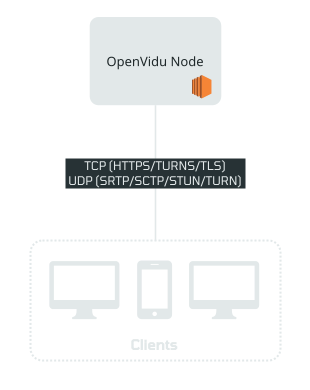

# OpenVidu Single Node installation: AWS

<div class="provider-chip" markdown>

:material-aws:{ .provider-chip-icon } AWS

</div>

One command creates the machine and OpenVidu comes up on it. `ov` renders the CloudFormation template embedded in its own binary for the edition you choose and applies it with **your own `aws` CLI**. The machine then deploys OpenVidu itself with the same `ov` build. When OpenVidu answers, `ov` registers the stack in your directory, and you operate it from there.

The deployed services are the same as in the [On Premises Single Node installation](../on-premises/install.md); on AWS the machine and its resources are created for you.

--8<-- "self-hosting/common/single-node-pro-license-intro.md"

=== "Architecture overview"

    This is what the deployment architecture looks like:

    { .round-corners .dark-img loading=lazy }

## Requirements

--8<-- "self-hosting/aws/ov-requirements.md"

## Deploy

Each stack lives in its own empty directory. Choose the edition. The commands name the stack `openvidu`; the outputs come from real runs of stacks with other names.

=== "OpenVidu **COMMUNITY**{ .openvidu-tag .openvidu-community-tag }"

    ```bash
    mkdir openvidu && cd openvidu
    ov stack deploy openvidu --cloud aws --aws-region us-east-1 \
      --certificate-type letsencrypt --mode auto
    ```

    One EC2 instance (`c6a.xlarge` by default, `--aws-instance-type` to change it) running OpenVidu on Docker Compose.

=== "OpenVidu **PRO**{ .openvidu-tag .openvidu-pro-tag }"

    ```bash
    mkdir openvidu && cd openvidu
    ov stack deploy openvidu --cloud aws --aws-region us-east-1 \
      --edition pro --openvidu-pro-license <your-license> \
      --certificate-type letsencrypt --mode auto
    ```

    One EC2 instance running OpenVidu PRO on Kubernetes. `--aws-cluster-api-cidr` limits who can reach the stack's remote admin control protocol on port 6443. That port gives full control of the stack, so do not leave it open to `0.0.0.0/0` in production.

    This is how the deploy of a stack named `pro` (in `eu-south-2`) ends: `ov` waits until OpenVidu is up, then registers the stack:

    ```text
    …
    ▶ Wait for the machines to deploy OpenVidu…
       · OpenVidu is up
       ✓ Wait for the machines to deploy OpenVidu
    …
    ✔ OpenVidu Pro (single node) is up on AWS
      URL:          https://openvidu-geepav-89-60-28-34.sslip.io/
      credentials:  aws secretsmanager get-secret-value --secret-id openvidu-eu-south-2-openvidu-pro --query SecretString --output text --region eu-south-2
    ```

## Use your own domain

--8<-- "self-hosting/aws/ov-domain.md"

## What the deploy runs

--8<-- "self-hosting/aws/ov-deploy-plan.md"

## What the deploy creates

--8<-- "self-hosting/aws/ov-resources.md"

## Access OpenVidu { #configure-your-application-to-use-the-deployment }

--8<-- "self-hosting/aws/ov-access.md"

## Review the commands first: assisted mode

--8<-- "self-hosting/aws/ov-assisted.md"

## Troubleshooting

--8<-- "self-hosting/aws/troubleshooting.md"

## Next steps

- [Administer the stack](./admin.md): change its configuration, back up its data and destroy it.
- [Build your app](../../../build-your-app/index.md) against it, or follow a [tutorial](../../../tutorials/application-server/index.md): it connects with `LIVEKIT_URL`, `LIVEKIT_API_KEY` and `LIVEKIT_API_SECRET` (`ov stack config get livekit-api-key` and `livekit-api-secret` print them).
