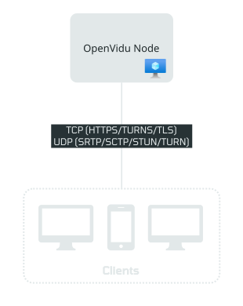

# OpenVidu Single Node installation: Azure

<div class="provider-chip" markdown>

:material-microsoft-azure:{ .provider-chip-icon } Azure

</div>

One command creates the machine and OpenVidu comes up on it. `ov` renders the Bicep template embedded in its own binary for the edition you choose and applies it with **your own `az` CLI** (which compiles the Bicep). The machine then deploys OpenVidu itself with the same `ov` build. When OpenVidu answers, `ov` registers the stack in your directory, and you operate it from there. See [how a deployment works](../../deployment-types.md#how-openvidu-is-deployed) for the shape shared by every cloud.

The deployed services are the same as in the [On Premises Single Node installation](../on-premises/install.md); on Azure, `ov` creates the infrastructure for you.

--8<-- "self-hosting/common/single-node-pro-license-intro.md"

=== "Architecture overview"

    This is what the deployment architecture looks like:

    { .round-corners .dark-img loading=lazy }

## Requirements

--8<-- "self-hosting/azure/ov-requirements.md"

## Deploy

Each stack lives in its own empty directory. Choose the edition. The commands name the stack `openvidu`; the outputs come from real runs of stacks with other names.

=== "OpenVidu **COMMUNITY**{ .openvidu-tag .openvidu-community-tag }"

    ```bash
    mkdir openvidu && cd openvidu
    ov stack deploy openvidu --cloud azure --azure-location northeurope \
      --certificate-type letsencrypt --mode auto
    ```

    One virtual machine (`Standard_D4s_v3` by default, `--param instanceType=<size>` to change it) running OpenVidu on Docker Compose.

=== "OpenVidu **PRO**{ .openvidu-tag .openvidu-pro-tag }"

    ```bash
    mkdir openvidu && cd openvidu
    ov stack deploy openvidu --cloud azure --azure-location northeurope \
      --edition pro --openvidu-pro-license <your-license> \
      --certificate-type letsencrypt --mode auto
    ```

    One virtual machine running OpenVidu PRO on Kubernetes, with OpenVidu as a Helm release. `--param kubeApiAllowedCidr=<cidr>` limits who can reach the cluster API on port 6443. That API gives full control of the stack, so do not leave it open to `0.0.0.0/0` in production.

    This is how the deploy of a stack named `dpaz1` ends: `ov` waits until the stack publishes its kubeconfig and the cluster answers, then registers it:

    ```text
    …
       · OpenVidu is up: the stack published its kubeconfig and the cluster API answers at 104.41.221.2:6443
    …
    ✔ OpenVidu Pro (single node) is up on Azure
      URL:          https://openvidu-j064da-104-41-221-2.sslip.io/
      credentials:  az keyvault secret show --vault-name openvidu-dpaz1-keyvault --name OPENVIDU-URL --query value -o tsv
      kubeconfig:   .openvidu/azure/kubeconfig.yaml
    ```

## What the deploy runs

--8<-- "self-hosting/azure/ov-deploy-plan.md"

## What the deploy creates

--8<-- "self-hosting/azure/ov-resources.md"

## Access OpenVidu { #check-deployment-outputs-in-azure-key-vault }

<span id="check-deployment-outputs-in-the-instance"></span>

--8<-- "self-hosting/azure/ov-access.md"

## Review the commands first: assisted mode

--8<-- "self-hosting/azure/ov-assisted.md"

## Troubleshooting

--8<-- "self-hosting/azure/troubleshooting.md"

## Next steps

- [Administer the deployment](./admin.md): change a parameter, operate it from another machine, destroy it.
- [Build your app](../../../build-your-app/index.md) against it, or follow a [tutorial](../../../tutorials/application-server/index.md): it connects with `LIVEKIT_URL`, `LIVEKIT_API_KEY` and `LIVEKIT_API_SECRET` (`ov stack config get livekit-api-key` and `livekit-api-secret` print them).
