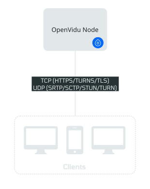

# OpenVidu Single Node installation: DigitalOcean

<div class="provider-chip" markdown>

:material-digital-ocean:{ .provider-chip-icon } DigitalOcean

</div>

One command creates the machine and OpenVidu comes up on it. `ov` renders the Terraform module embedded in its own binary for the Single Node topology and the edition you choose, and applies it with **your own `terraform` and your API token**. The Droplet then deploys OpenVidu itself with the same `ov` build. When OpenVidu answers, `ov` registers the stack in your directory, and you operate it from there.

--8<-- "self-hosting/common/single-node-pro-license-intro.md"

=== "Architecture overview"

    This is what the deployment architecture looks like:

    { .round-corners .dark-img loading=lazy }

## Requirements

--8<-- "self-hosting/digitalocean/ov-requirements.md"

## Deploy

Each stack lives in its own empty directory. Choose the edition. The commands name the stack `openvidu`; the outputs come from real runs of stacks with other names.

=== "OpenVidu **COMMUNITY**{ .openvidu-tag .openvidu-community-tag }"

    ```bash
    mkdir openvidu && cd openvidu
    ov stack deploy openvidu --cloud digitalocean \
      --certificate-type letsencrypt --mode auto
    ```

    One Droplet (`s-4vcpu-8gb` by default: 4 vCPU, 8 GB, 160 GB disk; `--param instanceType=<slug>` to change it) running OpenVidu on Docker Compose.

=== "OpenVidu **PRO**{ .openvidu-tag .openvidu-pro-tag }"

    ```bash
    mkdir openvidu && cd openvidu
    ov stack deploy openvidu --cloud digitalocean \
      --edition pro --openvidu-pro-license <your-license> \
      --certificate-type letsencrypt --mode auto
    ```

    One Droplet running OpenVidu PRO on Kubernetes. `--param clusterApiAllowedCidr=<cidr>` limits who can reach port 6443, the stack's remote admin control protocol. That port gives full control of the stack, so do not leave it open to `0.0.0.0/0` in production.

    This is how the deploy of a stack named `dpdo1` ends: `ov` waits until OpenVidu is up, then registers the stack:

    ```text
    ▶ Wait for the machines to deploy OpenVidu…
       · waiting for OpenVidu to come up (1s elapsed): the published values are not readable yet: secrets.env is not in the Space openvidu-dpdo1-space-ef16b466b1 yet (the machine writes it as it installs)
       · waiting for OpenVidu to come up (1m5s elapsed): OpenVidu is still installing
       · OpenVidu is up
       ✓ Wait for the machines to deploy OpenVidu
    …
    ✔ OpenVidu Pro (single node) is up on DigitalOcean
      URL:          https://openvidu-wakvlb-188-166-126-9.sslip.io/
      credentials:  env AWS_ACCESS_KEY_ID=$SPACES_ACCESS_KEY_ID AWS_SECRET_ACCESS_KEY=$SPACES_SECRET_ACCESS_KEY AWS_SESSION_TOKEN= aws s3 cp s3://openvidu-dpdo1-space-ef16b466b1/secrets.env - --endpoint-url https://ams3.digitaloceanspaces.com
    ```

## Use your own domain

--8<-- "self-hosting/digitalocean/ov-domain.md"

## What the deploy runs

--8<-- "self-hosting/digitalocean/ov-deploy-plan.md"

## What the deploy creates

--8<-- "self-hosting/digitalocean/ov-resources.md"

## Access OpenVidu

--8<-- "self-hosting/digitalocean/ov-access.md"

## Review the commands first: assisted mode

--8<-- "self-hosting/digitalocean/ov-assisted.md"

## Troubleshooting

--8<-- "self-hosting/digitalocean/troubleshooting.md"

## Next steps

- [Administer the stack](./admin.md): change a parameter, operate it from another machine, destroy it.
- [Build your app](../../../build-your-app/index.md) against it, or follow a [tutorial](../../../tutorials/application-server/index.md): it connects with `LIVEKIT_URL`, `LIVEKIT_API_KEY` and `LIVEKIT_API_SECRET`.
