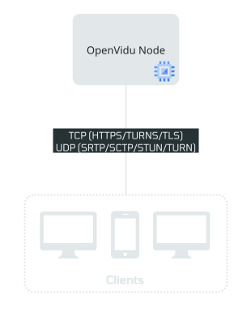

# OpenVidu Single Node installation: Google Cloud Platform

<div class="provider-chip" markdown>

:material-google-cloud:{ .provider-chip-icon } Google Cloud Platform

</div>

One command creates the machine and OpenVidu comes up on it. `ov` renders the Terraform module embedded in its own binary for the edition and topology you choose and applies it with **your own `terraform` and your `gcloud` credentials**. The machine then deploys OpenVidu itself with the same `ov` build. When OpenVidu answers, `ov` registers the stack in your directory, and you operate it from there.

--8<-- "self-hosting/common/single-node-pro-license-intro.md"

=== "Architecture overview"

    This is what the deployment architecture looks like:

    { .round-corners .dark-img loading=lazy }

## Requirements { #requirements }

--8<-- "self-hosting/gcp/ov-requirements.md"

## Deploy { #deploy }

Each stack lives in its own empty directory. Choose the edition. The commands name the stack `openvidu`; the outputs come from real runs of stacks with other names.

=== "OpenVidu **COMMUNITY**{ .openvidu-tag .openvidu-community-tag }"

    ```bash
    mkdir openvidu && cd openvidu
    ov stack deploy openvidu --cloud gcp --gcp-project my-project \
      --certificate-type letsencrypt --mode auto
    ```

    One Compute Engine instance (`e2-standard-4` by default, `--param instanceType=<type>` to change it) running OpenVidu on Docker Compose.

=== "OpenVidu **PRO**{ .openvidu-tag .openvidu-pro-tag }"

    ```bash
    mkdir openvidu && cd openvidu
    ov stack deploy openvidu --cloud gcp --gcp-project my-project \
      --edition pro --openvidu-pro-license <your-license> \
      --certificate-type letsencrypt --mode auto
    ```

    One Compute Engine instance running OpenVidu PRO on Kubernetes. `--param clusterApiAllowedCidr=<cidr>` limits who can reach port 6443, the port your machine administers the stack through. That port gives full control of the stack, so do not leave it open to `0.0.0.0/0` in production.

    This is how the deploy of a stack named `dpgcp1` ends: `ov` waits until OpenVidu is up, then registers the stack:

    ```text
    …
       · waiting for OpenVidu to come up (1m12s elapsed): OpenVidu is still installing
       · OpenVidu is up
    …
    ✔ OpenVidu Pro (single node) is up on Google Cloud
      URL:          https://openvidu-eos260-35-234-130-186.sslip.io/
      credentials:  gcloud secrets versions access latest --secret=openvidu-dpgcp1-OPENVIDU_URL --project=my-project  (every secret starts with openvidu-dpgcp1-)
    ```

## Use your own domain { #use-your-own-domain }

--8<-- "self-hosting/gcp/ov-domain.md"

## What the deploy runs { #what-the-deploy-runs }

--8<-- "self-hosting/gcp/ov-deploy-plan.md"

## What the deploy creates { #what-the-deploy-creates }

--8<-- "self-hosting/gcp/ov-resources.md"

## Access OpenVidu { #access-openvidu }

--8<-- "self-hosting/gcp/ov-access.md"

## Review the commands first: assisted mode { #assisted-mode }

--8<-- "self-hosting/gcp/ov-assisted.md"

## Troubleshooting { #troubleshooting }

--8<-- "self-hosting/gcp/troubleshooting.md"

## Next steps { #next-steps }

- [Administer the stack](./admin.md): change a parameter, operate it from another machine and destroy it.
- [Build your app](../../../build-your-app/index.md) against it, or follow a [tutorial](../../../tutorials/application-server/index.md): it connects with `LIVEKIT_URL`, `LIVEKIT_API_KEY` and `LIVEKIT_API_SECRET` (`ov stack config get livekit-api-key` and `livekit-api-secret` print them).
