# OpenVidu Single Node installation: On-premises

<div class="provider-chip" markdown>

:material-server:{ .provider-chip-icon } On-premises

</div>


Deploy OpenVidu Single Node on your own Linux server with the [OpenVidu CLI](../../openvidu-cli.md) (`ov`). `ov` installs and starts the stack over SSH, or on the machine it runs on, and generates every credential. **The edition is the only decision you make**: `--edition community` (the default) or `--edition pro`. [How OpenVidu is deployed](../../deployment-types.md#how-openvidu-is-deployed) explains the model.

--8<-- "self-hosting/common/single-node-pro-license-intro.md"

=== "Architecture overview"

    This is what the deployment architecture looks like:

    { .round-corners .dark-img loading=lazy }

All services are deployed on a single machine, which includes:

- **OpenVidu Server (LiveKit compatible)**.
- **Ingress** and **Egress** services.
- **OpenVidu Dashboard**, a web application interface to visualize your Rooms, Ingress, and Egress services.
- **MinIO** as an S3 storage service for recordings.
- **Redis** as a shared database for OpenVidu Server and Ingress/Egress services.
- **MongoDB** as a database for storing analytics and monitoring data.
- **Caddy** as a reverse proxy. It can be deployed with self-signed certificates, Let's Encrypt certificates, or custom certificates.
- **[OpenVidu Meet](../../../../meet/index.md)**, an optional high-quality video calling service.
- **Grafana, Mimir, Alloy, and Loki (Observability module)** form an optional observability stack for monitoring, allowing you to keep track of logs and deployment statistics for OpenVidu.
- **OpenVidu V2 Compatibility (v2compatibility module)** **PRO**{ .openvidu-tag .openvidu-pro-tag } is an optional service that provides an API designed to maintain compatibility for applications developed with OpenVidu version 2.

## Requirements { #requirements }

- One **Linux server** (Ubuntu recommended), with at least **4 CPU cores and 4 GB of RAM** for Community, and generous disk (100 GB recommended) if you record sessions. For PRO, which runs Kubernetes, at least **8 GB of RAM**, 16 GB recommended. With speech to text from a local provider (`vosk` or `sherpa` in the [speech processing agent](../../../ai/live-captions.md)), give the server 8 to 16 GB. These figures are estimates, not measured limits.
- A sudo-capable user on the server, reachable over SSH. Nothing else needs to be pre-installed: the deploy brings Docker and the Compose plugin (Community) or the OpenVidu node agent (PRO) when they are missing.
- A **domain** pointing at the server, and a **certificate type**:
    - `letsencrypt` or `zerossl`: a certificate obtained automatically (requires port 80 to be reachable).
    - `owncert`: bring your own, with `--owncert-public-key` and `--owncert-private-key`.
    - `selfsigned`: for a throwaway deployment.

    A server without a `--domain-name`, if it has a public IPv4 address, derives an `sslip.io` name from it so Let's Encrypt has a name to certify.
- The [ports OpenVidu needs](#port-rules) reachable. `ov` checks them before it installs anything ([Check the ports first](#check-the-ports)).
- The [OpenVidu CLI](../../openvidu-cli.md#install-the-openvidu-cli) on the machine you deploy from.
- For PRO, your **OpenVidu PRO license** (`--openvidu-pro-license`): [create an OpenVidu account :fontawesome-solid-external-link:{.external-link-icon}](../../../../account.md){:target="_blank"} to get one; there is a 15-day free trial.

## Port rules { #port-rules }

These are the inbound ports `ov` checks on a single node, with the names `ov` prints for them. Open them in your firewall, security group, or any network configuration on the machine.

=== "OpenVidu **COMMUNITY**{ .openvidu-tag .openvidu-community-tag }"

    | Port | Scope | Level | Description |
    | --- | --- | --- | --- |
    | `443/tcp` | public | required | Caddy: LiveKit API, OpenVidu Dashboard, OpenVidu Meet, WHIP API, TURN with TLS, custom layouts. |
    | `443/udp` | public | recommended | OpenVidu LiveKit Server: STUN/TURN over UDP. |
    | `80/tcp` | public | recommended | Caddy: HTTP-to-HTTPS redirect and Let's Encrypt validation. |
    | `50000-60000/udp` | public | recommended | OpenVidu LiveKit Server: WebRTC media over UDP. |
    | `7881/tcp` | public | recommended | OpenVidu LiveKit Server: WebRTC media over TCP (fallback when UDP is blocked). |
    | `22/tcp` | admin | required | SSH: the port `ov` administers the stack through. |

=== "OpenVidu **PRO**{ .openvidu-tag .openvidu-pro-tag }"

    | Port | Scope | Level | Description |
    | --- | --- | --- | --- |
    | `443/tcp` | public | required | Caddy: LiveKit API, OpenVidu Dashboard, OpenVidu Meet, WHIP API, TURN with TLS, custom layouts. |
    | `443/udp` | public | recommended | OpenVidu LiveKit Server: STUN/TURN over UDP. |
    | `80/tcp` | public | recommended | Caddy: HTTP-to-HTTPS redirect and Let's Encrypt validation. |
    | `50000-60000/udp` | public | recommended | OpenVidu LiveKit Server: WebRTC media over UDP. |
    | `7881/tcp` | public | recommended | OpenVidu LiveKit Server: WebRTC media over TCP (fallback when UDP is blocked). |
    | `6443/tcp` | admin | required | Stack remote admin control protocol: the port your machine administers the PRO stack through. |
    | `22/tcp` | admin | required | SSH: the port `ov` reaches the node through to install it. |

    On PRO, the node's own firewall must also let the pod networks `10.42.0.0/16` and `10.43.0.0/16` reach it, or the pods cannot reach the cluster API, LiveKit or the kubelet.

With the `ingress` module, also open `1935/tcp` (RTMP ingest) and `7885/udp` (WHIP). Outbound traffic is typically all allowed.

## Check the ports first { #check-the-ports }

The most common reason an on-premises OpenVidu "does not work" is a stack that comes up perfectly but has no media, because UDP never reaches the node. `ov stack check-ports` finds that in seconds, **before deploying anything**, for TCP *and* UDP:

```console
$ ov stack check-ports --ssh ubuntu@172.30.0.96 --ssh-key ~/.ssh/id_ed25519 \
    --domain-name 172-30-0-96.openvidu-local.dev
checking the inbound ports of 172.30.0.96…
…
  verdict   3 of 6 checked port(s) do NOT reach the node: 443/udp, 50000-60000/udp, 7881/tcp

Required
  the stack does not work without these
  ✓ 443/tcp           open
      Caddy — the probe arrived at the node — the whole path is open
  ✓ 22/tcp            open
      SSH — ov is connected to the node over SSH

Recommended
  it works without these, but every call is worse
  ! 443/udp           dropped · host-firewall
      OpenVidu LiveKit Server — the ufw firewall on the node drops it (deny (incoming), allow (outgoing), allow (routed))
      Participants behind restrictive networks are relayed over TURN/TLS on 443/tcp instead of UDP.
      fix (on the node): sudo ufw allow 443/udp
  ! 50000-60000/udp   dropped · host-firewall
      OpenVidu LiveKit Server — the ufw firewall on the node drops it (deny (incoming), allow (outgoing), allow (routed)) [sampled: 50000, 52500, 55000, 57500, 60000]
      Media is relayed through TURN on 443, which adds latency and load and lowers quality under load.
      fix (on the node): sudo ufw allow 50000:60000/udp
…
```

The fix is printed, never run: `ov` does not change firewalls. The same check runs automatically before every remote deploy. See [Ports](admin.md#ports) to run it on a running stack.

## Deploy

Each stack lives in its own empty directory on your machine. Choose the edition. The examples use a domain that resolves to a private address, so they bring their own certificate (`owncert`; a path to a PEM file, a base64 PEM or the PEM itself), kept here in `~/certs/`. On a server reachable from the internet on port 80, `--certificate-type letsencrypt` obtains one automatically, and `selfsigned` is enough for a throwaway deployment.

=== "OpenVidu **COMMUNITY**{ .openvidu-tag .openvidu-community-tag }"

    ```console
    $ mkdir ov-ce && cd ov-ce
    $ ov stack deploy web \
      --environment on-premises \
      --ssh ubuntu@172.30.0.96 --ssh-key ~/.ssh/id_ed25519 \
      --domain-name 172-30-0-96.openvidu-local.dev \
      --certificate-type owncert \
      --owncert-public-key ~/certs/fullchain.pem --owncert-private-key ~/certs/privkey.pem \
      --mode auto
    note: generated 11 credential(s) and pinned them in this stack's spec, so a later deploy reuses them instead of replacing them: livekit-api-key, livekit-api-secret, redis-password, minio-access-key, minio-secret-key, mongo-admin-password, mongo-replica-set-key, dashboard-admin-password, grafana-admin-password, meet-initial-admin-password, meet-initial-api-key
    checking the inbound ports before installing anything…
      Ports of 172.30.0.96 (Community single node)
      PORT             SCOPE   LEVEL        STATE  TO OPEN
      443/tcp          public  required     open
      443/udp          public  recommended  open
      80/tcp           public  recommended  open
      50000-60000/udp  public  recommended  open
      7881/tcp         public  recommended  open
      22/tcp           admin   required     open
      all 6 checked port(s) arrive at the node
    …
    ✓ [172.30.0.96 single] write 44 files to /opt/openvidu (docker-compose.yaml, config/, .ov/base/)
    …
    ✓ [172.30.0.96 single] systemctl restart openvidu
    deploy completed successfully
    wrote spec to openvidu-stack.yml
    ✔ stack "web" recorded in this directory
    ✔ published /opt/openvidu/stack/context.yaml (recover this stack's directory elsewhere with `ov stack import --ssh ubuntu@<host>`)
    ✔ the node operates this stack itself (`sudo ov stack status` there)
    waiting for OpenVidu to be ready on the node (Ctrl-C to stop waiting; the deployment keeps running)…
      ⏳ still starting: caddy, openvidu, dashboard, meet, grafana (0s)
      …
    ✔ OpenVidu is ready at https://172-30-0-96.openvidu-local.dev (caddy, openvidu, dashboard, meet, grafana)
    …
    ```

    Every credential is generated and **pinned** in `openvidu-stack.yml`, so a later deploy reuses them instead of locking the stack out of its data. Keep that file private.

=== "OpenVidu **PRO**{ .openvidu-tag .openvidu-pro-tag }"

    The only difference from Community is `--edition pro` and the license; everything else follows from it.

    ```console
    $ mkdir ov-pro && cd ov-pro
    $ ov stack deploy prod \
      --edition pro --environment on-premises \
      --ssh ubuntu@172.30.0.101 --ssh-key ~/.ssh/id_ed25519 \
      --openvidu-pro-license <your-license> \
      --domain-name 172-30-0-101.openvidu-local.dev \
      --certificate-type owncert --owncert-public-key ~/certs/fullchain.pem --owncert-private-key ~/certs/privkey.pem \
      --mode auto

    ▶ Connect to the VM…
       ✓ Connect to the VM

    ▶ Check the inbound ports…
       ✓ Check the inbound ports

    ▶ Install the OpenVidu node agent…
       ✓ Install the OpenVidu node agent

    ▶ Deploy OpenVidu…
       ✓ Deploy OpenVidu

    ▶ Leave the OpenVidu CLI on the node…
       ✓ Leave the OpenVidu CLI on the node

    ▶ Check access from outside…
       ✓ Check access from outside

    ✔ deploy completed.
    wrote spec to openvidu-stack.yml
    ✔ stack "prod" recorded in this directory
    …
    ```

    The node needs nothing pre-installed. Services come up over a few minutes after the deploy returns; [`ov stack status --wait`](admin.md#status) blocks until they are ready.

### The port preflight { #the-port-preflight }

A remote deploy checks the node's ports before installing anything. If a **required** port is closed, it stops (exit `6`) and prints the rule to add; a recommended port only warns. `--skip-port-check` deploys without the check.

### Deploying again { #deploying-again }

A deploy to a node that already runs the same stack says so and keeps its data: it rewrites `docker-compose.yaml` and `config/` from `openvidu-stack.yml` (your `docker-compose.override.yaml` stays) and reuses the credentials the data was written with. If it cannot read the node's configuration, it stops before writing anything and says how to fix it:

```text
172.30.0.96 already runs OpenVidu on 172-30-0-96.openvidu-local.dev (currently stopped). Deploying again rewrites its files from the spec and restarts it.
  · Its docker-compose.yaml and config/ are rewritten from the spec you are deploying; docker-compose.override.yaml is kept.
  · Its data is kept — nothing deletes MongoDB, MinIO or recordings.
  · The credentials in your spec are reused, so the kept data stays readable.
```

A PRO deploy refuses a machine that already runs another OpenVidu stack (a Community one, or another topology): destroy that stack first. A deployment installed by `install.sh` is converted with [`ov stack update`](../upgrade.md#migrate-a-deployment-installed-by-installsh) instead.

A remote deploy asks which mode to use unless you pass `--mode auto` or `--mode assisted`; with `--non-interactive`, `--mode` is required.

## Install on the server itself { #install-on-the-server-itself }

Instead of `--ssh`, put `ov` on the server, log in, and deploy with **`--this-node`** (*the machine I am running on*). The CLI writes the deployment there and escalates with `sudo`, so a user with passwordless sudo is enough. A `--this-node` stack lives in `/opt/openvidu/stack`:

```console
$ sudo ov stack deploy web --environment on-premises --this-node \
  --domain-name 172-30-0-96.openvidu-local.dev \
  --certificate-type selfsigned
…
✔ OpenVidu is ready at https://172-30-0-96.openvidu-local.dev (caddy, openvidu, dashboard, meet, grafana)
```

Either way, a deploy leaves `ov` and a stack directory on the node, so `sudo ov stack status` works there with no directory to name.

## Review the commands first: assisted mode { #assisted-mode }

`--mode assisted` runs **nothing** on the server. It writes the files and prints the runbook, step by step, for you to review and run yourself. Add it to any deploy above:

```bash
ov stack deploy web --environment on-premises --ssh ubuntu@172.30.0.96 --ssh-key ~/.ssh/id_ed25519 \
  --domain-name 172-30-0-96.openvidu-local.dev --certificate-type selfsigned --mode assisted
```

The runbook is the `ssh`, `scp` and `ov` commands that carry out the deploy, ending with the ones that record the stack in this directory and wait for it.

## Configure your application to use the deployment

Your application connects with `LIVEKIT_URL`, `LIVEKIT_API_KEY` and `LIVEKIT_API_SECRET`. Read them from the stack with `ov stack config get`, from the stack's directory:

```bash
ov stack config get livekit-api-key
ov stack config get livekit-api-secret
```

`LIVEKIT_URL` is your domain as `wss://yourdomain.example.io/` or `https://yourdomain.example.io/`, depending on the client library you use. `config get` prints secrets in plain text; [`ov stack config view`](../../configuration/changing-config.md#view-get-set-unset) prints the whole configuration with secrets masked.

For OpenVidu Meet, `MEET_INITIAL_API_KEY` (`ov stack config get meet-initial-api-key`) is the key for OpenVidu Meet Embedded and the OpenVidu Meet REST API; the initial admin user is always `admin`. On PRO, the OpenVidu V2 Compatibility API uses the basic-auth user `OPENVIDUAPP` with the password `LIVEKIT_API_SECRET`.

## Next steps

- [Build your app](../../../build-your-app/index.md) against it, or follow a [tutorial](../../../tutorials/application-server/index.md).
- [Administer the deployment](admin.md): status, logs, the health check, start and stop.
- [Change the configuration](../../configuration/changing-config.md) or [the modules](../../how-to-guides/enable-disable-modules.md).
- [Update the deployment](../upgrade.md).
- The [OpenVidu CLI commands](../../openvidu-cli.md#command-reference).
