# OpenVidu Single Node installation: Oracle Cloud Infrastructure

--8<-- "self-hosting/oracle/provider-chip.md"

One command creates the machine and OpenVidu comes up on it. `ov` renders the Terraform module embedded in its own binary for the edition you choose and applies it with **your own `terraform` and your OCI API key**. The machine then deploys OpenVidu on itself with the same `ov` build. When OpenVidu answers, `ov` registers the stack in your directory, and you operate it from there.

Community runs on Docker Compose; PRO runs on Kubernetes. The edition is the only decision you make: `--edition community` (the default) or `--edition pro`.

--8<-- "self-hosting/common/single-node-pro-license-intro.md"

=== "Architecture overview"

    { .round-corners .dark-img loading=lazy }

## Requirements { #requirements }

--8<-- "self-hosting/oracle/ov-requirements.md"

## Deploy { #deploy }

The stack lives in its own empty directory. Choose the edition. The commands name the stack `openvidu`; the outputs come from real runs of stacks with other names.

=== "OpenVidu **COMMUNITY**{ .openvidu-tag .openvidu-community-tag }"

    ```bash
    export OCI_COMPARTMENT_OCID=ocid1.compartment.oc1..<compartment>
    mkdir openvidu && cd openvidu
    ov stack deploy openvidu --cloud oracle --oci-region eu-madrid-1 \
      --certificate-type letsencrypt --mode auto
    ```

    One compute instance (`VM.Standard.E4.Flex` with 4 OCPUs and 8 GB by default, `--param instanceType=<shape>` to change it) running OpenVidu on Docker Compose.

=== "OpenVidu **PRO**{ .openvidu-tag .openvidu-pro-tag }"

    ```bash
    export OCI_COMPARTMENT_OCID=ocid1.compartment.oc1..<compartment>
    mkdir openvidu && cd openvidu
    ov stack deploy openvidu --cloud oracle --oci-region eu-madrid-1 \
      --edition pro --openvidu-pro-license <your-license> \
      --certificate-type letsencrypt --mode auto
    ```

    One compute instance running OpenVidu PRO on Kubernetes. `--param clusterApiAllowedCidr=<cidr>` limits who can reach port 6443, the stack's remote admin control protocol, where `ov` administers it from your machine. It gives full control of the stack, so do not leave it open to `0.0.0.0/0` in production.

## Use your own domain { #use-your-own-domain }

--8<-- "self-hosting/oracle/ov-domain.md"

## What the deploy runs { #what-the-deploy-runs }

--8<-- "self-hosting/oracle/ov-deploy-plan.md"

## What the deploy creates { #what-the-deploy-creates }

--8<-- "self-hosting/oracle/ov-resources.md"

## Access OpenVidu { #access-openvidu }

--8<-- "self-hosting/oracle/ov-access.md"

## Review the commands first: assisted mode { #assisted-mode }

--8<-- "self-hosting/oracle/ov-assisted.md"

## Troubleshooting { #troubleshooting }

--8<-- "self-hosting/oracle/troubleshooting.md"

## Next steps { #next-steps }

- [Administer the stack](./admin.md): change a parameter, operate it from another machine, destroy it.
- [Build your app](../../../build-your-app/index.md) against it: it connects with `LIVEKIT_URL`, `LIVEKIT_API_KEY` and `LIVEKIT_API_SECRET` (`ov stack config get livekit-api-key` and `livekit-api-secret` print them).
