<section class="ov-wrap ov-doors" aria-label="Choose a product" data-sal="slide-up">
  

    

      OpenVidu Meet
      Customizable ready-made app
    

    <h2 class="ov-door__title">A finished meeting app. Customizable. Embed it today.</h2>
    
Rooms, recordings, roles and your branding, out of the box. Drop it into your product with one tag, a REST API and webhooks.

    

      <a href="/meet/" class="ov-btn ov-btn--meet-ink" title="Get started with OpenVidu Meet">Deploy Meet<svg width="18" height="18" viewBox="0 0 24 24" fill="none" stroke="currentColor" stroke-width="2.2" stroke-linecap="round" stroke-linejoin="round" aria-hidden="true"><path d="M5 12h14M13 6l6 6-6 6"></path></svg></a>
      <a href="https://meet-demo-app.openvidu.io" class="ov-link" target="_blank" title="Try the OpenVidu Meet demo (opens in a new tab)">Try the live demo</a>
    

    

      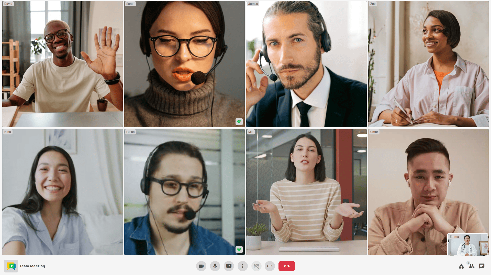
      
    

  

  

    

      OpenVidu Platform
      SDKs and APIs
    

    <h2 class="ov-door__title">The raw engine. Build anything.</h2>
    
Client and server SDKs from our LiveKit fork, for every major language, with full control over tracks, codecs and layouts.

    

      

        

<pre class="ov-code__pre">import { Room } from "livekit-client";

const room = new Room();
await room.connect("wss://your-deployment", token);
await room.localParticipant
  .enableCameraAndMicrophone();</pre>
      

    

    
Build it with your AI coding agent: the <a href="/docs/building-with-ai/agent-plugin/">OpenVidu Agent Plugin</a> puts this documentation inside Claude Code, Cursor, VS Code, Copilot, Codex or Kiro.

    

      <a href="/docs/" class="ov-btn ov-btn--white" title="Build with OpenVidu Platform SDKs">Start building<svg width="18" height="18" viewBox="0 0 24 24" fill="none" stroke="currentColor" stroke-width="2.2" stroke-linecap="round" stroke-linejoin="round" aria-hidden="true"><path d="M5 12h14M13 6l6 6-6 6"></path></svg></a>
      <a href="/docs/tutorials/application-server/" class="ov-link" title="OpenVidu Platform tutorials">Browse tutorials</a>
    

  

</section>

Not sure which door? <a href="/openvidu-meet-vs-openvidu-platform/">Compare Meet and Platform</a>

<section class="ov-wrap ov-section ov-shared" aria-label="What both share" data-sal="slide-up">
  
Same engine behind both doors

  

    
Self-hostedYour servers, your users' data. Nothing routes through us.

    
Any cloudAWS, Azure, Google Cloud, DigitalOcean, Oracle Cloud or on-premises.

    
LiveKit compatibleFamiliar APIs and SDKs, with mediasoup at the core.

    
Open sourceCOMMUNITY is free under Apache 2.0. PRO when you scale.

  

</section>

<section class="ov-wrap ov-section ov-cases" data-sal="slide-up">
  <h2 class="ov-h2">What are you building?</h2>
  

    <button type="button" class="ov-case" aria-pressed="true">Telehealth</button>
    <button type="button" class="ov-case" aria-pressed="false">Online classes</button>
    <button type="button" class="ov-case" aria-pressed="false">Customer support</button>
    <button type="button" class="ov-case" aria-pressed="false">Live events</button>
    <button type="button" class="ov-case" aria-pressed="false">Cameras and drones</button>
    <button type="button" class="ov-case" aria-pressed="false">AI voice agents</button>
  

  

    

      Best fit: OpenVidu Meet
      
Patient calls that never leave your servers.

      
Embed the consultation room in your patient portal with one tag, and control who can join, record or share.

      <a href="/meet/" class="ov-btn ov-btn--ink">Deploy OpenVidu Meet<svg width="18" height="18" viewBox="0 0 24 24" fill="none" stroke="currentColor" stroke-width="2.2" stroke-linecap="round" stroke-linejoin="round" aria-hidden="true"><path d="M5 12h14M13 6l6 6-6 6"></path></svg></a>
    

    

      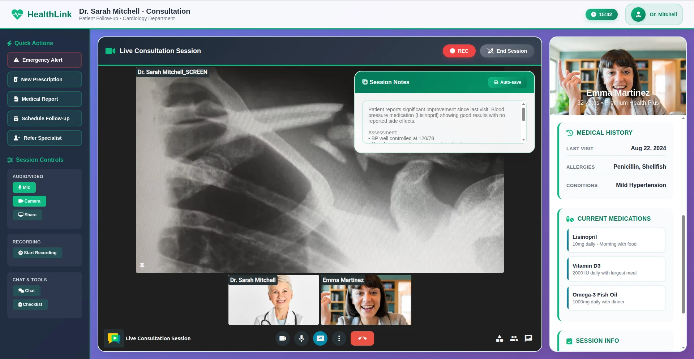
      <ul class="ov-feats" aria-label="Features used">
        <li class="ov-feat">Embed with one tag</li>
        <li class="ov-feat">Roles and permissions</li>
        <li class="ov-feat">Recording</li>
        <li class="ov-feat">End-to-end encryption</li>
      </ul>
    

  

  

    

      Best fit: OpenVidu Meet
      
A classroom with recording, screen sharing and raised hands.

      
Moderation, roles and recordings come ready. Brand it with your school colors.

      <a href="/meet/" class="ov-btn ov-btn--ink">Deploy OpenVidu Meet<svg width="18" height="18" viewBox="0 0 24 24" fill="none" stroke="currentColor" stroke-width="2.2" stroke-linecap="round" stroke-linejoin="round" aria-hidden="true"><path d="M5 12h14M13 6l6 6-6 6"></path></svg></a>
    

    

      
      
      <ul class="ov-feats" aria-label="Features used">
        <li class="ov-feat">Recording</li>
        <li class="ov-feat">Screen sharing</li>
        <li class="ov-feat">Raise hand</li>
        <li class="ov-feat">Virtual backgrounds</li>
        <li class="ov-feat">Your branding</li>
      </ul>
    

  

  

    

      Best fit: OpenVidu Meet
      
Turn a support ticket into a video call with a link.

      
Create rooms from your help desk through the REST API, and get webhooks when calls start, end or get recorded.

      <a href="/meet/" class="ov-btn ov-btn--ink">Deploy OpenVidu Meet<svg width="18" height="18" viewBox="0 0 24 24" fill="none" stroke="currentColor" stroke-width="2.2" stroke-linecap="round" stroke-linejoin="round" aria-hidden="true"><path d="M5 12h14M13 6l6 6-6 6"></path></svg></a>
    

    

      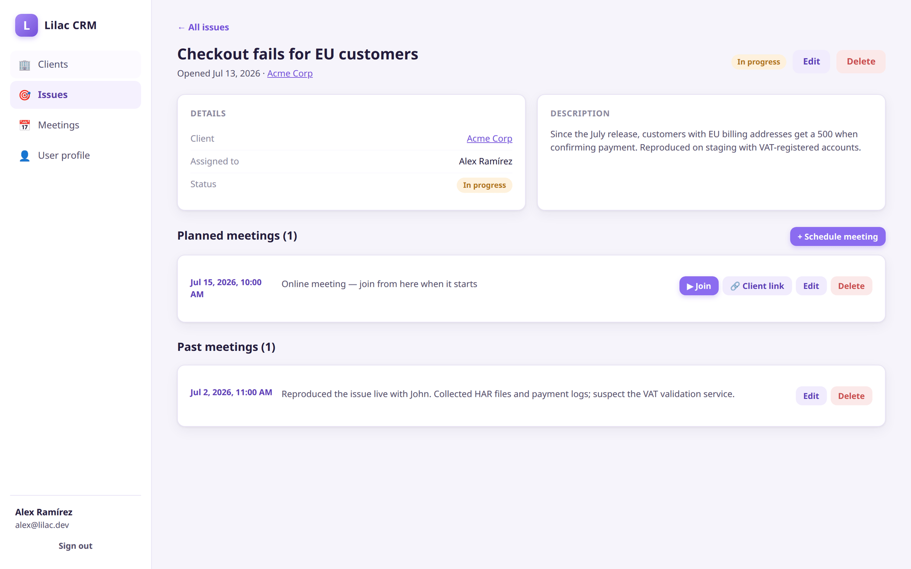
      <ul class="ov-feats" aria-label="Features used">
        <li class="ov-feat">REST API</li>
        <li class="ov-feat">Webhooks</li>
        <li class="ov-feat">Shareable links</li>
        <li class="ov-feat">Recordings</li>
      </ul>
    

  

  

    

      Best fit: OpenVidu Platform
      
Low-latency streams for hundreds of viewers.

      
Control every track and layout, and broadcast to YouTube or Twitch at the same time.

      <a href="/docs/" class="ov-btn ov-btn--ink">Build with OpenVidu Platform<svg width="18" height="18" viewBox="0 0 24 24" fill="none" stroke="currentColor" stroke-width="2.2" stroke-linecap="round" stroke-linejoin="round" aria-hidden="true"><path d="M5 12h14M13 6l6 6-6 6"></path></svg></a>
    

    

      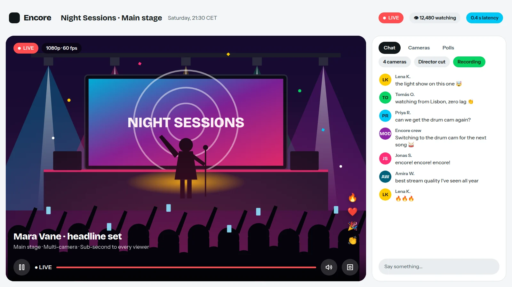
      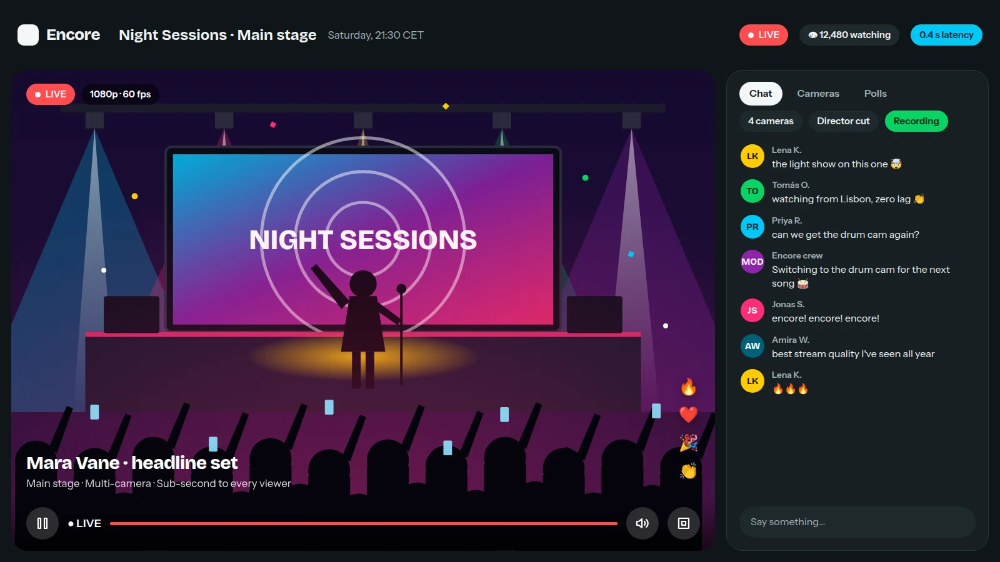
      <ul class="ov-feats" aria-label="Features used">
        <li class="ov-feat">WHIP ingest</li>
        <li class="ov-feat">Sub-second latency</li>
        <li class="ov-feat">Simulcast</li>
        <li class="ov-feat">RTMP out to YouTube and Twitch</li>
      </ul>
    

  

  

    

      Best fit: OpenVidu Platform
      
Ingest and process camera feeds in real time.

      
Bring in external streams and run server-side pipelines on the video and audio.

      <a href="/docs/" class="ov-btn ov-btn--ink">Build with OpenVidu Platform<svg width="18" height="18" viewBox="0 0 24 24" fill="none" stroke="currentColor" stroke-width="2.2" stroke-linecap="round" stroke-linejoin="round" aria-hidden="true"><path d="M5 12h14M13 6l6 6-6 6"></path></svg></a>
    

    

      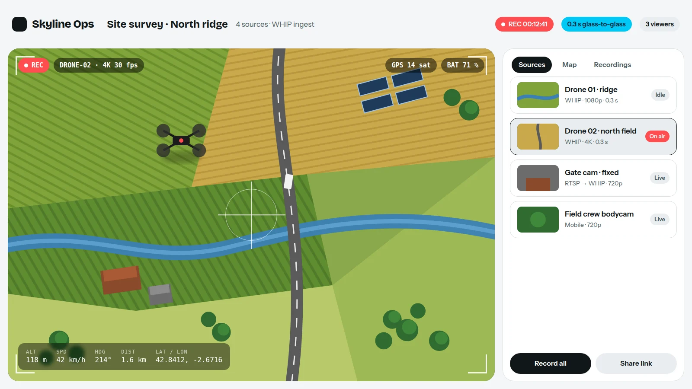
      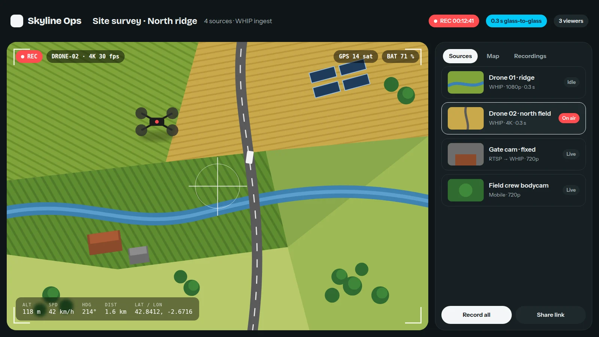
      <ul class="ov-feats" aria-label="Features used">
        <li class="ov-feat">WHIP and RTMP ingest</li>
        <li class="ov-feat">Server-side pipelines</li>
        <li class="ov-feat">Python and Node agents</li>
        <li class="ov-feat">Any codec</li>
      </ul>
    

  

  

    

      Best fit: OpenVidu Platform
      
Put an AI agent in the room.

      
Transcription, voice assistants and telephony, built on the same SDKs as the rest of your app.

      <a href="/docs/" class="ov-btn ov-btn--ink">Build with OpenVidu Platform<svg width="18" height="18" viewBox="0 0 24 24" fill="none" stroke="currentColor" stroke-width="2.2" stroke-linecap="round" stroke-linejoin="round" aria-hidden="true"><path d="M5 12h14M13 6l6 6-6 6"></path></svg></a>
    

    

      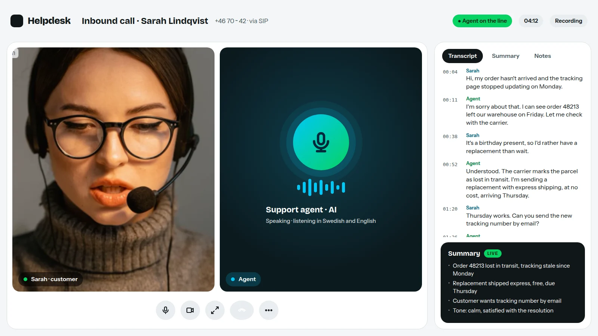
      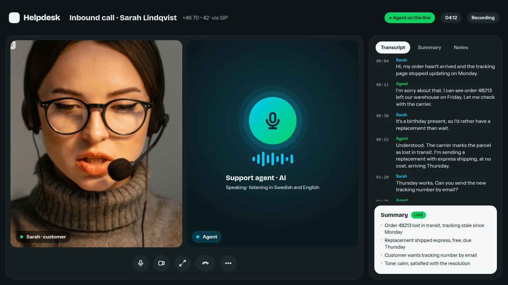
      <ul class="ov-feats" aria-label="Features used">
        <li class="ov-feat">Live transcription</li>
        <li class="ov-feat">Voice agents</li>
        <li class="ov-feat">SIP telephony</li>
        <li class="ov-feat">Agents framework</li>
      </ul>
    

  

</section>

<section class="ov-wrap ov-section ov-deploy" id="deploy" data-sal="slide-up">
  

    <h2 class="ov-h2 ov-deploy__title">Deploy where you already run.</h2>
    
Ready-made templates for every major cloud, or one installer for your own servers. Your users' data never leaves your infrastructure.

  

  

    <a class="ov-provider ov-provider--onprem" role="listitem" href="/docs/self-hosting/single-node/on-premises/install/"><svg width="28" height="31" viewBox="2 1 20 22" aria-hidden="true"><path d="M4 1h16a1 1 0 0 1 1 1v4a1 1 0 0 1-1 1H4a1 1 0 0 1-1-1V2a1 1 0 0 1 1-1m0 8h16a1 1 0 0 1 1 1v4a1 1 0 0 1-1 1H4a1 1 0 0 1-1-1v-4a1 1 0 0 1 1-1m0 8h16a1 1 0 0 1 1 1v4a1 1 0 0 1-1 1H4a1 1 0 0 1-1-1v-4a1 1 0 0 1 1-1M9 5h1V3H9zm0 8h1v-2H9zm0 8h1v-2H9zM5 3v2h2V3zm0 8v2h2v-2zm0 8v2h2v-2z"></path></svg>On-premisesOne-line installer</a>
    <a class="ov-provider ov-provider--aws" role="listitem" href="/docs/self-hosting/single-node/aws/install/"><svg width="50" height="30" viewBox="1.8 5.6 20.8 12.6" aria-hidden="true"><path d="M7.64 10.38c0 .25.02.45.07.62.05.12.12.28.21.46.04.04.05.1.05.15 0 .07-.04.13-.13.2l-.42.28c-.06.04-.12.06-.17.06-.07 0-.13-.04-.2-.1-.09-.1-.17-.2-.24-.31-.06-.11-.13-.24-.2-.39-.52.61-1.17.92-1.96.92-.56 0-1-.16-1.33-.48-.32-.32-.49-.75-.49-1.29 0-.55.2-1 .6-1.36.41-.34.95-.52 1.63-.52.23 0 .44.02.71.06.23.03.5.08.76.14v-.48c0-.51-.1-.84-.31-1.07-.22-.21-.57-.3-1.08-.3-.24 0-.48.03-.72.08-.25.06-.49.13-.72.23-.11.04-.2.07-.23.08-.05.02-.08.02-.11.02-.09 0-.14-.06-.14-.2v-.33c0-.1.01-.18.05-.23q.045-.075.18-.12c.24-.14.51-.24.84-.32a4 4 0 0 1 1.04-.13q1.185 0 1.74.54c.37.36.55.91.55 1.64v2.15zm-2.7 1.02c.22 0 .44-.04.68-.12s.45-.23.63-.43c.11-.13.19-.27.25-.43 0-.16.05-.35.05-.58v-.27c-.2-.07-.4-.07-.62-.12a7 7 0 0 0-.62-.04c-.45 0-.77.09-.99.27s-.32.43-.32.76c0 .32.07.56.24.71.16.17.39.25.7.25m5.34.71a.6.6 0 0 1-.28-.06c-.03-.05-.08-.14-.12-.26L8.32 6.65c-.04-.15-.06-.22-.06-.27 0-.11.05-.17.16-.17h.65c.13 0 .22.02.26.07.06.04.1.13.14.26l1.11 4.4 1.04-4.4c.03-.13.07-.22.13-.26.05-.04.14-.07.25-.07h.55c.12 0 .21.02.26.07.05.04.1.13.13.26L14 11l1.14-4.46c.04-.13.09-.22.13-.26.06-.04.14-.07.26-.07h.62c.11 0 .17.06.17.17 0 .03-.01.07-.02.12 0 0-.02.08-.04.15l-1.61 5.14c-.04.14-.08.21-.15.26-.04.04-.13.07-.24.07h-.57c-.13 0-.19-.02-.27-.07a.45.45 0 0 1-.12-.26L12.27 7.5l-1.03 4.28q-.045.195-.12.27a.5.5 0 0 1-.27.06zm8.55.18c-.33 0-.7-.04-1.03-.12s-.59-.17-.76-.26a.5.5 0 0 1-.21-.19.4.4 0 0 1-.04-.18v-.34c0-.14.05-.2.15-.2h.12c.04 0 .1.05.17.08.22.1.47.18.73.23.27.05.54.08.79.08.42 0 .75-.07.97-.22.23-.17.35-.36.35-.63 0-.19-.07-.34-.18-.47-.12-.12-.35-.24-.67-.34l-.97-.3c-.48-.16-.84-.38-1.06-.68a1.58 1.58 0 0 1-.33-.97c0-.28.06-.52.18-.73.12-.22.28-.4.46-.55.22-.15.44-.26.71-.34q.39-.12.84-.12.21 0 .45.03c.14.02.28.05.42.07.14.04.26.07.38.11s.2.08.28.12c.09.05.16.1.2.16s.06.13.06.22v.32q0 .21-.15.21c-.05 0-.14-.03-.26-.08-.37-.17-.8-.26-1.27-.26-.38 0-.66.06-.89.19-.2.12-.31.32-.31.59 0 .19.07.35.2.47.13.13.38.25.73.37l.95.3c.48.14.82.36 1.03.64q.3.405.3.93c0 .28-.06.54-.17.77-.12.22-.28.42-.5.58-.19.17-.44.29-.72.38s-.62.13-.95.13m1.25 3.24C17.89 17.14 14.71 18 12 18c-3.85 0-7.3-1.42-9.91-3.77-.21-.19-.02-.44.23-.29 2.82 1.63 6.29 2.62 9.89 2.62 2.43 0 5.1-.5 7.55-1.56.37-.15.68.26.32.53M21 14.5c-.29-.37-1.86-.18-2.57-.1-.21.03-.24-.16-.05-.3 1.25-.87 3.31-.6 3.54-.33.24.3-.06 2.36-1.23 3.34-.19.15-.36.07-.28-.11.27-.68.86-2.16.59-2.5"></path></svg>AWSCloudFormation</a>
    <a class="ov-provider ov-provider--azure" role="listitem" href="/docs/self-hosting/single-node/azure/install/"><svg width="40" height="32" viewBox="2 4 20 16" aria-hidden="true"><path d="M13.05 4.24 6.56 18.05 2 18l5.09-8.76zm.7 1.09L22 19.76H6.74l9.3-1.66-4.87-5.79z"></path></svg>AzureResource Manager</a>
    <a class="ov-provider ov-provider--gcp" role="listitem" href="/docs/self-hosting/single-node/gcp/install/"><svg width="40" height="33" viewBox="1 3 22 18" aria-hidden="true"><path d="M23 14.75C23 18.2 20.2 21 16.75 21h-9.5C3.8 21 1 18.2 1 14.75c0-2.14 1.08-4.03 2.71-5.15C4.58 5.82 7.96 3 12 3s7.42 2.82 8.29 6.6A6.22 6.22 0 0 1 23 14.75M16.63 17c1.31 0 2.37-1.06 2.37-2.37 0-1.28-1-2.33-2.28-2.38l.03-.5a4.754 4.754 0 0 0-8.32-3.14c1.5.29 2.8 1.11 3.71 2.25L9.5 13.5c-.42-.73-1.21-1.25-2.12-1.25-1.32 0-2.38 1.06-2.38 2.38 0 1.27 1 2.3 2.25 2.37z"></path></svg>Google CloudTerraform</a>
    <a class="ov-provider ov-provider--do" role="listitem" href="/docs/self-hosting/single-node/digitalocean/install/"><svg width="32" height="32" viewBox="2 2 20 20" aria-hidden="true"><path d="M6 12H2C2 6.5 6.5 2 12 2s10 4.5 10 10-4.5 10-10 10v-4H8v-4h4v4c3.32 0 6-2.69 6-6s-2.69-6-6-6-6 2.69-6 6m2 6v3H5v-3zm-5-2h2v2H3z"></path></svg>DigitalOceanTerraform</a>
    <a class="ov-provider ov-provider--oracle" role="listitem" href="/docs/self-hosting/single-node/oracle/install/"><svg width="46" height="29" viewBox="216.79 178.57 566.43 357.14" aria-hidden="true"><path d="M395.357 535.714c-99.286 0-178.571-79.286-178.571-178.571s79.286-178.571 178.571-178.571h209.286c99.286 0 178.571 79.286 178.571 178.571s-79.286 178.571-178.571 178.571zM599.286 472.5c65 0 115.357-52.323 115.357-115.357 0-65-52.323-115.357-115.357-115.357H400.715c-65 0-115.357 52.323-115.357 115.357S337.681 472.5 400.715 472.5z"></path></svg>Oracle CloudWeb console</a>
  

  

    

      <h3 class="ov-arch__title">One stack under both doors.</h3>
      
Your product sits on top. Below it, OpenVidu Meet or the OpenVidu Platform SDKs, then the OpenVidu engine with LiveKit-compatible APIs and mediasoup. All of it runs on infrastructure you control.

      <a href="/docs/" class="ov-link">How the Platform works</a>
    

    

      

        Your app
        
Your productyour UI, your users

      

      

        Pick one
        

          
Meetfinished app, embed it

          
PlatformSDKs, build it

        

      

      

        Engine
        

          OpenVidu
          COMMUNITYPRO
          LiveKit-compatible APIs · mediasoup media engine
        

      

      

        Your infra
        

          AWSAzureGoogle CloudDigitalOceanOracle CloudOn-premises
        

      

    

  

  

    <h3 class="ov-topo__title">Four deployments, one set of APIs.</h3>
    
Start on your laptop or a single server. Move to a cluster when you need more rooms per server, autoscaling or fault tolerance, without changing your app.

    

      <a class="ov-topo__card" href="/docs/self-hosting/local/">
        DEVELOPMENT
        
          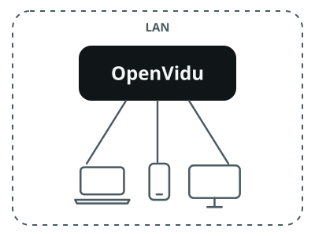
          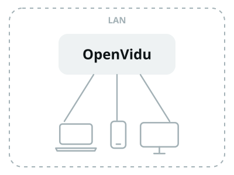
        
        Local
        Docker Compose on your machine, with certificates for every device on your network.
      </a>
      <a class="ov-topo__card" href="/docs/self-hosting/single-node/">
        COMMUNITYPRO
        
          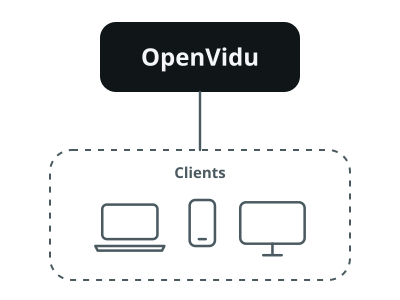
          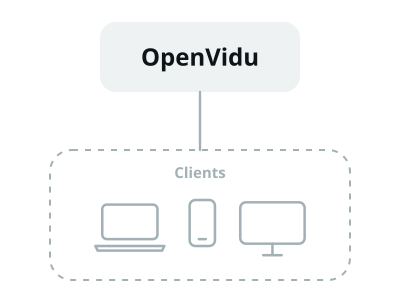
        
        Single Node
        One server for medium user load. Free with COMMUNITY. PRO doubles the media performance on the same hardware.
      </a>
      <a class="ov-topo__card" href="/docs/self-hosting/elastic/">
        PRO
        
          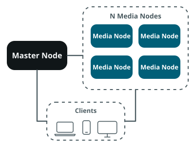
          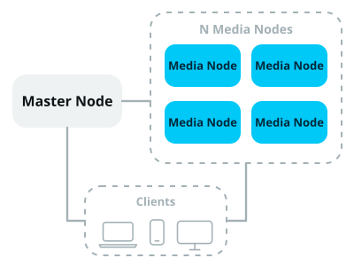
        
        Elastic
        Media nodes come and go with demand. You pay for what runs.
      </a>
      <a class="ov-topo__card" href="/docs/self-hosting/ha/">
        PRO
        
          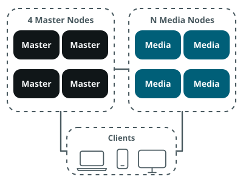
          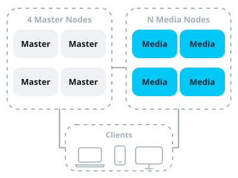
        
        High Availability
        Replicated master nodes. A failed server never stops a call.
      </a>
    

  

</section>

<section class="ov-wrap ov-section ov-pricing" id="pricing" data-sal="slide-up">
  <h2 class="ov-h2">Start free. Scale when you need to.</h2>
  

    

      COMMUNITY
      
Freeopen source, Apache 2.0

      <ul class="ov-plan__list">
        <li>Single Node deployment for medium user load</li>
        <li>Meet and Platform included</li>
        <li>Recording, ingress and S3 storage</li>
        <li>Built-in observability</li>
      </ul>
      <a class="ov-btn ov-btn--ink" href="/meet/" title="Get started with OpenVidu Meet">Deploy free</a>
    

    

      PRO
      
$0.0006per core, per minute

      <ul class="ov-plan__list">
        <li>2x performance with mediasoup</li>
        <li>Elastic: add media nodes as load grows</li>
        <li>High Availability: no single point of failure</li>
        <li>Advanced observability</li>
      </ul>
      <a class="ov-btn ov-btn--yellow" href="/account/" title="Get an OpenVidu License">Start your 15-day free trial</a>
    

  

  
Both editions run Meet and Platform. You pay only while a PRO cluster runs, never per participant. <a href="/pricing/">See pricing</a>

</section>

<section class="ov-wrap ov-section ov-stories" aria-labelledby="success-stories" data-sal="slide-up">
  <h2 class="ov-h2 ov-stories__title" id="success-stories">Teams that already picked a door.</h2>
  

    <figure class="ov-story">
      
      Virtual classrooms · LMS
      <blockquote class="ov-story__text">
“With OpenVidu integrated directly into DynDevice, users now enjoy a seamless, all-in-one experience.”
</blockquote>
      <figcaption class="ov-story__by"><strong>Matteo Resconi</strong>IT &amp; Development Area Manager, Mega Italia Media<a class="ov-story__link" href="/blog/2026/07/28/dyndevice-virtual-classrooms-openvidu/">Read the full story →</a></figcaption>
    </figure>
    <figure class="ov-story">
      
      Live English lessons · EdTech
      <blockquote class="ov-story__text">
“OpenVidu let us keep our infrastructure economics and control, and shed a whole layer of custom code we no longer had to maintain.”
</blockquote>
      <figcaption class="ov-story__by"><strong>Andrei Iakimov</strong>DevOps Lead, Novakid<a class="ov-story__link" href="/blog/2026/09/15/novakid-live-english-lessons/">Read the full story →</a></figcaption>
    </figure>
    <figure class="ov-story">
      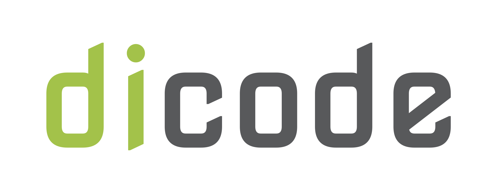
      Private video calls · Consulting
      <blockquote class="ov-story__text">
“From our clients' perspective, joining video calls is much easier than it would be with a solution such as Teams.”
</blockquote>
      <figcaption class="ov-story__by"><strong>Janne Sikiö</strong>CEO, Dicode<a class="ov-story__link" href="/blog/2026/10/27/dicode-private-video-calls-openvidu/">Read the full story →</a></figcaption>
    </figure>
  

</section>

<section class="ov-wrap ov-section ov-record" aria-label="Track record" data-sal="slide-up">
  

    <a class="ov-stat" href="/research/">12+years building WebRTC</a>
    <a class="ov-stat" href="/research/">19peer-reviewed research publications</a>
    <a class="ov-stat" href="/research/">500+academic citations</a>
    <a class="ov-stat" href="https://github.com/OpenVidu" target="_blank" title="OpenVidu on GitHub (opens in a new tab)">3open source media stacks we contribute to: Kurento, LiveKit and mediasoup</a>
  

</section>

<section class="ov-wrap ov-section ov-closing" data-sal="slide-up">
  

    <h2 class="ov-closing__title">Pick your door.</h2>
    

      <a href="/meet/" class="ov-btn ov-btn--lg ov-btn--meet" title="Get started with OpenVidu Meet">Deploy OpenVidu Meet</a>
      <a href="/docs/" class="ov-btn ov-btn--lg ov-btn--platform" title="Build with OpenVidu Platform SDKs">Build with OpenVidu Platform</a>
    

    <a href="/support/" class="ov-closing__link">Or talk to an expert</a>
  

</section>
