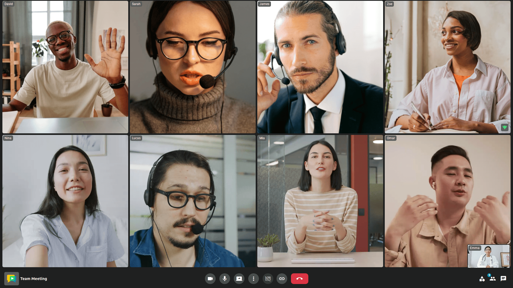

<section class="ov-wrap ov-doors" aria-label="Choose a product" data-sal="slide-up">
  

    

      OpenVidu Meet
      Ready-made app
    

    <h2 class="ov-door__title">A finished meeting app. Embed it today.</h2>
    
Rooms, recordings, roles and your branding, out of the box. Drop it into your product with one tag, a REST API and webhooks.

    

      <a href="/meet/" class="ov-btn ov-btn--meet-ink" title="Get started with OpenVidu Meet">Deploy Meet<svg width="18" height="18" viewBox="0 0 24 24" fill="none" stroke="currentColor" stroke-width="2.2" stroke-linecap="round" stroke-linejoin="round" aria-hidden="true"><path d="M5 12h14M13 6l6 6-6 6"></path></svg></a>
      <a href="https://meet-demo-app.openvidu.io" class="ov-link" target="_blank" title="Try the OpenVidu Meet demo (opens in a new tab)">Try the live demo</a>
    

    

      
      
    

  

  

    

      OpenVidu Platform
      SDKs and APIs
    

    <h2 class="ov-door__title">The raw engine. Build anything.</h2>
    
Client and server SDKs from our LiveKit fork, for every major language, with full control over tracks, codecs and layouts.

    

      <a href="/docs/" class="ov-btn ov-btn--white" title="Build with OpenVidu Platform SDKs">Start building<svg width="18" height="18" viewBox="0 0 24 24" fill="none" stroke="currentColor" stroke-width="2.2" stroke-linecap="round" stroke-linejoin="round" aria-hidden="true"><path d="M5 12h14M13 6l6 6-6 6"></path></svg></a>
      <a href="/docs/tutorials/application-server/" class="ov-link" title="OpenVidu Platform tutorials">Browse tutorials</a>
    

    

      

        

<pre class="ov-code__pre">import { Room } from "livekit-client";

const room = new Room();
await room.connect("wss://your-openvidu-deployment", token);
await room.localParticipant
  .enableCameraAndMicrophone();</pre>
      

    

  

</section>

Not sure which door? <a href="/openvidu-meet-vs-openvidu-platform/">Compare Meet and Platform</a>

<section class="ov-wrap ov-section ov-shared" aria-label="What both share" data-sal="slide-up">
  
Same engine behind both doors

  

    
Self-hostedYour servers, your users' data. Nothing routes through us.

    
Any cloudAWS, Azure, Google Cloud, DigitalOcean, Oracle Cloud or on-premises.

    
LiveKit compatibleFamiliar APIs and SDKs, with mediasoup at the core.

    
Open sourceCOMMUNITY is free under Apache 2.0. PRO when you scale.

  

  

    Deploy on
    <svg width="50" height="30" viewBox="1.8 5.6 20.8 12.6" fill="currentColor" aria-hidden="true"><path d="M7.64 10.38c0 .25.02.45.07.62.05.12.12.28.21.46.04.04.05.1.05.15 0 .07-.04.13-.13.2l-.42.28c-.06.04-.12.06-.17.06-.07 0-.13-.04-.2-.1-.09-.1-.17-.2-.24-.31-.06-.11-.13-.24-.2-.39-.52.61-1.17.92-1.96.92-.56 0-1-.16-1.33-.48-.32-.32-.49-.75-.49-1.29 0-.55.2-1 .6-1.36.41-.34.95-.52 1.63-.52.23 0 .44.02.71.06.23.03.5.08.76.14v-.48c0-.51-.1-.84-.31-1.07-.22-.21-.57-.3-1.08-.3-.24 0-.48.03-.72.08-.25.06-.49.13-.72.23-.11.04-.2.07-.23.08-.05.02-.08.02-.11.02-.09 0-.14-.06-.14-.2v-.33c0-.1.01-.18.05-.23q.045-.075.18-.12c.24-.14.51-.24.84-.32a4 4 0 0 1 1.04-.13q1.185 0 1.74.54c.37.36.55.91.55 1.64v2.15zm-2.7 1.02c.22 0 .44-.04.68-.12s.45-.23.63-.43c.11-.13.19-.27.25-.43 0-.16.05-.35.05-.58v-.27c-.2-.07-.4-.07-.62-.12a7 7 0 0 0-.62-.04c-.45 0-.77.09-.99.27s-.32.43-.32.76c0 .32.07.56.24.71.16.17.39.25.7.25m5.34.71a.6.6 0 0 1-.28-.06c-.03-.05-.08-.14-.12-.26L8.32 6.65c-.04-.15-.06-.22-.06-.27 0-.11.05-.17.16-.17h.65c.13 0 .22.02.26.07.06.04.1.13.14.26l1.11 4.4 1.04-4.4c.03-.13.07-.22.13-.26.05-.04.14-.07.25-.07h.55c.12 0 .21.02.26.07.05.04.1.13.13.26L14 11l1.14-4.46c.04-.13.09-.22.13-.26.06-.04.14-.07.26-.07h.62c.11 0 .17.06.17.17 0 .03-.01.07-.02.12 0 0-.02.08-.04.15l-1.61 5.14c-.04.14-.08.21-.15.26-.04.04-.13.07-.24.07h-.57c-.13 0-.19-.02-.27-.07a.45.45 0 0 1-.12-.26L12.27 7.5l-1.03 4.28q-.045.195-.12.27a.5.5 0 0 1-.27.06zm8.55.18c-.33 0-.7-.04-1.03-.12s-.59-.17-.76-.26a.5.5 0 0 1-.21-.19.4.4 0 0 1-.04-.18v-.34c0-.14.05-.2.15-.2h.12c.04 0 .1.05.17.08.22.1.47.18.73.23.27.05.54.08.79.08.42 0 .75-.07.97-.22.23-.17.35-.36.35-.63 0-.19-.07-.34-.18-.47-.12-.12-.35-.24-.67-.34l-.97-.3c-.48-.16-.84-.38-1.06-.68a1.58 1.58 0 0 1-.33-.97c0-.28.06-.52.18-.73.12-.22.28-.4.46-.55.22-.15.44-.26.71-.34q.39-.12.84-.12.21 0 .45.03c.14.02.28.05.42.07.14.04.26.07.38.11s.2.08.28.12c.09.05.16.1.2.16s.06.13.06.22v.32q0 .21-.15.21c-.05 0-.14-.03-.26-.08-.37-.17-.8-.26-1.27-.26-.38 0-.66.06-.89.19-.2.12-.31.32-.31.59 0 .19.07.35.2.47.13.13.38.25.73.37l.95.3c.48.14.82.36 1.03.64q.3.405.3.93c0 .28-.06.54-.17.77-.12.22-.28.42-.5.58-.19.17-.44.29-.72.38s-.62.13-.95.13m1.25 3.24C17.89 17.14 14.71 18 12 18c-3.85 0-7.3-1.42-9.91-3.77-.21-.19-.02-.44.23-.29 2.82 1.63 6.29 2.62 9.89 2.62 2.43 0 5.1-.5 7.55-1.56.37-.15.68.26.32.53M21 14.5c-.29-.37-1.86-.18-2.57-.1-.21.03-.24-.16-.05-.3 1.25-.87 3.31-.6 3.54-.33.24.3-.06 2.36-1.23 3.34-.19.15-.36.07-.28-.11.27-.68.86-2.16.59-2.5"></path></svg>AWS
    <svg width="40" height="32" viewBox="2 4 20 16" fill="#0072C6" aria-hidden="true"><path d="M13.05 4.24 6.56 18.05 2 18l5.09-8.76zm.7 1.09L22 19.76H6.74l9.3-1.66-4.87-5.79z"></path></svg>Azure
    <svg width="40" height="33" viewBox="1 3 22 18" fill="#1E8E3E" aria-hidden="true"><path d="M23 14.75C23 18.2 20.2 21 16.75 21h-9.5C3.8 21 1 18.2 1 14.75c0-2.14 1.08-4.03 2.71-5.15C4.58 5.82 7.96 3 12 3s7.42 2.82 8.29 6.6A6.22 6.22 0 0 1 23 14.75M16.63 17c1.31 0 2.37-1.06 2.37-2.37 0-1.28-1-2.33-2.28-2.38l.03-.5a4.754 4.754 0 0 0-8.32-3.14c1.5.29 2.8 1.11 3.71 2.25L9.5 13.5c-.42-.73-1.21-1.25-2.12-1.25-1.32 0-2.38 1.06-2.38 2.38 0 1.27 1 2.3 2.25 2.37z"></path></svg>Google Cloud
    <svg width="32" height="32" viewBox="2 2 20 20" fill="#0069E0" aria-hidden="true"><path d="M6 12H2C2 6.5 6.5 2 12 2s10 4.5 10 10-4.5 10-10 10v-4H8v-4h4v4c3.32 0 6-2.69 6-6s-2.69-6-6-6-6 2.69-6 6m2 6v3H5v-3zm-5-2h2v2H3z"></path></svg>DigitalOcean
    <svg width="46" height="29" viewBox="216.79 178.57 566.43 357.14" fill="#C74634" aria-hidden="true"><path d="M395.357 535.714c-99.286 0-178.571-79.286-178.571-178.571s79.286-178.571 178.571-178.571h209.286c99.286 0 178.571 79.286 178.571 178.571s-79.286 178.571-178.571 178.571zM599.286 472.5c65 0 115.357-52.323 115.357-115.357 0-65-52.323-115.357-115.357-115.357H400.715c-65 0-115.357 52.323-115.357 115.357S337.681 472.5 400.715 472.5z"></path></svg>Oracle Cloud
    <svg width="28" height="31" viewBox="2 1 20 22" fill="currentColor" aria-hidden="true"><path d="M4 1h16a1 1 0 0 1 1 1v4a1 1 0 0 1-1 1H4a1 1 0 0 1-1-1V2a1 1 0 0 1 1-1m0 8h16a1 1 0 0 1 1 1v4a1 1 0 0 1-1 1H4a1 1 0 0 1-1-1v-4a1 1 0 0 1 1-1m0 8h16a1 1 0 0 1 1 1v4a1 1 0 0 1-1 1H4a1 1 0 0 1-1-1v-4a1 1 0 0 1 1-1M9 5h1V3H9zm0 8h1v-2H9zm0 8h1v-2H9zM5 3v2h2V3zm0 8v2h2v-2zm0 8v2h2v-2z"></path></svg>On-premises
  

</section>

<section class="ov-wrap ov-section ov-cases" data-sal="slide-up">
  <h2 class="ov-h2">What are you building?</h2>
  

    <button type="button" class="ov-case" aria-pressed="true">Telehealth</button>
    <button type="button" class="ov-case" aria-pressed="false">Online classes</button>
    <button type="button" class="ov-case" aria-pressed="false">Customer support</button>
    <button type="button" class="ov-case" aria-pressed="false">Live events</button>
    <button type="button" class="ov-case" aria-pressed="false">Cameras and drones</button>
    <button type="button" class="ov-case" aria-pressed="false">AI voice agents</button>
  

  

    

      Best fit: OpenVidu Meet
      
Patient calls that never leave your servers.

    

    

      
Embed the consultation room in your patient portal with one tag, and control who can join, record or share.

      <a href="/meet/" class="ov-btn ov-btn--ink">Deploy OpenVidu Meet<svg width="18" height="18" viewBox="0 0 24 24" fill="none" stroke="currentColor" stroke-width="2.2" stroke-linecap="round" stroke-linejoin="round" aria-hidden="true"><path d="M5 12h14M13 6l6 6-6 6"></path></svg></a>
    

  

  

    

      Best fit: OpenVidu Meet
      
A classroom with recording, screen sharing and raised hands.

    

    

      
Moderation, roles and recordings come ready. Brand it with your school colors.

      <a href="/meet/" class="ov-btn ov-btn--ink">Deploy OpenVidu Meet<svg width="18" height="18" viewBox="0 0 24 24" fill="none" stroke="currentColor" stroke-width="2.2" stroke-linecap="round" stroke-linejoin="round" aria-hidden="true"><path d="M5 12h14M13 6l6 6-6 6"></path></svg></a>
    

  

  

    

      Best fit: OpenVidu Meet
      
Turn a support ticket into a video call with a link.

    

    

      
Create rooms from your help desk through the REST API, and get webhooks when calls start, end or get recorded.

      <a href="/meet/" class="ov-btn ov-btn--ink">Deploy OpenVidu Meet<svg width="18" height="18" viewBox="0 0 24 24" fill="none" stroke="currentColor" stroke-width="2.2" stroke-linecap="round" stroke-linejoin="round" aria-hidden="true"><path d="M5 12h14M13 6l6 6-6 6"></path></svg></a>
    

  

  

    

      Best fit: OpenVidu Platform
      
Low-latency streams for hundreds of viewers.

    

    

      
Control every track and layout, and broadcast to YouTube or Twitch at the same time.

      <a href="/docs/" class="ov-btn ov-btn--ink">Build with OpenVidu Platform<svg width="18" height="18" viewBox="0 0 24 24" fill="none" stroke="currentColor" stroke-width="2.2" stroke-linecap="round" stroke-linejoin="round" aria-hidden="true"><path d="M5 12h14M13 6l6 6-6 6"></path></svg></a>
    

  

  

    

      Best fit: OpenVidu Platform
      
Ingest and process camera feeds in real time.

    

    

      
Bring in external streams and run server-side pipelines on the video and audio.

      <a href="/docs/" class="ov-btn ov-btn--ink">Build with OpenVidu Platform<svg width="18" height="18" viewBox="0 0 24 24" fill="none" stroke="currentColor" stroke-width="2.2" stroke-linecap="round" stroke-linejoin="round" aria-hidden="true"><path d="M5 12h14M13 6l6 6-6 6"></path></svg></a>
    

  

  

    

      Best fit: OpenVidu Platform
      
Put an AI agent in the room.

    

    

      
Transcription, voice assistants and telephony, built on the same SDKs as the rest of your app.

      <a href="/docs/" class="ov-btn ov-btn--ink">Build with OpenVidu Platform<svg width="18" height="18" viewBox="0 0 24 24" fill="none" stroke="currentColor" stroke-width="2.2" stroke-linecap="round" stroke-linejoin="round" aria-hidden="true"><path d="M5 12h14M13 6l6 6-6 6"></path></svg></a>
    

  

</section>

<section class="ov-wrap ov-section ov-scale" data-sal="slide-up">
  

    <h2 class="ov-h2 ov-scale__title">From one server to a cluster that stays up.</h2>
    
Start free on a single node. Move to PRO when you need more rooms per server, autoscaling or fault tolerance.

  

  

    

      COMMUNITY
      

      Single Node
      Free. One server for medium user load.
    

    

      PRO
      

      Single Node PRO
      2x performance on the same hardware, with mediasoup.
    

    

      PRO
      

      Elastic
      Add media nodes as demand grows. Remove them when it drops.
    

    

      PRO
      

      High Availability
      Replicated master nodes. A failed server never stops a call.
    

  

  

    
<strong>$0.0006 per core per minute.</strong> Pay only while your PRO cluster runs, never per participant. First 15 days free.

    <a href="/pricing/" class="ov-btn ov-btn--yellow-ink">See pricing</a>
  

</section>

<section class="ov-wrap ov-section ov-proof" aria-label="Track record" data-sal="slide-up">
  
12+years building WebRTC

  
<a href="/research/" class="ov-stat__value">19</a>research publications

  
<a href="/research/" class="ov-stat__value">500+</a>academic citations

  
Kurento, LiveKit, mediasoupopen source we contribute to

</section>

<section class="ov-wrap ov-section ov-closing" data-sal="slide-up">
  

    <h2 class="ov-closing__title">Pick your door.</h2>
    

      <a href="/meet/" class="ov-btn ov-btn--lg ov-btn--meet" title="Get started with OpenVidu Meet">Deploy OpenVidu Meet</a>
      <a href="/docs/" class="ov-btn ov-btn--lg ov-btn--platform" title="Build with OpenVidu Platform SDKs">Build with OpenVidu Platform</a>
    

    <a href="/support/" class="ov-closing__link">Or talk to an expert</a>
  

</section>
