

<section class="ov-hero">
  

  

  <h1 class="ov-hero__title">Self-hosted video conferencing, ready in minutes</h1>
  
<strong>OpenVidu Meet is an open-source video conferencing app that runs on your own servers.</strong> Use it as it is, with rooms, links and recordings managed from its console, or embed it in your product with one tag, a REST API and webhooks.

  

    <a href="/meet/getting-started/" class="ov-btn ov-btn--meet-ink" title="Get started with OpenVidu Meet">Deploy Meet in minutes<svg width="18" height="18" viewBox="0 0 24 24" fill="none" stroke="currentColor" stroke-width="2.2" stroke-linecap="round" stroke-linejoin="round" aria-hidden="true"><path d="M5 12h14M13 6l6 6-6 6"></path></svg></a>
    <a href="https://meet-demo-app.openvidu.io" class="ov-link" target="_blank" rel="noopener" title="Try the OpenVidu Meet demo (opens in a new tab)">Try the live demo</a>
  

  

    <a class="glightbox" href="/assets/videos/meet/home/demo.mp4" data-type="video"><video class="round-corners" src="/assets/videos/meet/home/demo-preview.mp4" poster="/assets/videos/meet/home/demo-poster.jpg" muted playsinline autoplay loop></video></a>
  

</section>

<section class="ov-section" id="two-ways">
  
Standalone or embedded

  <h2 class="ov-h2">Two ways to use it</h2>
  

    <article class="ovp-mode">
      <svg viewBox="0 0 24 24" fill="none" stroke="currentColor" stroke-width="2" stroke-linecap="round" stroke-linejoin="round" aria-hidden="true"><rect x="3" y="4" width="18" height="16" rx="2"></rect><path d="M3 9h18M7 6.5h.01M10 6.5h.01"></path></svg>Ready to use
      <h3 class="ovp-mode__title">A complete meeting app on your own domain.</h3>
      
Deploy it and your team is meeting the same day. Nobody writes a line of code.

      <ul class="ovp-checks">
        <li>Create rooms and share their links from the console</li>
        <li>Guests join from the browser, with nothing to install</li>
        <li>Recordings, users and permissions in one place</li>
      </ul>
      

        <a href="/meet/getting-started/" class="ov-btn ov-btn--meet" title="Get started with OpenVidu Meet">Deploy Meet<svg width="18" height="18" viewBox="0 0 24 24" fill="none" stroke="currentColor" stroke-width="2.2" stroke-linecap="round" stroke-linejoin="round" aria-hidden="true"><path d="M5 12h14M13 6l6 6-6 6"></path></svg></a>
        <a href="https://meet-demo-app.openvidu.io" class="ov-link" target="_blank" rel="noopener" title="Try the OpenVidu Meet demo (opens in a new tab)">Try the live demo</a>
      

      

        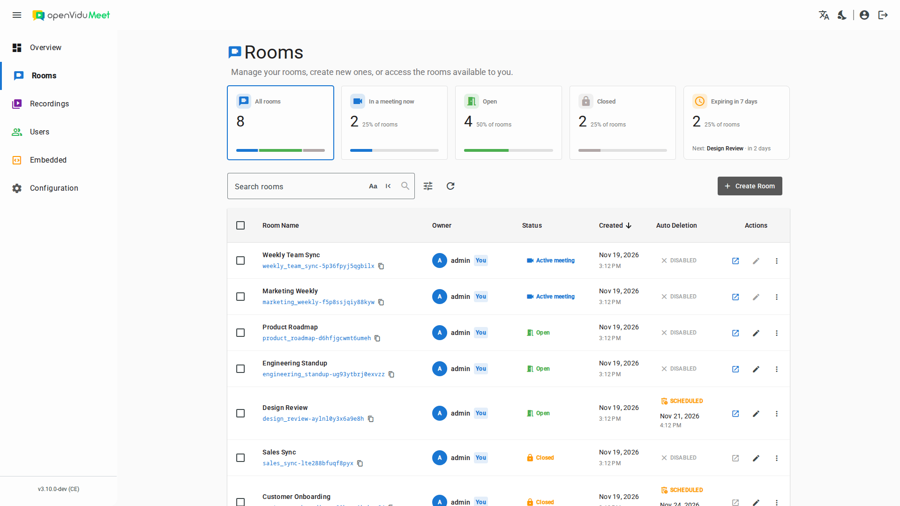
        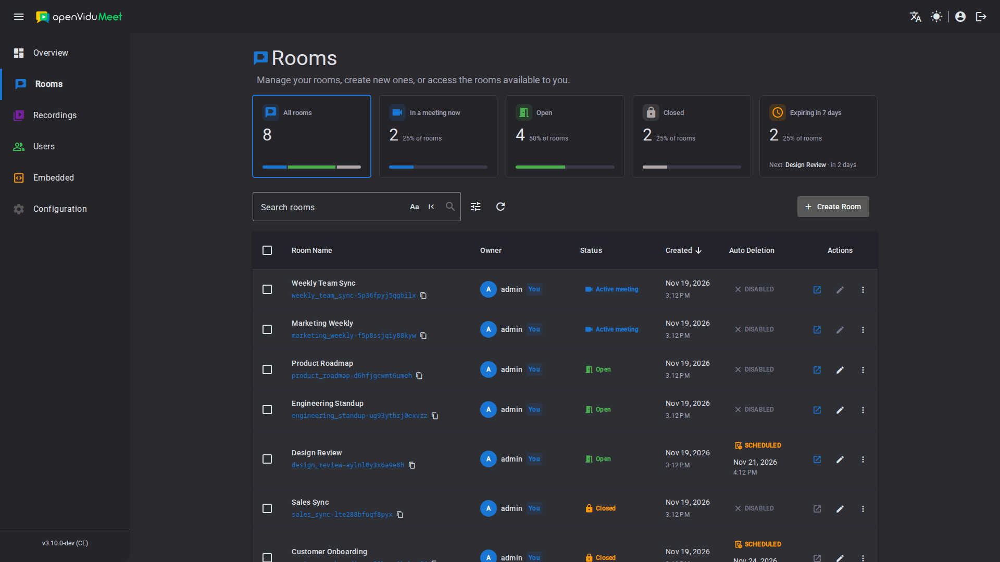
        
        
      

    </article>
    <article class="ovp-mode ovp-mode--embed">
      <svg viewBox="0 0 24 24" fill="none" stroke="currentColor" stroke-width="2" stroke-linecap="round" stroke-linejoin="round" aria-hidden="true"><path d="M8 7l-5 5 5 5M16 7l5 5-5 5M13.5 4l-3 16"></path></svg>Embedded
      <h3 class="ovp-mode__title">Meetings inside your own product.</h3>
      
Your users never leave your app, and your backend decides who meets, when and with which permissions.

      <ul class="ovp-checks">
        <li>The <code>&lt;openvidu-meet&gt;</code> web component, in any page or framework</li>
        <li>Rooms, members and recordings from your backend with the REST API</li>
        <li>Webhooks when meetings start, end or get recorded</li>
      </ul>
      

        <a href="/meet/embedded/intro/" class="ov-btn ov-btn--ink" title="Explore OpenVidu Meet Embedded">Explore Meet Embedded<svg width="18" height="18" viewBox="0 0 24 24" fill="none" stroke="currentColor" stroke-width="2.2" stroke-linecap="round" stroke-linejoin="round" aria-hidden="true"><path d="M5 12h14M13 6l6 6-6 6"></path></svg></a>
        <a href="/meet/embedded/step-by-step-guide/" class="ov-link" title="Embed OpenVidu Meet step by step">Step-by-step guide</a>
      

      

        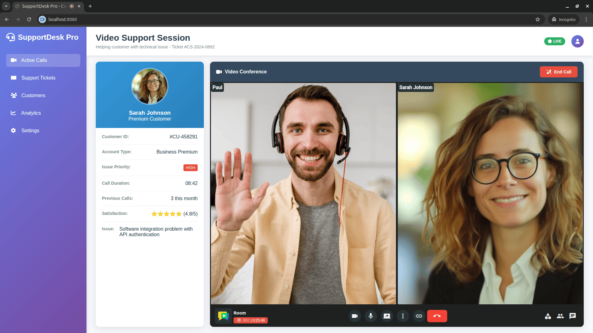
        

          

<pre class="ov-code__pre">&lt;!-- your page --&gt;
&lt;openvidu-meet room-url="…"&gt;&lt;/openvidu-meet&gt;</pre>
        

      

    </article>
  

</section>

<section class="ov-section" id="self-hosted" data-sal="slide-up">
  
Self-hosted

  <h2 class="ov-h2">Why run it on your own servers</h2>
  

    

      <svg viewBox="0 0 24 24" fill="none" stroke="currentColor" stroke-width="2" stroke-linecap="round" stroke-linejoin="round"><rect x="3" y="3.5" width="18" height="7" rx="2"></rect><rect x="3" y="13.5" width="18" height="7" rx="2"></rect><path d="M7 7h.01M7 17h.01M11 7h6M11 17h6"></path></svg>
      <h3>Your data stays with you</h3>
      
Calls, recordings and user data live only on servers you run, in the country you choose. No third party joins, routes or stores them, and end-to-end encryption is there when you need it.

    

    

      <svg viewBox="0 0 24 24" fill="none" stroke="currentColor" stroke-width="2" stroke-linecap="round" stroke-linejoin="round"><path d="M3.5 12.5l8-8h8v8l-8 8z"></path><circle cx="15.5" cy="8.5" r="1.2"></circle></svg>
      <h3>A cost you can predict</h3>
      
COMMUNITY is free. PRO is priced by the cores of your deployment, never by participant or by meeting minute, so the bill follows the size of your servers. <a href="/pricing/">See pricing</a>

    

    

      <svg viewBox="0 0 24 24" fill="none" stroke="currentColor" stroke-width="2" stroke-linecap="round" stroke-linejoin="round"><circle cx="12" cy="12" r="8.5"></circle><path d="M12 7.5V12l3 2"></path></svg>
      <h3>Up in minutes, on any cloud</h3>
      
A single server is ready in 5 to 10 minutes on any of the clouds below, or on your own hardware. <a href="/blog/2026/07/07/deploy-and-scale-in-times-across-clouds/">We timed it</a>

    

  

  <nav class="ovp-providers" aria-label="Deployment options">
    Deploy on
    <a class="ovp-provider" href="/meet/deployment/basic/"><svg viewBox="2 1 20 22" aria-hidden="true"><path d="M4 1h16a1 1 0 0 1 1 1v4a1 1 0 0 1-1 1H4a1 1 0 0 1-1-1V2a1 1 0 0 1 1-1m0 8h16a1 1 0 0 1 1 1v4a1 1 0 0 1-1 1H4a1 1 0 0 1-1-1v-4a1 1 0 0 1 1-1m0 8h16a1 1 0 0 1 1 1v4a1 1 0 0 1-1 1H4a1 1 0 0 1-1-1v-4a1 1 0 0 1 1-1M9 5h1V3H9zm0 8h1v-2H9zm0 8h1v-2H9zM5 3v2h2V3zm0 8v2h2v-2zm0 8v2h2v-2z"></path></svg>On-premises</a>
    <a class="ovp-provider" style="--ovp-brand: #ff9900" href="/docs/self-hosting/single-node/aws/install/"><svg viewBox="1.8 5.6 20.8 12.6" aria-hidden="true"><path d="M7.64 10.38c0 .25.02.45.07.62.05.12.12.28.21.46.04.04.05.1.05.15 0 .07-.04.13-.13.2l-.42.28c-.06.04-.12.06-.17.06-.07 0-.13-.04-.2-.1-.09-.1-.17-.2-.24-.31-.06-.11-.13-.24-.2-.39-.52.61-1.17.92-1.96.92-.56 0-1-.16-1.33-.48-.32-.32-.49-.75-.49-1.29 0-.55.2-1 .6-1.36.41-.34.95-.52 1.63-.52.23 0 .44.02.71.06.23.03.5.08.76.14v-.48c0-.51-.1-.84-.31-1.07-.22-.21-.57-.3-1.08-.3-.24 0-.48.03-.72.08-.25.06-.49.13-.72.23-.11.04-.2.07-.23.08-.05.02-.08.02-.11.02-.09 0-.14-.06-.14-.2v-.33c0-.1.01-.18.05-.23q.045-.075.18-.12c.24-.14.51-.24.84-.32a4 4 0 0 1 1.04-.13q1.185 0 1.74.54c.37.36.55.91.55 1.64v2.15zm-2.7 1.02c.22 0 .44-.04.68-.12s.45-.23.63-.43c.11-.13.19-.27.25-.43 0-.16.05-.35.05-.58v-.27c-.2-.07-.4-.07-.62-.12a7 7 0 0 0-.62-.04c-.45 0-.77.09-.99.27s-.32.43-.32.76c0 .32.07.56.24.71.16.17.39.25.7.25m5.34.71a.6.6 0 0 1-.28-.06c-.03-.05-.08-.14-.12-.26L8.32 6.65c-.04-.15-.06-.22-.06-.27 0-.11.05-.17.16-.17h.65c.13 0 .22.02.26.07.06.04.1.13.14.26l1.11 4.4 1.04-4.4c.03-.13.07-.22.13-.26.05-.04.14-.07.25-.07h.55c.12 0 .21.02.26.07.05.04.1.13.13.26L14 11l1.14-4.46c.04-.13.09-.22.13-.26.06-.04.14-.07.26-.07h.62c.11 0 .17.06.17.17 0 .03-.01.07-.02.12 0 0-.02.08-.04.15l-1.61 5.14c-.04.14-.08.21-.15.26-.04.04-.13.07-.24.07h-.57c-.13 0-.19-.02-.27-.07a.45.45 0 0 1-.12-.26L12.27 7.5l-1.03 4.28q-.045.195-.12.27a.5.5 0 0 1-.27.06zm8.55.18c-.33 0-.7-.04-1.03-.12s-.59-.17-.76-.26a.5.5 0 0 1-.21-.19.4.4 0 0 1-.04-.18v-.34c0-.14.05-.2.15-.2h.12c.04 0 .1.05.17.08.22.1.47.18.73.23.27.05.54.08.79.08.42 0 .75-.07.97-.22.23-.17.35-.36.35-.63 0-.19-.07-.34-.18-.47-.12-.12-.35-.24-.67-.34l-.97-.3c-.48-.16-.84-.38-1.06-.68a1.58 1.58 0 0 1-.33-.97c0-.28.06-.52.18-.73.12-.22.28-.4.46-.55.22-.15.44-.26.71-.34q.39-.12.84-.12.21 0 .45.03c.14.02.28.05.42.07.14.04.26.07.38.11s.2.08.28.12c.09.05.16.1.2.16s.06.13.06.22v.32q0 .21-.15.21c-.05 0-.14-.03-.26-.08-.37-.17-.8-.26-1.27-.26-.38 0-.66.06-.89.19-.2.12-.31.32-.31.59 0 .19.07.35.2.47.13.13.38.25.73.37l.95.3c.48.14.82.36 1.03.64q.3.405.3.93c0 .28-.06.54-.17.77-.12.22-.28.42-.5.58-.19.17-.44.29-.72.38s-.62.13-.95.13m1.25 3.24C17.89 17.14 14.71 18 12 18c-3.85 0-7.3-1.42-9.91-3.77-.21-.19-.02-.44.23-.29 2.82 1.63 6.29 2.62 9.89 2.62 2.43 0 5.1-.5 7.55-1.56.37-.15.68.26.32.53M21 14.5c-.29-.37-1.86-.18-2.57-.1-.21.03-.24-.16-.05-.3 1.25-.87 3.31-.6 3.54-.33.24.3-.06 2.36-1.23 3.34-.19.15-.36.07-.28-.11.27-.68.86-2.16.59-2.5"></path></svg>AWS</a>
    <a class="ovp-provider" style="--ovp-brand: #0078d4" href="/docs/self-hosting/single-node/azure/install/"><svg viewBox="2 4 20 16" aria-hidden="true"><path d="M13.05 4.24 6.56 18.05 2 18l5.09-8.76zm.7 1.09L22 19.76H6.74l9.3-1.66-4.87-5.79z"></path></svg>Azure</a>
    <a class="ovp-provider" style="--ovp-brand: #34a853" href="/docs/self-hosting/single-node/gcp/install/"><svg viewBox="1 3 22 18" aria-hidden="true"><path d="M23 14.75C23 18.2 20.2 21 16.75 21h-9.5C3.8 21 1 18.2 1 14.75c0-2.14 1.08-4.03 2.71-5.15C4.58 5.82 7.96 3 12 3s7.42 2.82 8.29 6.6A6.22 6.22 0 0 1 23 14.75M16.63 17c1.31 0 2.37-1.06 2.37-2.37 0-1.28-1-2.33-2.28-2.38l.03-.5a4.754 4.754 0 0 0-8.32-3.14c1.5.29 2.8 1.11 3.71 2.25L9.5 13.5c-.42-.73-1.21-1.25-2.12-1.25-1.32 0-2.38 1.06-2.38 2.38 0 1.27 1 2.3 2.25 2.37z"></path></svg>Google Cloud</a>
    <a class="ovp-provider" style="--ovp-brand: #0080ff" href="/docs/self-hosting/single-node/digitalocean/install/"><svg viewBox="2 2 20 20" aria-hidden="true"><path d="M6 12H2C2 6.5 6.5 2 12 2s10 4.5 10 10-4.5 10-10 10v-4H8v-4h4v4c3.32 0 6-2.69 6-6s-2.69-6-6-6-6 2.69-6 6m2 6v3H5v-3zm-5-2h2v2H3z"></path></svg>DigitalOcean</a>
    <a class="ovp-provider" style="--ovp-brand: #c74634" href="/docs/self-hosting/single-node/oracle/install/"><svg viewBox="216.79 178.57 566.43 357.14" aria-hidden="true"><path d="M395.357 535.714c-99.286 0-178.571-79.286-178.571-178.571s79.286-178.571 178.571-178.571h209.286c99.286 0 178.571 79.286 178.571 178.571s-79.286 178.571-178.571 178.571zM599.286 472.5c65 0 115.357-52.323 115.357-115.357 0-65-52.323-115.357-115.357-115.357H400.715c-65 0-115.357 52.323-115.357 115.357S337.681 472.5 400.715 472.5z"></path></svg>Oracle Cloud</a>
  </nav>
</section>

<section class="ov-section" id="use-cases" data-sal="slide-up">
  
Use cases

  <h2 class="ov-h2">What are you building?</h2>
  

    <a class="ovp-case ovp-case--lead" href="/meet/embedded/intro/">
      <svg viewBox="0 0 24 24" fill="none" stroke="currentColor" stroke-width="2" stroke-linecap="round" stroke-linejoin="round" aria-hidden="true"><path d="M5 3v5a4.5 4.5 0 0 0 9 0V3M9.5 12.5v2a5 5 0 0 0 10 0V13"></path><circle cx="19.5" cy="11" r="2"></circle></svg>Telehealth
      Patient calls that never leave your servers.
      Embed the consultation room in your patient portal with one tag. Patients wait until the practitioner admits them, and you decide who can record or share.
      Embed with one tagLocked roomRoles and permissionsEnd-to-end encryption
      Embed it in your patient portal<svg width="18" height="18" viewBox="0 0 24 24" fill="none" stroke="currentColor" stroke-width="2.2" stroke-linecap="round" stroke-linejoin="round" aria-hidden="true"><path d="M5 12h14M13 6l6 6-6 6"></path></svg>
      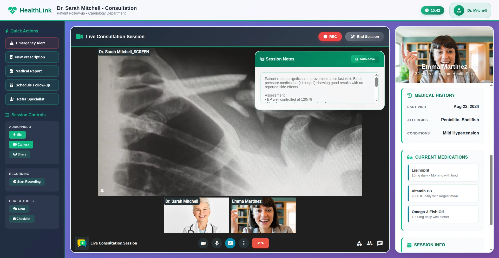
    </a>
    <a class="ovp-case ovp-case--green" href="/meet/getting-started/">
      <svg viewBox="0 0 24 24" fill="none" stroke="currentColor" stroke-width="2" stroke-linecap="round" stroke-linejoin="round" aria-hidden="true"><path d="M2 9l10-5 10 5-10 5z"></path><path d="M6 11v5c3 2 9 2 12 0v-5M22 9v6"></path></svg>Online classes
      A classroom with recording and raised hands.
      Run your first class<svg width="18" height="18" viewBox="0 0 24 24" fill="none" stroke="currentColor" stroke-width="2.2" stroke-linecap="round" stroke-linejoin="round" aria-hidden="true"><path d="M5 12h14M13 6l6 6-6 6"></path></svg>
      
      
    </a>
    <a class="ovp-case ovp-case--ink" href="/meet/embedded/reference/rest-api/">
      <svg viewBox="0 0 24 24" fill="none" stroke="currentColor" stroke-width="2" stroke-linecap="round" stroke-linejoin="round" aria-hidden="true"><path d="M4 14v-2a8 8 0 0 1 16 0v2"></path><rect x="3" y="14" width="4" height="6" rx="1.5"></rect><rect x="17" y="14" width="4" height="6" rx="1.5"></rect></svg>Customer support
      Turn a support ticket into a video call.
      Create rooms from your help desk<svg width="18" height="18" viewBox="0 0 24 24" fill="none" stroke="currentColor" stroke-width="2.2" stroke-linecap="round" stroke-linejoin="round" aria-hidden="true"><path d="M5 12h14M13 6l6 6-6 6"></path></svg>
      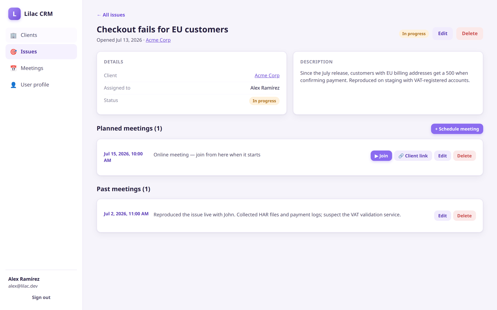
    </a>
  

</section>

<section class="ov-section" id="security" data-sal="slide-up">
  
Security and access

  <h2 class="ov-h2">Decide who gets in, and what they can do</h2>
  

    <ul class="ovp-points">
      <li data-ovp-point>
        <button type="button"><svg viewBox="0 0 24 24" fill="none" stroke="currentColor" stroke-width="2" stroke-linecap="round" stroke-linejoin="round"><path d="M5 21V4a1 1 0 0 1 1-1h12a1 1 0 0 1 1 1v17M3 21h18M15 12h.01"></path></svg>Locked roomGuests wait until a moderator admits them, from the meeting, the REST API or your own app.</button>
        <a href="/meet/features/meetings/locked-room/">How the locked room works</a>
      </li>
      <li data-ovp-point>
        <button type="button"><svg viewBox="0 0 24 24" fill="none" stroke="currentColor" stroke-width="2" stroke-linecap="round" stroke-linejoin="round"><rect x="4.5" y="10.5" width="15" height="10.5" rx="2.5"></rect><path d="M8 10.5V7a4 4 0 0 1 8 0v3.5M12 14.5v2.5"></path></svg>End-to-end encryptionOnly participants with the room key see and hear the meeting. Not even your server can.</button>
        <a href="/meet/features/meetings/e2e-encryption/">About end-to-end encryption</a>
      </li>
      <li data-ovp-point>
        <button type="button"><svg viewBox="0 0 24 24" fill="none" stroke="currentColor" stroke-width="2" stroke-linecap="round" stroke-linejoin="round"><circle cx="9" cy="8" r="3.5"></circle><path d="M2.5 20a6.5 6.5 0 0 1 13 0M17 11l1.5 1.5L22 9"></path></svg>Roles and permissionsMake each member a moderator or a speaker, and decide who can record, share their screen, chat or react.</button>
        <a href="/meet/features/room-members/overview/">Room members and permissions</a>
      </li>
      <li data-ovp-point>
        <button type="button"><svg viewBox="0 0 24 24" fill="none" stroke="currentColor" stroke-width="2" stroke-linecap="round" stroke-linejoin="round"><path d="M10 14a4.5 4.5 0 0 0 6.4 0l3-3a4.5 4.5 0 0 0-6.4-6.4l-1 1M14 10a4.5 4.5 0 0 0-6.4 0l-3 3a4.5 4.5 0 0 0 6.4 6.4l1-1"></path></svg>A link for each roleShare a link for members, for anonymous speakers or for anonymous moderators. The link sets what each guest can do.</button>
        <a href="/meet/features/rooms/access/">Room access</a>
      </li>
    </ul>
    

      

        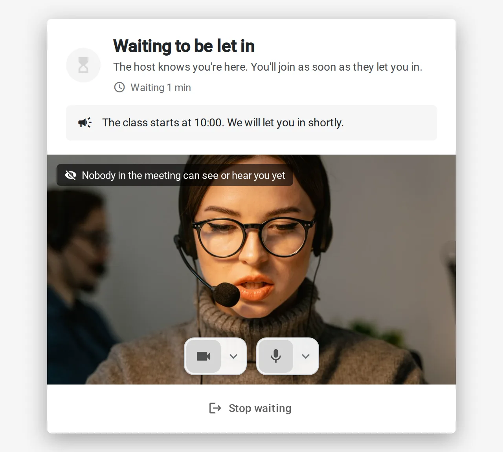
        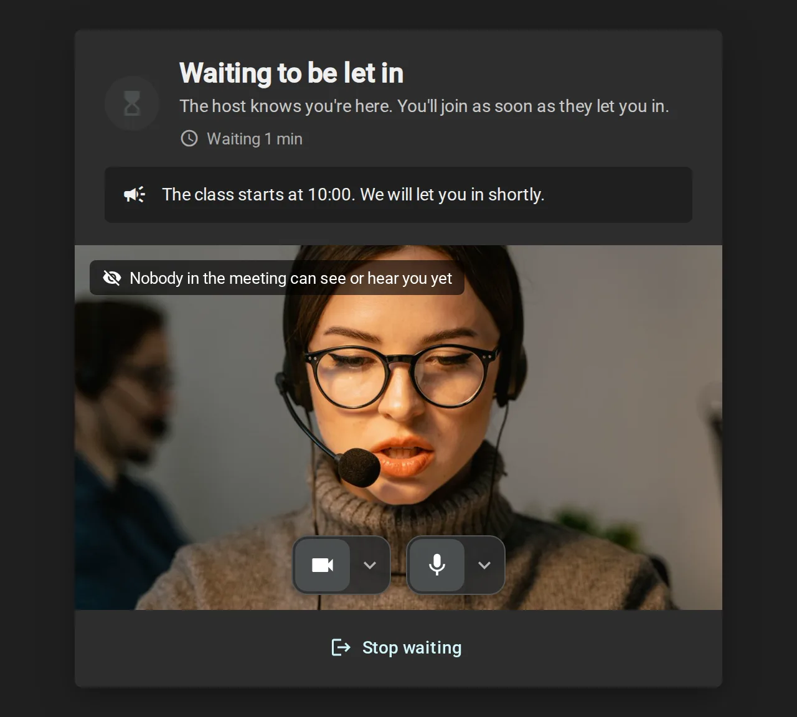
        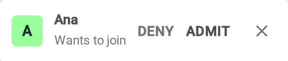
        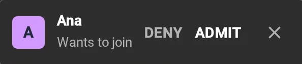
      

      

        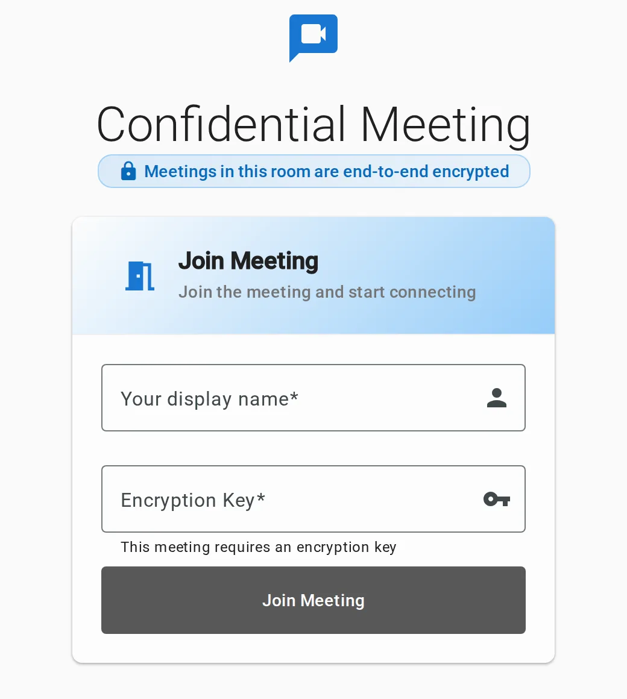
        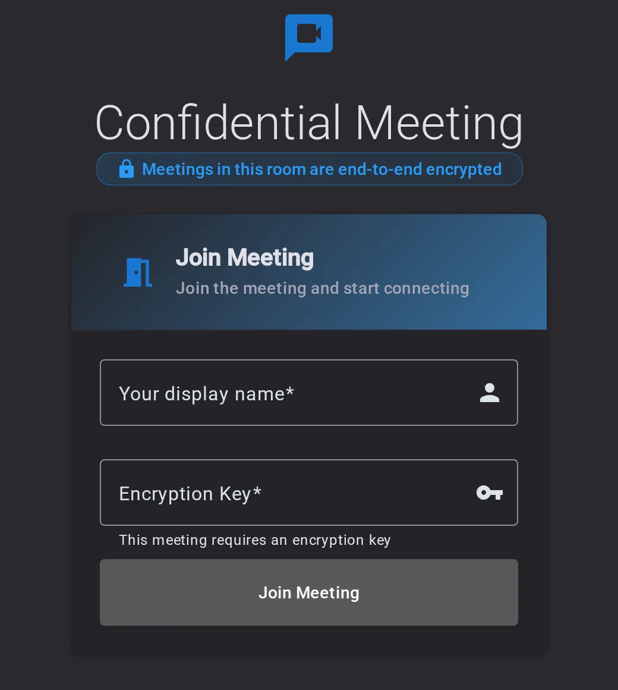
        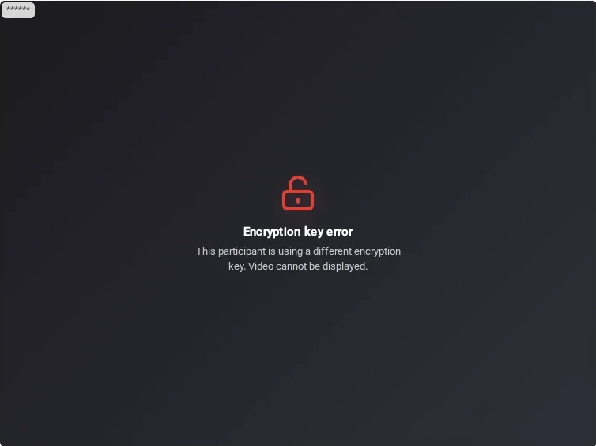
        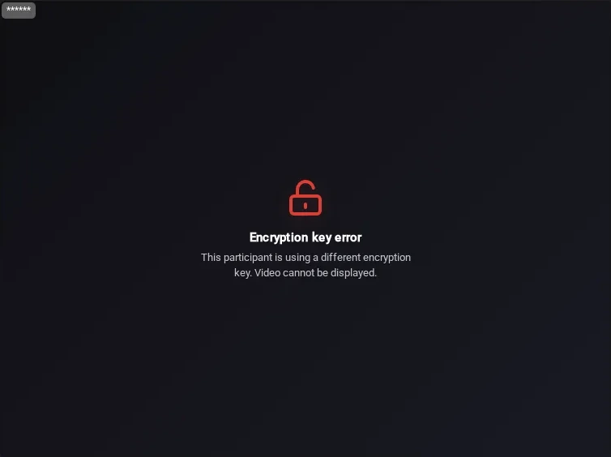
      

      

        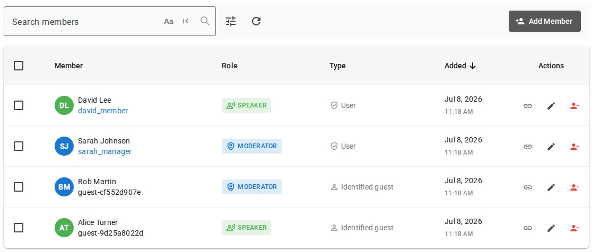
        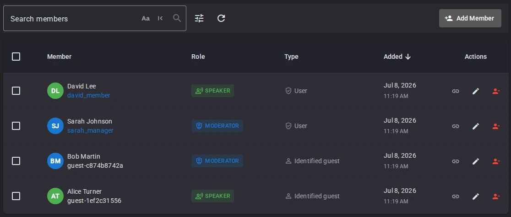
      

      

        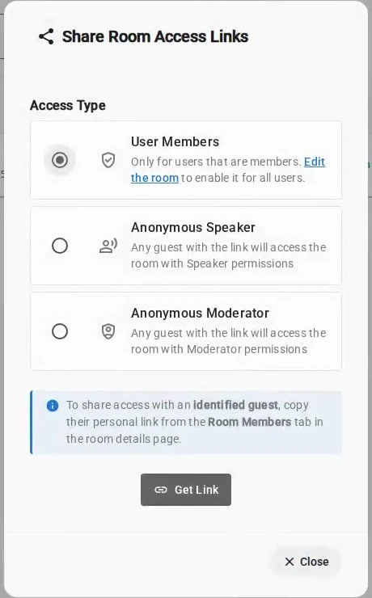
        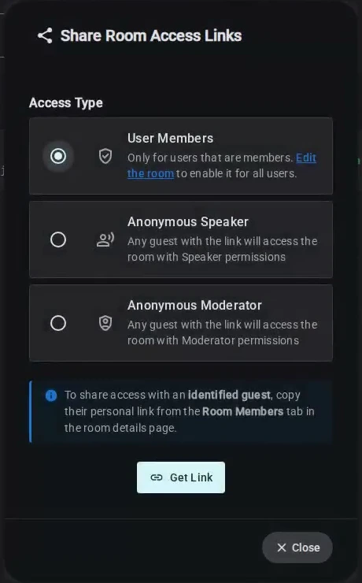
      

    

  

</section>

<section class="ov-section" id="console">
  
The console

  <h2 class="ov-h2">Your rooms, your recordings, your colors</h2>
  

    
<h3>Record and share</h3>
High-quality recordings stored on your own servers, with access control over who can watch, download or delete them.

    

      <a class="glightbox" href="/assets/videos/meet/recordings/management/share-recording-dark.mp4" data-type="video" data-gallery="dark"><video class="round-corners lazy-video" src="/assets/videos/meet/recordings/management/share-recording-dark.mp4#only-dark" preload="none" muted playsinline loop></video></a>
      <a class="glightbox" href="/assets/videos/meet/recordings/management/share-recording-light.mp4" data-type="video" data-gallery="light"><video class="round-corners lazy-video" src="/assets/videos/meet/recordings/management/share-recording-light.mp4#only-light" preload="none" muted playsinline loop></video></a>
    

  

  

    

      
<h3>Pre-configure your rooms</h3>
Create and customize the behavior of your rooms in a few clicks: access and permissions, recording, chat and more.

      

        <a class="glightbox" href="/assets/videos/meet/rooms/management/create-room-wizard-dark.mp4" data-type="video" data-gallery="dark"><video class="round-corners lazy-video" src="/assets/videos/meet/rooms/management/create-room-wizard-dark.mp4#only-dark" preload="none" muted playsinline loop></video></a>
        <a class="glightbox" href="/assets/videos/meet/rooms/management/create-room-wizard-light.mp4" data-type="video" data-gallery="light"><video class="round-corners lazy-video" src="/assets/videos/meet/rooms/management/create-room-wizard-light.mp4#only-light" preload="none" muted playsinline loop></video></a>
      

    

    

      
<h3>Your own colors</h3>
Set the color scheme of every meeting from the console so the rooms look like the rest of your product.

      

        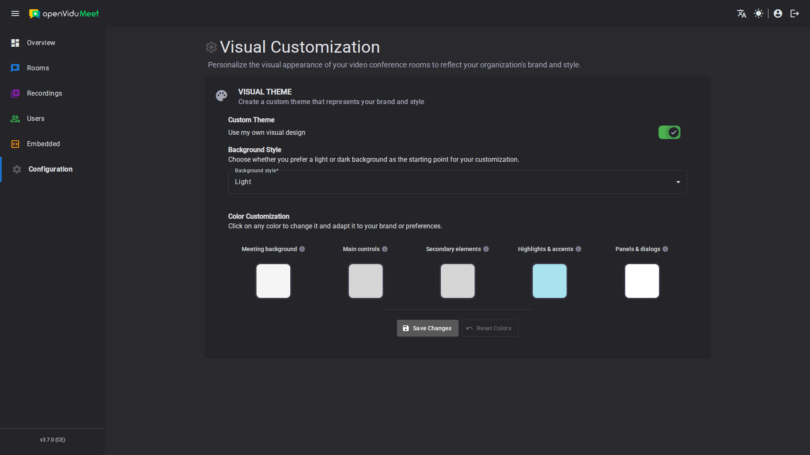
        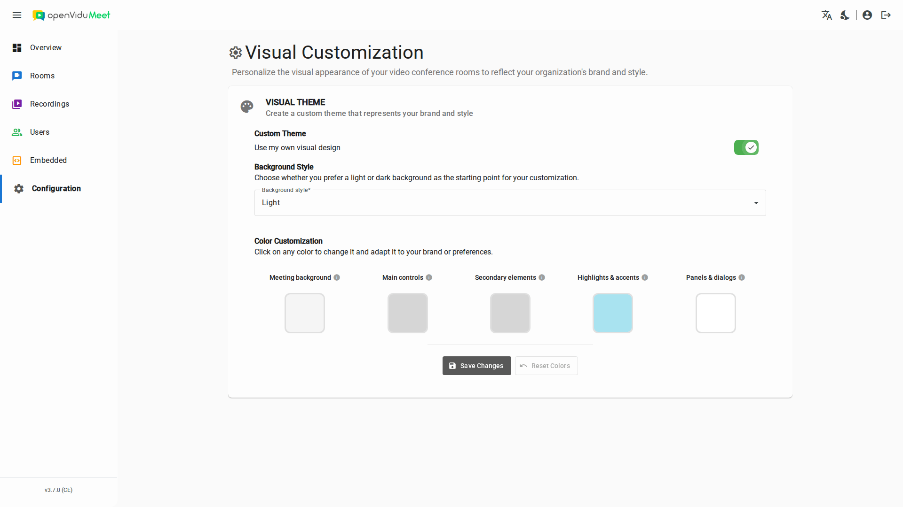
      

    

  

</section>

<section class="ov-section ovp-features" id="features" data-sal="slide-up">
  
In the meeting

  <h2 class="ov-h2">Every meeting feature you expect</h2>
  

    
    
    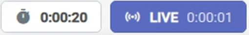
    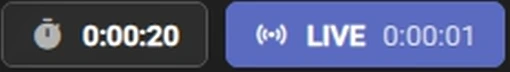
    
    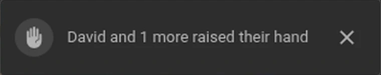
    
    
    
    
  

</section>

-   :material-cursor-default-click:{ .feature-icon } __One-click video calls__{ .feature-name }

    ---

    Share meeting links so anyone can instantly join your video calls from any browser, with no downloads or setup.

-   :material-video-4k-box:{ .feature-icon } __Up to 4K video and HiFi audio__{ .feature-name }

    ---

    Enjoy up to 4K video quality and crystal-clear audio enhanced with noise cancellation and echo suppression.

-   :material-monitor-share:{ .feature-icon } __Screen Sharing__{ .feature-name }

    ---

    Share your screen in stunning quality for flawless presentations and smooth collaboration every time.

-   :material-record-circle-outline:{ .feature-icon } __Recording__{ .feature-name }

    ---

    Record your meetings and keep every recording on your own servers, with control over who can watch it.

-   :material-hand-back-left:{ .feature-icon } __Raise hand__{ .feature-name }

    ---

    Let participants ask for the floor without interrupting, so moderators can keep large meetings orderly.

-   :material-emoticon-outline:{ .feature-icon } __Reactions__{ .feature-name }

    ---

    React with emojis in real time to share quick feedback and keep everyone engaged without unmuting.

-   :material-image-filter-center-focus-weak:{ .feature-icon } __Virtual backgrounds__{ .feature-name }

    ---

    Blur the background or replace it with an image, right from the meeting or before joining it.

-   :material-shield-account-outline:{ .feature-icon } __Meeting moderation__{ .feature-name }

    ---

    Mute participants, lower their hands, remove them from the call or promote them to moderator.

-   :material-chat-outline:{ .feature-icon } __Chat__{ .feature-name }

    ---

    Send and receive text messages during your calls for clear communication.

-   :material-subtitles-outline:{ .feature-icon } __Live Captions__{ .feature-name }

    ---

    Access a wide range of speech-to-text providers for accurate and flexible real-time transcription.

-   :octicons-broadcast-24:{ .feature-icon } __Live broadcasting__{ .feature-name }

    ---

    Broadcast your video calls live to platforms like YouTube or Twitch, reaching a wider audience directly from OpenVidu Meet.

-   :material-message-text-clock-outline:{ .feature-icon } __A richer chat__{ .feature-name .coming-soon-overlay .eta-2027-01 }

    ---

    Chat history across sessions, private messages, mentions, reactions and editing of sent messages.

-   :material-file-send:{ .feature-icon } __File sharing__{ .feature-name .coming-soon-overlay .eta-2026-12 }

    ---

    Enable participants to share files easily during calls with a simple drag-and-drop feature.

-   :material-draw:{ .feature-icon } __Whiteboard__{ .feature-name .coming-soon-overlay .eta-2027-q1 }

    ---

    Sketch ideas together on a shared whiteboard, with every stroke synced in real time for all participants.

-   :material-account-group-outline:{ .feature-icon } __Breakout rooms__{ .feature-name .coming-soon-overlay .eta-2027-q1 }

    ---

    Split participants into smaller groups for focused discussions and bring them back to the main room whenever you want.

[Deploy Meet in minutes](./getting-started.md){ .ov-btn .ov-btn--meet-ink }
[Try the live demo :fontawesome-solid-external-link:{.external-link-icon}](https://meet-demo-app.openvidu.io){ .ov-link target="_blank" }

<section class="ov-section" markdown>

<h2 class="ov-h2" id="free-open-source-edition-vs-commercial-edition">Free open-source edition vs Commercial edition</h2>

OpenVidu Meet is available in two editions. You can choose the one that best fits your needs when [deploying OpenVidu Meet](./deployment/overview.md).

COMMUNITY

### OpenVidu COMMUNITY

It is completely **open-source and free to use**. It includes all the features you need for your video conferencing solution. Everything listed in the [Features](#features) section is available in OpenVidu Meet COMMUNITY: HD video, HiFi audio, recording, screen sharing, chat, virtual backgrounds, and more.

OpenVidu Meet COMMUNITY is perfect for production deployments with moderate user load. It can be easily deployed on your own servers, and you can customize its branding to match your organization’s identity. If necessary, upgrading to OpenVidu PRO is seamless and non-disruptive.

PRO

### OpenVidu PRO

It is OpenVidu's **commercial edition** and requires a license. It is meant for high demanding environments with significant user load. On top of every functional feature available in OpenVidu COMMUNITY, OpenVidu PRO brings **2x performance**, **advanced observability**, **scalability** and **fault tolerance** features. As well as **priority support** from our team of experts.

OpenVidu PRO follows a simple pricing model based on the size of your deployment (number of CPU cores). Check the [OpenVidu pricing page](../pricing.md) for more details.

</section>

<section class="ov-section ov-closing" data-sal="slide-up" markdown>

<h2 class="ov-closing__title">Video calls on your servers, this week.</h2>

[Deploy OpenVidu Meet](./getting-started.md){ .ov-btn .ov-btn--lg .ov-btn--meet title="Get started with OpenVidu Meet" }

[Or talk to an expert](../support/index.md){ .ov-closing__link }

Need total control and advanced SDKs to build your custom real-time application? Check out [OpenVidu Platform](../docs/index.md). Not sure which one fits? [Compare Meet vs Platform](../openvidu-meet-vs-openvidu-platform.md).

</section>

