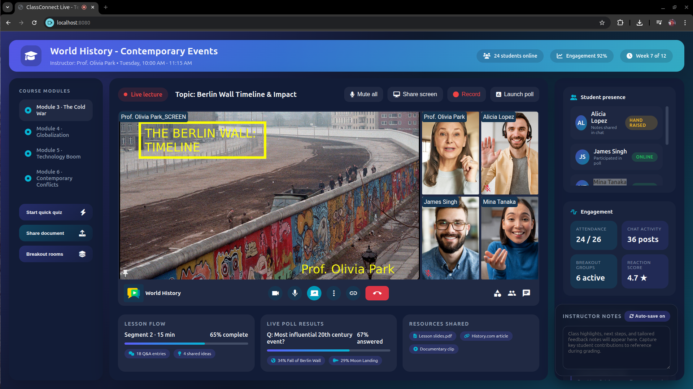
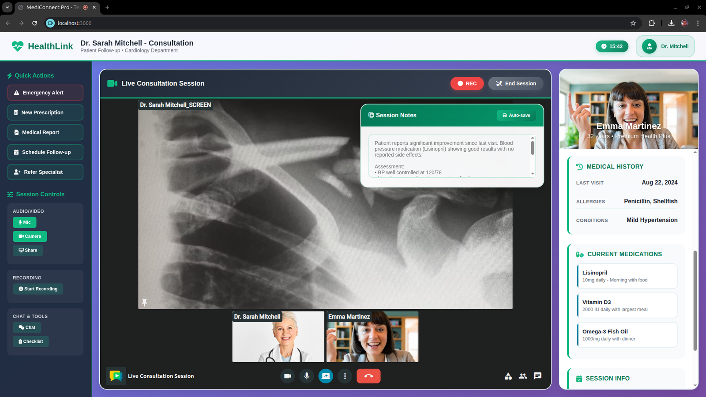

<div class="ov-landing ov-landing--product" markdown>

<section class="ov-hero" markdown>

{ .ov-hero__logo .skip-gallery .not-selectable width=1441 height=345 }
{ .ov-hero__logo .skip-gallery .not-selectable width=1441 height=345 }

<h1 class="ov-hero__title">OpenVidu Meet: self-hosted video conferencing, ready in minutes</h1>

<p class="ov-hero__lead" markdown="span">**OpenVidu Meet is an open-source, self-hosted video conferencing application** — a ready-to-use alternative to Zoom, Google Meet or Jitsi Meet that runs on your own servers, needs no code to deploy, and can be embedded in your product through a web component, REST API and webhooks.</p>

<div class="ov-actions" markdown>
[Deploy Meet in minutes](./getting-started.md){ .ov-btn .ov-btn--meet-ink title="Get started with OpenVidu Meet" }
[Try the live demo :fontawesome-solid-external-link:{.external-link-icon}](https://meet-demo-app.openvidu.io){ .ov-link target="_blank" }
</div>

<div class="ov-hero__visual">
    <a class="glightbox" href="/assets/videos/meet/home/demo.mp4" data-type="video"><video class="round-corners" src="/assets/videos/meet/home/demo-preview.mp4" poster="/assets/videos/meet/home/demo-poster.jpg" muted playsinline autoplay loop></video></a>
</div>

</section>

<section class="ov-section" data-sal="slide-up" markdown>

<div class="grid cards ov-cards" markdown>

-   :material-video-box:{ .feature-icon } __Feature-rich for videoconferencing__{ .feature-name }

    ---

    OpenVidu Meet brings all the **features** you expect from a professional video calling solution: HD video, HiFi audio, recording, screen sharing, chat, virtual backgrounds, and more.

-   :material-code-tags:{ .feature-icon } __Integrate right into your app__{ .feature-name }

    ---

    OpenVidu Meet can be used out-of-the-box via web, but it also offers everything you need to **embed it into your existing application**: a web component, a REST API and webhooks.

-   :material-server:{ .feature-icon } __Secure, self-hosted deployments__{ .feature-name }

    ---

    OpenVidu Meet is designed from the ground up to be **self-hosted** on your own servers (with ready-made templates for AWS, Azure, Google Cloud, DigitalOcean and Oracle Cloud). It provides the highest level of **privacy and security** for your video calls.

-   :fontawesome-solid-user-md:{ .feature-icon } __Designed for most common use cases__{ .feature-name }

    ---

    OpenVidu Meet perfectly fits most common videoconferencing use cases: **e-learning, telehealth, remote collaboration, customer support**... And you can customize its **branding** to match your organization’s identity.

</div>

</section>

<section class="ov-section" markdown>

<h2 class="ov-h2" id="features">Built for all purposes. Customizable for your particular use case.</h2>

<div class="ov-showcase ov-showcase--stack" data-sal="slide-up" markdown>
<div markdown>
### Multi-Party smart layout

Connect dozens of participants in a room. OpenVidu Meet automatically adapts to provide the best experience.
</div>
<div class="ov-card__media" markdown>
{ .round-corners loading=lazy width=1920 height=1080 }
{ .round-corners loading=lazy width=1920 height=1080 }
</div>
</div>

<div class="ov-grid ov-grid--2" data-sal="slide-up" markdown>
<div class="ov-showcase ov-showcase--stack" markdown>
<div markdown>
### Pre-join view

Participants can set up their video/audio devices, virtual background and language before joining the meeting.
</div>
<div class="ov-card__media" markdown>
{ .round-corners loading=lazy width=580 height=554 }
{ .round-corners loading=lazy width=580 height=554 }
</div>
</div>
<div class="ov-showcase ov-showcase--stack" markdown>
<div markdown>
### Background filters

Allow participants to easily replace their video background with a blur effect or an image.
</div>
<div class="ov-card__media">
    <a class="glightbox" href="/assets/videos/meet/meetings/virtual-background/virtual-bg-meeting-dark.mp4" data-type="video" data-gallery="dark"><video class="round-corners lazy-video" src="/assets/videos/meet/meetings/virtual-background/virtual-bg-meeting-dark.mp4#only-dark" preload="none" muted playsinline loop></video></a>
    <a class="glightbox" href="/assets/videos/meet/meetings/virtual-background/virtual-bg-meeting-light.mp4" data-type="video" data-gallery="light"><video class="round-corners lazy-video" src="/assets/videos/meet/meetings/virtual-background/virtual-bg-meeting-light.mp4#only-light" preload="none" muted playsinline loop></video></a>
</div>
</div>
</div>

<div class="ov-showcase ov-showcase--stack" data-sal="slide-up" markdown>
<div markdown>
### Record and share

OpenVidu Meet offers high-quality recordings and greatly simplifies their storage and access control.
</div>
<div class="ov-card__media">
    <a class="glightbox" href="/assets/videos/meet/recordings/management/share-recording-dark.mp4" data-type="video" data-gallery="dark"><video class="round-corners lazy-video" src="/assets/videos/meet/recordings/management/share-recording-dark.mp4#only-dark" preload="none" muted playsinline loop></video></a>
    <a class="glightbox" href="/assets/videos/meet/recordings/management/share-recording-light.mp4" data-type="video" data-gallery="light"><video class="round-corners lazy-video" src="/assets/videos/meet/recordings/management/share-recording-light.mp4#only-light" preload="none" muted playsinline loop></video></a>
</div>
</div>

<div class="ov-grid ov-grid--2" data-sal="slide-up" markdown>
<div class="ov-showcase ov-showcase--stack" markdown>
<div markdown>
### Pre-configure your rooms

Create and customize the behavior of your rooms in a few clicks: look-and-feel, access and permissions, recording, chat and more.
</div>
<div class="ov-card__media">
    <a class="glightbox" href="/assets/videos/meet/rooms/management/create-room-wizard-dark.mp4" data-type="video" data-gallery="dark"><video class="round-corners lazy-video" src="/assets/videos/meet/rooms/management/create-room-wizard-dark.mp4#only-dark" preload="none" muted playsinline loop></video></a>
    <a class="glightbox" href="/assets/videos/meet/rooms/management/create-room-wizard-light.mp4" data-type="video" data-gallery="light"><video class="round-corners lazy-video" src="/assets/videos/meet/rooms/management/create-room-wizard-light.mp4#only-light" preload="none" muted playsinline loop></video></a>
</div>
</div>
<div class="ov-showcase ov-showcase--stack" markdown>
<div markdown>
### Share room links

Unique secure links give access to your rooms with different permission levels.
</div>
<div class="ov-card__media">
    <a class="glightbox" href="/assets/videos/meet/rooms/access/share-link-dark.mp4" data-type="video" data-gallery="dark"><video class="round-corners lazy-video" src="/assets/videos/meet/rooms/access/share-link-dark.mp4#only-dark" preload="none" muted playsinline loop></video></a>
    <a class="glightbox" href="/assets/videos/meet/rooms/access/share-link-light.mp4" data-type="video" data-gallery="light"><video class="round-corners lazy-video" src="/assets/videos/meet/rooms/access/share-link-light.mp4#only-light" preload="none" muted playsinline loop></video></a>
</div>
</div>
</div>

</section>

<section class="ov-section" markdown>

<h2 class="ov-h2">With all the features you need to fine-tune your perfect video calling service.</h2>

<div class="grid cards ov-cards" data-sal="slide-up" markdown>

-   :material-cursor-default-click:{ .feature-icon } __One-click video calls__{ .feature-name }

    ---

    Share meeting links so anyone can instantly join your video calls from any browser — no downloads or setup needed.

-   :material-registered-trademark:{ .feature-icon } __Your own branding__{ .feature-name }

    ---

    Create a professional look by branding OpenVidu Meet with your own domain, and custom colors.

-   :material-video-4k-box:{ .feature-icon } __Up to 4K video and HiFi audio__{ .feature-name }

    ---

    Enjoy up to 4K video quality and crystal-clear audio enhanced with noise cancellation and echo suppression.

-   :material-record-rec:{ .feature-icon } __Recording__{ .feature-name }

    ---

    Record your video calls in multiple layouts and easily control who can access or manage each recording.

-   :material-monitor-share:{ .feature-icon } __Screen Sharing__{ .feature-name }

    ---

    Share your screen in stunning quality for flawless presentations and smooth collaboration every time.

-   :material-face-man-shimmer-outline:{ .feature-icon } __Background effects__{ .feature-name }

    ---

    Enhance your videos by blurring backgrounds or replacing them with custom images and effects.

-   :material-chat-outline:{ .feature-icon } __Chat__{ .feature-name }

    ---

    Send and receive text messages during your calls for clear communication.

-   :material-wifi-lock:{ .feature-icon } __E2E Encryption__{ .feature-name }

    ---

    Protect your calls from man-in-the-middle attacks, ensuring only meeting participants can decrypt audio, video, and chat.

-   :material-subtitles-outline:{ .feature-icon } __Live Captions__{ .feature-name }

    ---

    Access a wide range of speech-to-text providers for accurate and flexible real-time transcription.

-   :material-hand-back-left:{ .feature-icon } __Raise hand__{ .feature-name .coming-soon-overlay .eta-2026-11 }

    ---

    Let participants raise their hand to ask for the floor without interrupting, so moderators can keep large meetings orderly.

-   :material-emoticon-outline:{ .feature-icon } __Reactions__{ .feature-name .coming-soon-overlay .eta-2026-11 }

    ---

    React with emojis in real time to share quick feedback and keep everyone engaged without unmuting.

-   :material-tune:{ .feature-icon } __Redesigned settings panel__{ .feature-name .coming-soon-overlay .eta-2026-11 }

    ---

    A cleaner settings panel to configure your devices, audio, video and preferences in a couple of clicks.

-   :octicons-broadcast-24:{ .feature-icon } __Live broadcasting__{ .feature-name .coming-soon-overlay .eta-2026-11 }

    ---

    Easily broadcast your video calls live to platforms like YouTube or Twitch, reaching a wider audience directly from OpenVidu Meet.

-   :material-door-sliding-lock:{ .feature-icon } __Locked rooms__{ .feature-name .coming-soon-overlay .eta-2026-11 }

    ---

    Keep your meetings secure by blocking unwanted guests and requiring moderator approval to join.

-   :material-message-text-clock-outline:{ .feature-icon } __Persisted chat__{ .feature-name .coming-soon-overlay .eta-2026-12 }

    ---

    Chat history is kept across sessions, so participants who join late or reconnect never miss a message.

-   :material-message-reply-text-outline:{ .feature-icon } __Chat reactions, mentions and editing__{ .feature-name .coming-soon-overlay .eta-2026-12 }

    ---

    React to messages, mention other participants, and edit or delete messages you have already sent.

-   :material-message-lock-outline:{ .feature-icon } __Private chats__{ .feature-name .coming-soon-overlay .eta-2026-12 }

    ---

    Send direct messages to a single participant during the call, without leaving the meeting.

-   :material-file-send:{ .feature-icon } __File sharing__{ .feature-name .coming-soon-overlay .eta-2026-12 }

    ---

    Enable participants to share files easily during calls with a simple drag-and-drop feature.

-   :material-draw:{ .feature-icon } __Whiteboard__{ .feature-name .coming-soon-overlay .eta-2026-12 }

    ---

    Sketch ideas together on a shared whiteboard, with every stroke synced in real time for all participants.

-   :material-note-multiple-outline:{ .feature-icon } __Shared notes__{ .feature-name .coming-soon-overlay .eta-2027-q1 }

    ---

    Write collaborative notes with all participants during the call, keeping decisions and action items in one place.

-   :material-account-group-outline:{ .feature-icon } __Breakout rooms__{ .feature-name .coming-soon-overlay .eta-2027-q1 }

    ---

    Split participants into smaller groups for focused discussions and bring them back to the main room whenever you want.

</div>

<div class="ov-actions" markdown>
[Deploy Meet in minutes](./getting-started.md){ .ov-btn .ov-btn--meet-ink }
[Try the live demo :fontawesome-solid-external-link:{.external-link-icon}](https://meet-demo-app.openvidu.io){ .ov-link target="_blank" }
</div>

</section>

<section class="ov-section" markdown>

<h2 class="ov-h2" id="integrations">Integrations</h2>

<p class="ov-lead">OpenVidu Meet can be easily integrated with your existing applications and workflows.</p>

<div class="ov-grid ov-grid--2" data-sal="slide-up" markdown>
<div class="ov-showcase ov-showcase--stack" markdown>
<div markdown>
### Pre-built web component

Embed the OpenVidu Meet UI right into your app.
</div>
<div class="ov-card__media" markdown>
<a class="glightbox" href="/assets/videos/meet/home/embed-html.mp4" data-type="video"><video class="round-corners lazy-video" src="/assets/videos/meet/home/embed-html.mp4" preload="none" muted playsinline loop></video></a>

{ .round-corners loading=lazy width=1920 height=1080 }
</div>
</div>
<div class="ov-showcase ov-showcase--stack" markdown>
<div markdown>
### REST API and webhooks

Control your meetings from your backend.
</div>
<div class="ov-card__media ov-codewin" markdown>
```bash
curl --request POST \
    --url https://YOUR_DOMAIN/meet/api/v1/rooms \
    --header 'Accept: application/json' \
    --header 'Content-Type: application/json' \
    --header 'X-API-KEY: YOUR_API_KEY' \
    --data '{"roomName": "My Room"}'
```
</div>
</div>
</div>

<div class="ov-actions" markdown>
[Explore OpenVidu Meet Embedded](./embedded/intro.md){ .ov-btn .ov-btn--ink }
</div>

</section>

<section class="ov-section" markdown>

<h2 class="ov-h2" id="deployments">Deployments</h2>

<p class="ov-lead">Self-host OpenVidu Meet on your own infrastructure for maximum security and cost-effectiveness. It is easy to deploy, protect, maintain, and scale. No advanced DevOps skills are required to run it in production.</p>

<div class="grid cards ov-cards" data-sal="slide-up" markdown>

-   :material-server:{ .feature-icon .bare-metal-icon } __On Premises__{ .feature-name }

    ---

    Deploy on your own bare-metal servers

-   :material-aws:{ .feature-icon .aws-icon } __AWS__{ .feature-name }

    ---

    Deploy with AWS CloudFormation

-   :material-microsoft-azure:{ .feature-icon .azure-icon } __Azure__{ .feature-name }

    ---

    Deploy with Azure Resource Manager

-   :material-google-cloud:{ .feature-icon .gcp-icon } __GCP__{ .feature-name }

    ---

    Deploy in GCP with Terraform

-   :material-digital-ocean:{ .feature-icon .digitalocean-icon } __DigitalOcean__{ .feature-name }

    ---

    Deploy in DigitalOcean through the web console or with Terraform CLI

-   :custom-oracle-cloud-infrastructure:{ .feature-icon .oracle-icon } __Oracle Cloud Infrastructure__{ .feature-name }

    ---

    Deploy in Oracle Cloud Infrastructure through the web console

</div>

<div class="ov-actions" markdown>
[Check out the deployment documentation](./deployment/overview.md){ .ov-btn .ov-btn--ink }
</div>

</section>

<section class="ov-section" markdown>

<h2 class="ov-h2" id="use-cases">Use cases</h2>

<div class="splide" data-sal="slide-up" markdown>
<div class="splide__track" markdown>
<div class="splide__list" markdown>
<div class="splide__slide" markdown>
<div class="carousel-cell-content" markdown>
Team meetings
{.fake-title}

Empower collaboration across your organization with customizable, secure, high-quality video meetings.

<div class="grid cards use-cases-inner-cards no-border no-shadow" markdown>

{ .round-corners loading=lazy width=1920 height=1080 }
{ .round-corners loading=lazy width=1920 height=1080 }

-	OpenVidu Meet is the perfect tool for **collaborative work**. With its user-friendly interface and powerful features, teams can easily connect, share ideas, and make decisions in real-time.

</div>

<div class="grid cards use-cases-cards three-columns" markdown>

-   __Collaboration tools__{ .feature-name }

    ---

    Screen sharing with top-tier quality, virtual backgrounds, chat, recording, and more.

-   __Quick access and flexibility__{ .feature-name }

    ---

    One-click join via secure room access links. No installation required, full support for any web browser.

-   __Custom branding__{ .feature-name }

    ---

    Achieve a professional look and feel with customizable domain and colors.

</div>
</div>
</div>

<div class="splide__slide" markdown>
<div class="carousel-cell-content" markdown>
e-Learning
{.fake-title}

Deliver a seamless learning experience by embedding OpenVidu Meet in your LMS or e-learning portal using **OpenVidu Meet Embedded**.

<div class="grid cards use-cases-inner-cards no-border no-shadow" markdown>

-	With OpenVidu Meet, **instructors** can engage with **students** through high quality video & audio, as well as advanced interactive tools. Locked rooms, breakout groups and many more features coming soon to enhance the learning experience.

{ .round-corners loading=lazy width=1920 height=1079 }

</div>

<div class="grid cards use-cases-cards three-columns" markdown>

-   __High quality media__{ .feature-name }

    ---

    Up to **4K** video and **HiFi** audio for crystal-clear lessons. Stable experience across all kind of network thanks to **simulcast**, **SVC**, **dynacast** and **adaptive streaming**.

-   __Accessibility__{ .feature-name }

    ---

    OpenVidu Meet is localized in multiple languages. Live captions and real-time transcriptions improve accessibility for hearing-impaired users and non-native speakers.

-   __Persistence and continuity__{ .feature-name }

    ---

    Record and share lessons with multiple layouts. Manage recordings and share via secure links.

</div>
</div>
</div>

<div class="splide__slide" markdown>
<div class="carousel-cell-content" markdown>
Telehealth
{.fake-title}

The most secure videoconference platform is the one you host on your own servers.

<div class="grid cards use-cases-inner-cards no-border no-shadow" markdown>

{ .round-corners loading=lazy width=1920 height=1080 }

-	OpenVidu Meet is the ideal solution for telehealth services. **Practitioners** can conduct remote consultations, share medical documents, and ensure **patient** privacy with end-to-end encryption.

</div>

<div class="grid cards use-cases-cards three-columns" markdown>

-   __Security and privacy__{ .feature-name }

    ---

    End-to-end encryption for audio, video, and chat. Locked rooms and administrator-controlled access. No third-party data routing.

-   __Accessibility and trust__{ .feature-name }

    ---

    Browser-based with no installation needed. Live Captions and real-time transcriptions with specific support for medical language models coming soon.

-   __Communication and clarity__{ .feature-name }

    ---

    Up to 4K and HiFi audio for clear communication between practitioners and patients. File sharing for medical documents and images coming soon.

</div>
</div>
</div>

<div class="splide__slide" markdown>
<div class="carousel-cell-content" markdown>
Customer support
{.fake-title}

Build trust with instant, reliable support through embedded video calls that persist. Right where your clients need it.

<div class="grid cards use-cases-inner-cards no-border no-shadow" markdown>

-	Connecting your **remote assistance** team with your **customers** has never been so easy. OpenVidu Meet provides all the necessary tools for effective communication and collaboration, ensuring a seamless support experience.

{ .round-corners loading=lazy width=1920 height=1080 }

</div>

<div class="grid cards use-cases-cards three-columns" markdown>

-   __Ease of access__{ .feature-name }

    ---

    Simple, one-click access via web: embed support rooms directly into your platform.

-   __Record assistance__{ .feature-name }

    ---

    Record your customer support meetings and generate transcriptions for future reference.

-   __Custom branding__{ .feature-name }

    ---

    Customize the look and feel of your support rooms to match your brand identity.

</div>
</div>
</div>

</div>
</div>
</div>

</section>

<section class="ov-section" markdown>

<h2 class="ov-h2" id="free-open-source-edition-vs-commercial-edition">Free open-source edition vs Commercial edition</h2>

<p class="ov-lead" markdown="span">OpenVidu Meet is available in two editions. You can choose the one that best fits your needs when [deploying OpenVidu Meet](./deployment/overview.md).</p>

<div class="ov-grid ov-grid--2" data-sal="slide-up" markdown>
<div class="ov-card" markdown>
<span class="ov-tag ov-tag--community">COMMUNITY</span>

### OpenVidu COMMUNITY

It is completely **open-source and free to use**. It includes all the features you need for your video conferencing solution. Everything listed in the [Features](#features) section is available in OpenVidu Meet COMMUNITY: HD video, HiFi audio, recording, screen sharing, chat, virtual backgrounds, and more.

OpenVidu Meet COMMUNITY is perfect for production deployments with moderate user load. It can be easily deployed on your own servers, and you can customize its branding to match your organization’s identity. If necessary, upgrading to OpenVidu PRO is seamless and non-disruptive.
</div>
<div class="ov-card" markdown>
<span class="ov-tag ov-tag--pro">PRO</span>

### OpenVidu PRO

It is OpenVidu's **commercial edition** and requires a license. It is meant for high demanding environments with significant user load. On top of every functional feature available in OpenVidu COMMUNITY, OpenVidu PRO brings **2x performance**, **advanced observability**, **scalability** and **fault tolerance** features. As well as **priority support** from our team of experts.

OpenVidu PRO follows a simple pricing model based on the size of your deployment (number of CPU cores). Check the [OpenVidu pricing page](../pricing.md) for more details.
</div>
</div>

</section>

<section class="ov-section ov-closing" data-sal="slide-up" markdown>
<div class="ov-closing__panel" markdown>
<h2 class="ov-closing__title">Video calls on your servers, this week.</h2>
<div class="ov-closing__actions" markdown>
[Deploy OpenVidu Meet](./getting-started.md){ .ov-btn .ov-btn--lg .ov-btn--meet title="Get started with OpenVidu Meet" }
</div>
[Or talk to an expert](../support/index.md){ .ov-closing__link }
</div>

<p class="ov-compare" markdown="span">Need total control and advanced SDKs to build your custom real-time application? Check out [OpenVidu Platform](../docs/index.md). Not sure which one fits? [Compare Meet vs Platform](../openvidu-meet-vs-openvidu-platform.md).</p>

</section>

</div>
